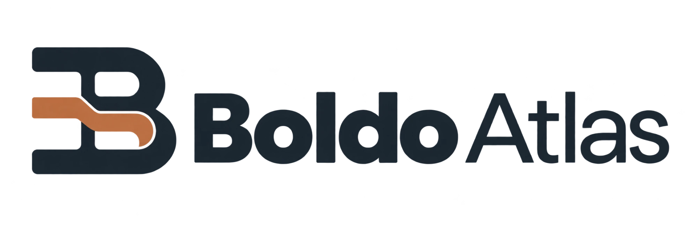

<p align="center"></p>

**BoldoAtlas** es una app de escritorio para Windows que arma el organigrama de una organización —gerencias, áreas y subáreas— con sus procesos, actividades y las fichas de cada trabajador. Funciona 100 % local, sin servidor ni cuentas, y se puede usar en modo portable desde un pendrive.

> Estado: en desarrollo (Fase 1 — fundaciones). Ver el [diseño](docs/superpowers/specs/2026-10-28-boldo-atlas-design.md).

## Descarga

Última versión en [Releases](https://github.com/MscottB/BoldoAtlas/releases/latest):

| Archivo | Para qué |
|---|---|
| `BoldoAtlas_windows_x64_portable.zip` | Extraer en cualquier carpeta y ejecutar `BoldoAtlas.exe`. Los datos quedan en `datos/` junto al programa. |
| `BoldoAtlas_windows_x64_setup.exe` | Instalador. Los datos quedan en `%APPDATA%\io.github.mscottb.boldoatlas`. |
| `SHA256SUMS.txt` | Sumas para verificar la descarga: `Get-FileHash <archivo> -Algorithm SHA256`. |

Requisitos: Windows 10 u 11 con WebView2 (ya viene en Windows 11 y en casi todo Windows 10).

**Aviso de Windows SmartScreen:** el programa aún no está firmado digitalmente, así que la primera vez Windows puede mostrar "Windows protegió su PC". Haz clic en **Más información → Ejecutar de todas formas**. En modo portable, extrae el zip antes de ejecutar: abrirlo desde dentro del zip impide guardar los datos.

## Compilar

Requiere Node 24+ y Rust estable.

```bash
npm ci
npm run tauri dev      # app en modo desarrollo
npm run test           # tests del frontend
cargo test --manifest-path src-tauri/Cargo.toml   # tests de Rust
npm run tauri build -- --bundles nsis             # instalador
```

## Publicar una versión

La versión sale de la etiqueta de git ([SemVer](https://semver.org/lang/es/)) y se muestra en "Acerca de" como `Versión 1.2.0 · DDMMAAAA`. Para publicar:

```bash
git tag v1.2.0
git push origin v1.2.0
```

GitHub Actions compila, arma el zip portable, el instalador y las sumas SHA256, y crea el Release. Las etiquetas con guion (`v1.3.0-beta.1`) se publican como *pre-release*.

## Licencia

[AGPL-3.0](LICENSE) · Creado por Michael Jim Scott Bravo.
