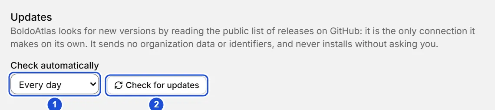

# Updates

::: info In short
BoldoAtlas looks for new versions and tells you; it never downloads or installs anything without your confirmation. Here you see how to check, install and turn the check off.
:::

BoldoAtlas looks for new versions on its own and tells you; it never downloads or installs anything until you confirm.

## How it checks

It checks **every time you open the app** and, by default, **every day** while it stays open, the same in the portable and the installed version. When there is a new version a discreet notice appears on Home and in the top bar, **Version X available**; one click opens the update window.

You can also check whenever you want:

- **About › Check for updates**.
- **Check for updates** in the app menu and in the command palette (Ctrl+K).
- **Settings › Updates › Check for updates**.

If there is nothing new you'll see "You have the latest version"; offline, "Could not check: check your connection".

{width=760 height=170}

## The update window

It shows your version and the new one, and **the release notes of every version you skipped**, newest first. When you press **Download and install** you see the download progress and can **Cancel download**; closing this window or the app cancels it too. Every download is signed by the author and is rejected if the signature doesn't match.

What happens on install depends on how you have BoldoAtlas:

| Type | What it does |
|---|---|
| Portable | Replaces the program inside its folder and restarts. Your data in `datos/` is not touched. |
| Installed (Windows, macOS, AppImage) | Downloads the update, installs it and restarts. |
| Linux `.deb` or `.rpm` | The system updates it: **Download the package** opens the release page so you can get it and install it with your package manager. |

If something fails, the previous version stays and the error is shown. You can also update by hand: first use **Quit**, because with the app in the tray the program stays open and can't be replaced; then download the new zip and replace the program. `datos/` is not touched.

## What's new

The first time you open a new version, **What's new in version X** appears, with what changed since the last version you used on this PC. You can see it again in **About › What's new**; the notes ship inside the app, so they work offline. Release notes are written in Spanish.

## Installing

Open the Windows installer from File Explorer (double-click it in Downloads), not from inside another app: opened from a packaged app, such as Claude Desktop, the install ends up incomplete. The installer reopens itself or asks you to move it to Downloads.

On Windows, the installed version can start with the system: a checkbox on the installer's last page and in **Settings › Start with the system**. It opens minimized. It isn't offered in the portable, nor on Linux and macOS.

## Tray icon

While BoldoAtlas is open, its icon appears in the system tray. One click brings it to the front (on Linux, the icon only opens the menu); the menu (right click) has Open BoldoAtlas, Home, Find a person, Settings, Help, **Update to vX** when there is a new version (otherwise Check for updates), Back up now, Open data folder and Quit. When you close the window you can keep it here, with the window hidden, or quit it completely (see **When opening and quitting** in Home); **Quit** always closes it completely and nothing stays in the background. When there is a new version, the icon's tooltip says so. On Linux, if the tray library (AppIndicator) is missing, there is no icon and the app works the same. On Windows, the system records in the registry (`HKCU\Control Panel\NotifyIconSettings`) the path of every program that shows a tray icon, the portable included: it is the only trace outside its folder, and BoldoAtlas does not write it.

## Cleanup

The update's temporary files (the downloaded installer, the portable's previous program) are deleted when it finishes or on the next start. In the portable all of that stays inside its folder, in `datos/`.

## Turning it off and privacy

In **Settings › Updates › Check automatically** you choose **Never**, **Only when opening**, **Every hour**, **Every 6 hours**, **Every day** (the default) or **Every week**. The choice applies only to this computer. With **Never** BoldoAtlas connects to nothing on its own.

Checking is the only connection BoldoAtlas makes on its own: it reads the public list of releases on GitHub and the new version's notes. It sends no organization data or identifiers.

::: tip Tip
If you work offline, choose **Never** under **Check automatically**: BoldoAtlas will not connect to anything on its own.
:::

**See also:** [Getting started](inicio.md) · [Backups](respaldos.md).
