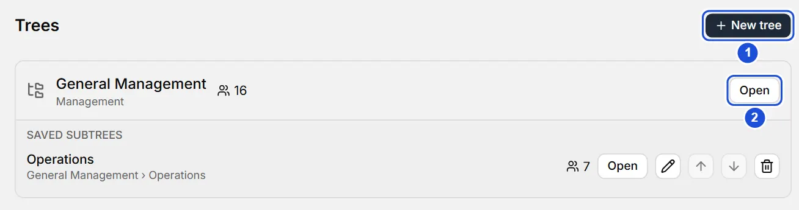

# Trees

::: info In short
Trees gathers your org charts and the branches you saved so you can open them quickly, without going through the whole tree.
:::

The **Trees** section gathers your trees and the branches you saved so you can open them quickly.

## Trees

Each tree is a root unit (one with no parent). Its block shows the name, the type and the total headcount, with an **Open** button that shows it on the canvas.

**+ New tree** creates another, independent root: type the name, choose the type and press **Create**.

## Saved subtrees

A branch of a tree can be saved so you can open it as a tree of its own, while it stays attached to the unit it comes from. It appears under the block of the tree it belongs to, with its path of origin.

To save a branch:

1. Select the branch on the canvas (or open a branch as a tree).
2. Choose **Save in Trees** under **More**, in the canvas bar (it is also in the card's context menu and in the unit panel).

If it is already saved, it says **Saved**. A root does not need saving: it already is a tree.

{width=872 height=230}

On each subtree you can:

- **Open** the branch on the canvas. From there, **Up one level** takes you to its parent unit and **View in the full tree** goes back to the whole tree.
- **Rename** (pencil): `Enter` saves and `Esc` cancels. If you leave it empty, it uses the unit's name.
- **Move up** or **Move down** to change its order.
- **Remove from Trees**: this only removes the shortcut; the unit and everything under it stay in the tree.

If you delete a saved unit, its subtree stops showing; it comes back if you restore the unit with **Undo**.

**See also:** [The tree](arbol.md).
