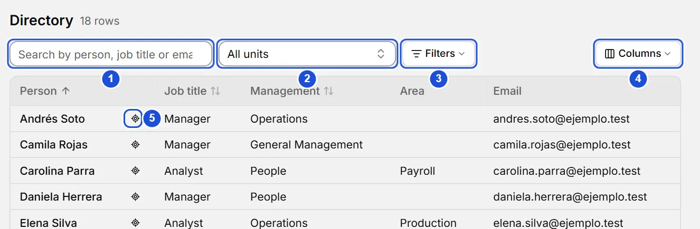
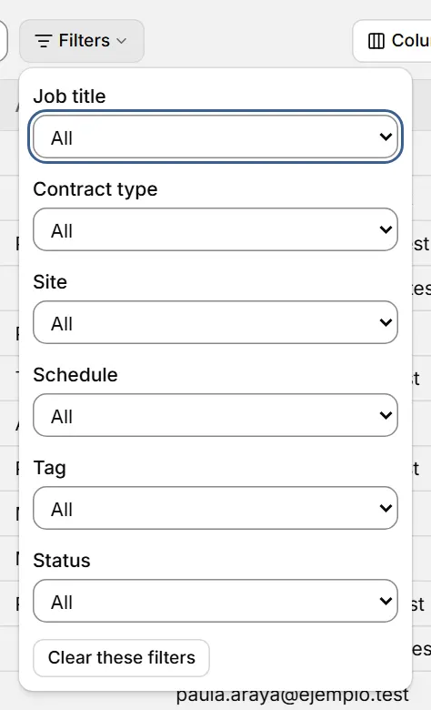

# Directory

::: info In short
The Directory is a table with every person and position in the organization: use it to search, filter, sort and open each record.
:::

The Directory is a table with every position and every person in the organization. Use it to search, filter and compare without walking the tree.

## What each row shows

- **A position**: with the name of its current holder, or **Vacant** if it has none. If the position has a current replacement, it appears in the **Replacement** column (turn it on in **Columns**).
- **A person with no current position**: with "No position" in the Job title column.

A person with two positions appears in two rows. Someone who is only a replacement appears in the row of the position they replace.

There is one column for each unit type you use (for example Division, Area, Subarea): it shows the nearest unit of that type going up, including the position's own unit. **Person**, **Job title**, the Management and Area columns and **Email** are in view (if you use neither Management nor Area, the first type in use). The **Columns** button shows or hides the rest: **Replacement**, the other unit types, **Contract type**, **Site** and **Schedule**. Your choice is remembered on this computer.

{width=884 height=290}

## Search and filter

To find a person:

1. Type part of their name, job title or email in the search box.
2. Press their row to open their record.
3. To see them in the org chart, press the locate icon next to their name.

- The search box looks in the names of the person and the replacement, the job title and the holder's email, ignoring case and accents ("munoz" finds "Muñoz").
- **Unit** includes its whole branch. **View in the directory**, on the People tab of a unit's panel, opens the directory with just that filter. The **Filters** button holds the rest and shows how many are active; **Clear these filters**, inside it, empties only those. **Job title**, **contract type**, **site** and **schedule** filter by exact value (deactivated ones too); contract type, site and schedule are the holder's, so a vacancy never matches them. **Tag** uses the tags of the position's unit. **Status** separates filled positions, vacancies and people with no position.
- **Clear all**, next to the filters, removes them all (the text and the unit too). Filters and sort order are remembered on this computer.

{width=316 height=520}

::: tip Tip
`Ctrl` + click on a person opens their record in a new tab, so you keep this tab's filters.
:::

## Sort and open

Press the **Person**, **Job title** or first visible unit column header (it sorts by the full unit path) to sort; press again to reverse. Empty cells always stay at the end.

Press a row (or Tab to the name and Enter) to open the person's record; on a vacancy, the position opens. The locate icon, next to the name, shows that position in the org chart (`Ctrl` + click: in a new tab); for a person with no current position it is disabled.

**See also:** [Person records](fichas.md) · [Work tabs](pestanas.md).
