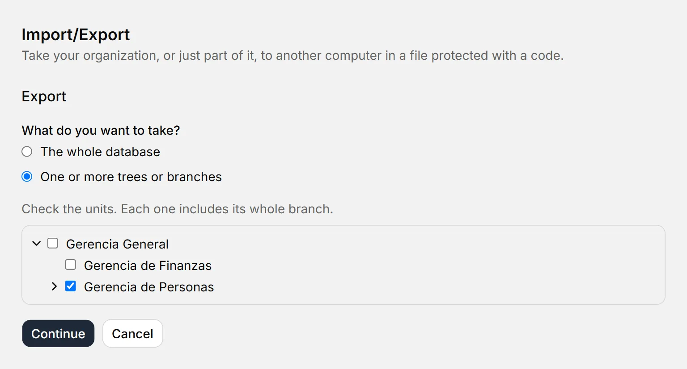
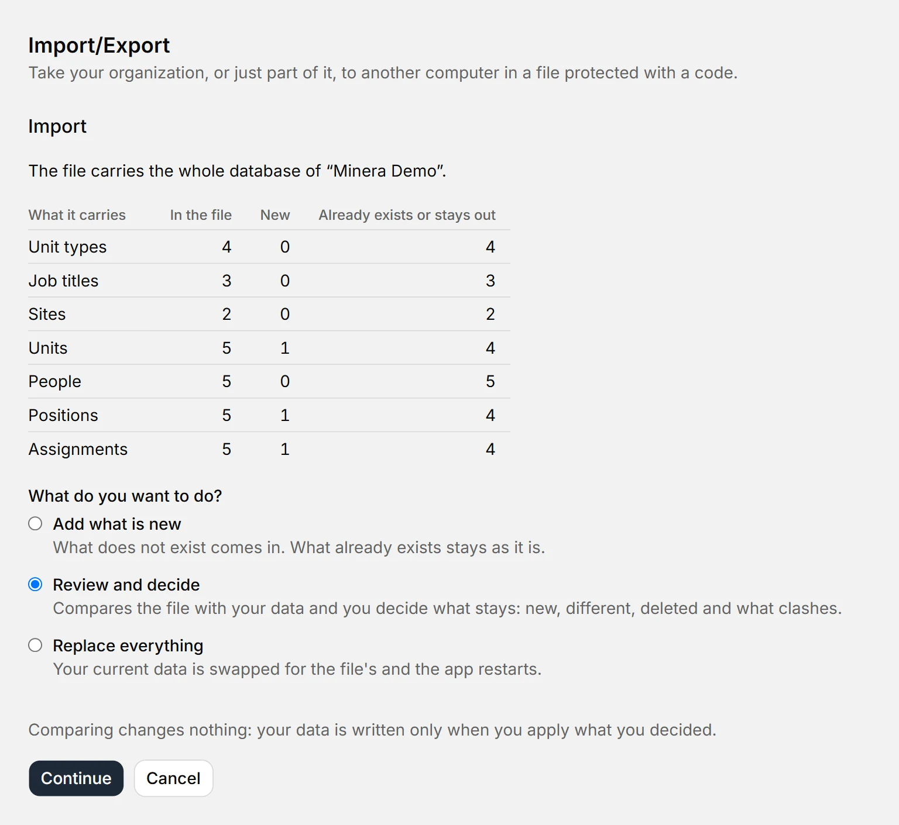

# Export and import

::: info In short
To take your organization, or just part of it, to another computer: **Export** saves it to a `.boldo` file protected with a code, and **Import** opens that file on the other side. Here you see how to do it without overwriting the data you already have.
:::

Both actions are in **Import/Export**, in the sidebar, and in the app menu. To open a file you can also use **Open a .boldo file** on the Welcome screen.

## Export

1. Press **Export** and choose what to take: **The whole database**, or **One or more trees or branches**. If you check a unit, its whole branch goes.
2. Press **Continue**. You will see what the file carries and what stays out.
3. Press **Save as…** and choose where to save it.
4. Copy the code with **Copy code**.

{width=768 height=414}

A branch carries its units, its positions, the people who hold them today with their history in that branch, the list values they use, its tags, its saved branches and views, and its processes. What was deleted does not go, nor do the records of people who are no longer there. What points outside the branch is cut and you are told before saving: connections with a unit that is not going, a head whose position is not going, the roles of people who are not going and the assignments of people who are no longer there.

::: warning Important
The code is shown only once and is not saved anywhere. If it is lost, the file cannot be opened: you have to export again, which gives another file and another code. The file carries personal data: send the file and the code **through different channels**, for example the file by email and the code by phone.
:::

## Import

1. Press **Import** and then **Choose file…**.
2. Type the code and press **Open**. Capitals and dashes do not matter.
3. Review what it carries: how much is in the file, how much is new and how much already exists. Up to here your database has not changed, and **Cancel** deletes the temporary copy of the file.
4. Choose what to do and press **Apply**.

{width=768 height=794}

If the code does not match or the file was altered, you see the same notice: “The code is not correct or the file is damaged”. Your database is not touched.

### Add what is new

What does not exist in your database comes in as it is, except what is deleted in the file. What already exists stays as it is, even if it differs in the file: at the end you see how many were skipped and which, in a list that opens with a click.

| If the file carries… | What happens |
|---|---|
| A record you already have (the same one, even if edited) | Yours stays |
| A list value with the same name as one of yours, ignoring capitals and accents | It joins yours: not duplicated |
| A person with the same email as one of yours | Not duplicated: what came with them stays with yours |
| Something pointing to what you deleted in your database | That reference is left empty or, if required, it does not come in. You are told |
| Something that clashes with a rule of your database, like a second holder in a position | It does not come in. You are told |

If you import a branch whose parent unit is in your database, it goes back inside it. If it is not, you are asked where to place it: **inside a unit** or **as an independent tree**. Either way it goes after its siblings. A database with no name takes the name of the organization in the file.

### Replace everything

Your current data is swapped for the file's and the app restarts. It only works with a file of **the whole database**: with a part you would erase the rest. You are asked to confirm.

::: tip Tip
Before applying either one, BoldoAtlas makes a backup marked **Before replacing**. If you change your mind, restore it from [Backups](respaldos.md). If anything fails while applying, nothing is written.
:::

## If you close halfway

While exporting or importing, closing asks first and says which task is in progress. **Keep in the tray** does not interrupt it. **Quit the app** does: what was half done never keeps the final name and your data does not change. When you open the app again, the unencrypted copies in the `datos` folder are deleted. If a cut leaves a `.boldo.tmp` file next to the destination, it is encrypted and you can delete it by hand.

If you leave the code screen without copying the code, BoldoAtlas keeps showing it in a notice until you copy it or decide to close it.

## Different versions

- A file made with an earlier version of BoldoAtlas is updated when opened, without touching your database.
- One made with a **newer** version does not open until you update BoldoAtlas.
- If your database does not fit in one file (512 MB of data at most), export by branches: each file carries a part. If a field is too long, the notice says which one, so you can shorten it.
- Even if the code is correct, BoldoAtlas checks the file before applying it: it rejects anything that is not a valid copy or that carries more data than it can handle. That check looks at the form, not the content: the data is what the sender put in, so import only files from people you trust and look at what it carries before applying.

**See also:** [Backups](respaldos.md) · [List values](mantenedores.md).
