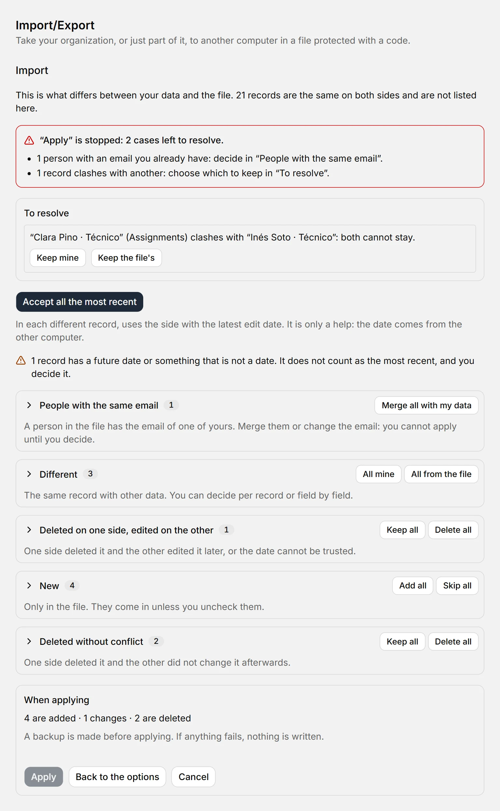
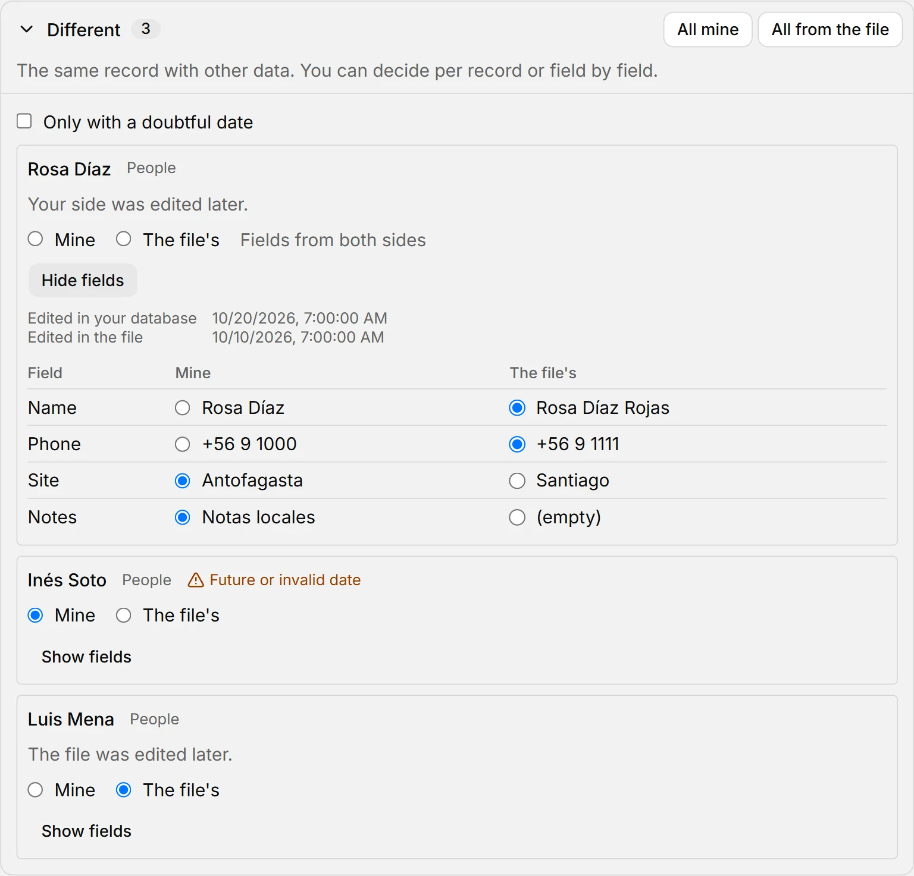

# Export and import

::: info In short
To take your organization, or just part of it, to another computer: **Export** saves it to a `.boldo` file protected with a code, and **Import** opens that file on the other side. Here you see how to do it without overwriting the data you already have.
:::

Both actions are in **Import/Export**, in the sidebar, and in the app menu. To open a file you can also use **Open a .boldo file** on the Welcome screen.

## Export

1. Press **Export** and choose what to take: **The whole database**, or **One or more trees or branches**. If you check a unit, its whole branch goes.
2. Press **Continue**. You will see what the file carries and what stays out.
3. Press **Save as…** and choose where to save it.
4. Copy the code with **Copy code**.

{width=768 height=414}

A branch carries its units, its positions, the people who hold them today, the full history of those positions, the list values they use, its tags, its saved branches and views, and its processes. People who are no longer there travel with their name and email only, without phone, notes or photo, so the history makes sense. What was deleted does not go. What points outside the branch is cut and you are told before saving: connections with a unit that is not going, a head whose position is not going and the roles of people who are not going.

::: warning Important
The code is shown only once and is not saved anywhere. If it is lost, the file cannot be opened: you have to export again, which gives another file and another code. The file carries personal data: send the file and the code **through different channels**, for example the file by email and the code by phone.
:::

## Import

1. Press **Import** and then **Choose file…**.
2. Type the code and press **Open**. Capitals and dashes do not matter.
3. Review what it carries: how much is in the file, how much is new and how much already exists. Up to here your database has not changed, and **Cancel** deletes the temporary copy of the file.
4. Choose what to do and press **Apply**.

{width=768 height=706}

If the code does not match or the file was altered, you see the same notice: “The code is not correct or the file is damaged”. Your database is not touched.

### Add what is new

To bring in what is missing without reviewing one by one. What does not exist in your database comes in as it is, except what is deleted in the file. What already exists stays as it is, even if it differs in the file: at the end you see how many were skipped and which, in a list that opens with a click.

| If the file carries… | What happens |
|---|---|
| A record you already have (the same one, even if edited) | Yours stays |
| A list value with the same name as one of yours, ignoring capitals and accents | It joins yours: not duplicated |
| A person with the same email as one of yours | Not duplicated: what came with them stays with yours |
| Something pointing to what you deleted in your database | That reference is left empty or, if required, it does not come in. You are told |
| Something that clashes with a rule of your database, like a second holder in a position | It does not come in. You are told |

If you import a branch whose parent unit is in your database, it goes back inside it. If it is not, you are asked where to place it: **inside a unit** or **as an independent tree**. Either way it goes after its siblings. A database with no name takes the name of the organization in the file.

### Review and decide

For two copies that kept working separately: you compare the file with your data and decide what stays. It works with a file of the whole database or of one or more branches. Comparing changes nothing: your data is written only when you press **Apply**.

1. Choose **Review and decide** and press **Continue**.
2. Look at the summary: each type of case with its count. What is the same on both sides is not listed.
3. Press **Accept all the most recent** to settle the common cases in one click, or open a group and decide per record. **Show fields** shows each field with its value in your data and in the file, and you can choose field by field.
4. Resolve whatever appears in **To resolve**. While anything is left, **Apply** is stopped and a notice at the top says what is missing.
5. Press **Apply**. The **When applying** box says beforehand how much is added, changed, deleted or left empty, including what is only in your database. If a lot is deleted at once, it asks you to confirm with the number.

{width=768 height=1280}

| Case | What it is | What comes selected | What you can do |
|---|---|---|---|
| **New** | Only in the file | They come in | Uncheck them |
| **Different** | The same record with other data | The side edited most recently | Yours or the file's, per record or per field |
| **Deleted on one side, edited on the other** | One side deleted it and the other edited it later | What is in your database stays there, and what you deleted stays deleted | Keep, delete, or restore what you deleted |
| **Deleted without conflict** | One side deleted it and the other did not change it afterwards | It stays deleted | Revert |
| **Merged with what you already have** | Values with the same name as one of yours, ignoring capitals and accents | Yours is used | Nothing to decide |
| **People with the same email** | A person in the file has the email of one of yours | Nothing: it stops **Apply** | Merge with your data, merge with the file's, or change their email |
| **Clashes with another** | For example, two holders in a position or two Approvers in an activity | Nothing: it stops **Apply** | Keep yours or the file's. If you keep an assignment from the file, yours is closed |
| **Reference to something that will not be there** | Something points to what you chose not to bring or to what will end up deleted | Nothing: it stops **Apply** | Reassign, leave empty if allowed, or discard the record. **Resolve all references** does it at once |
| **Would end up inside itself** | With what you chose, a unit ends up hanging from itself | Nothing: it stops **Apply** | Change its parent unit or leave it without one |

What is only in your database stays: nothing is deleted for not being in the file. That is what lets you bring a single branch without touching the rest. For people who are no longer there, a branch carries only name and email: what comes empty does not erase their data in your database. A photo or a view's settings are compared without being shown, and it says how much they weigh.

{width=768 height=736}

::: warning Important
“The most recent” is only a help: that date comes from the other computer, and it may be wrong. A future date or something that is not a date is marked, never counts as the most recent and does not delete or recover anything by itself: you decide.
:::

If your data changes while you review, **Apply** warns you and writes nothing. Press **Compare again**: what you decided about what did not change is kept, and a notice says how many decisions went back to their initial value.

Decisions last as long as the review. **Cancel** and **Back to the options** warn before losing them. If you go to another screen, a notice offers to go back to the review or discard it; and if you close the app with unapplied decisions, it asks first.

### Replace everything

Your current data is swapped for the file's and the app restarts. It only works with a file of **the whole database**: with a part you would erase the rest. You are asked to confirm.

::: tip Tip
Before applying, BoldoAtlas makes a backup: marked **Before importing** when adding or reviewing and deciding, and **Before replacing** when replacing everything. If you change your mind, restore it from [Backups](respaldos.md). If anything fails while applying, nothing is written.
:::

## If you close halfway

While exporting or importing, closing asks first and says which task is in progress. **Keep in the tray** does not interrupt it. **Quit the app** does: what was half done never keeps the final name and your data does not change. When you open the app again, the unencrypted copies in the `datos` folder are deleted. If a cut leaves a `.boldo.tmp` file next to the destination, it is encrypted and you can delete it by hand.

If you leave the code screen without copying the code, BoldoAtlas keeps showing it in a notice until you copy it or decide to close it.

## Different versions

- A file made with an earlier version of BoldoAtlas is updated when opened, without touching your database.
- One made with a **newer** version does not open until you update BoldoAtlas.
- If your database does not fit in one file (512 MB of data at most), export by branches: each file carries a part. If a field is too long, the notice says which one, so you can shorten it.
- Even if the code is correct, BoldoAtlas checks the file before applying it: it rejects anything that is not a valid copy or that carries more data than it can handle. That check looks at the form, not the content: the data is what the sender put in, so import only files from people you trust and look at what it carries before applying.

**See also:** [Backups](respaldos.md) · [List values](mantenedores.md).
