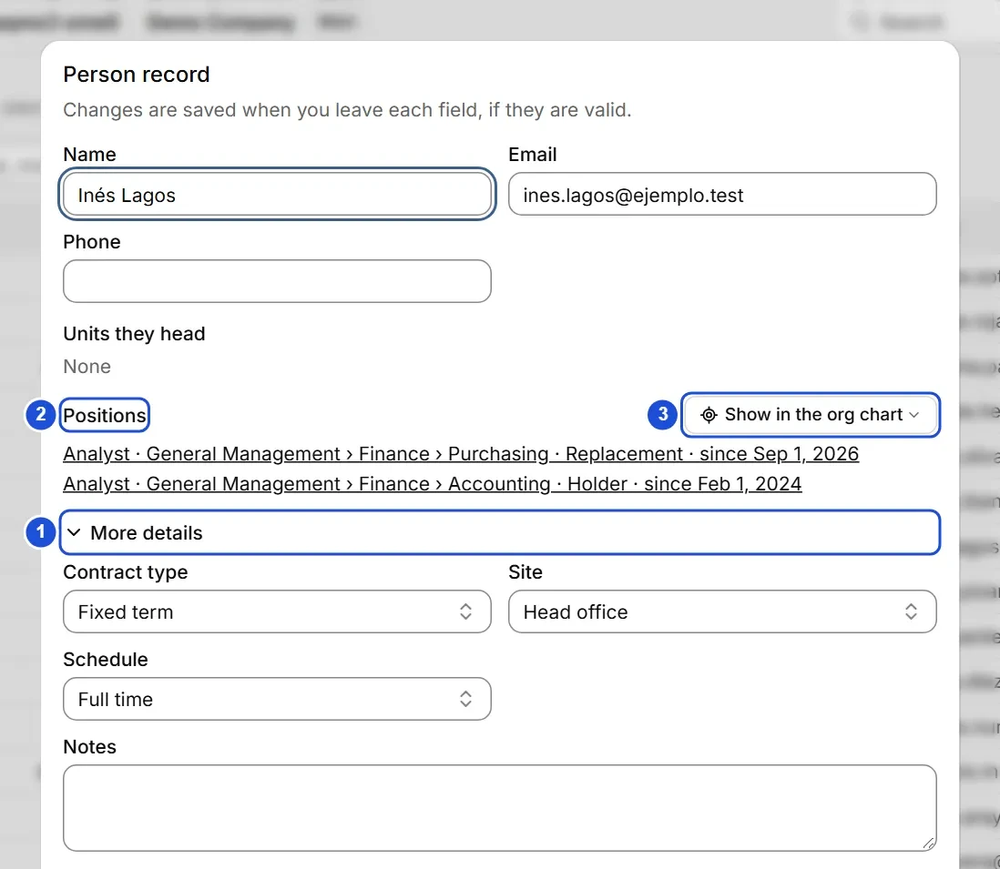
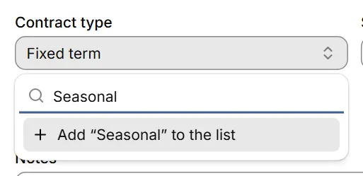

# Person records

::: info In short
The record keeps a person's details: contact, contract, site, schedule and notes. It saves by itself, field by field.
:::

The record is the form for a person: their contact details, contract, site, schedule and notes. It opens from the **Directory**, from **Review**, from the command palette (`Ctrl+K`, searching for the person) or from a position's dialog, by clicking the name of its holder. When you close it, focus returns to where you were; if that place no longer exists, to the **Search** button in the top bar.

Job title and unit are not edited in the record: they belong to the **position** the person holds (as holder or as a replacement). A vacancy is a position without a holder.

The name, email, phone, the units the person heads and their positions are in plain view. **Contract type**, **site**, **schedule** and **notes** are under **More details**: it opens by itself if the person already has any of those or there is an error there; otherwise with a click, and it stays as you leave it.

{width=732 height=637}

## Value lists

**Contract type**, **Site** and **Schedule** are chosen from lists, so data stays tidy and free of duplicates.

To pick or add a contract type:

1. Open **More details** and press the **Contract type** field.
2. Type in the search box to filter the list.
3. Pick the value; if it does not exist, press **Add “text” to the list**.

- Type in the search box to filter the list.
- If the value does not exist, **Add “text” to the list** appears: it creates the value and selects it.
- If one already exists that is the same (ignoring case and accents), adding is not offered: pick the one shown in the list.
- If a value was deactivated in the list but the record still uses it, it keeps showing with the **(inactive)** mark. **No value** leaves the field empty.

{width=342 height=166}

## Saving

There is no Save button: each field is saved when you leave it, as long as that field is valid. If one is not valid, the reason appears under the field and that field is not saved until it is fixed; the others are saved. A new record is created once it has a name, which is required; until then you are told it is missing.

::: warning Important
If you close the record with unsaved changes (an invalid field, or a new record not yet created), **You have unsaved changes** appears: **Keep editing** goes back to the record and **Discard** closes it and loses those changes.
:::

- The **email** must look like an address (for example, ana@company.com) and cannot be shared between people.

## Photos

BoldoAtlas no longer stores photos of people, to keep less personal data on your computer: the record, the org chart cards and the Directory show their initials.

If an organization or a backup still has photos, a notice says so when the app opens. **Remove the photos now** deletes them from your organizations and their backups, with a progress bar, and you can keep working meanwhile. **Later** closes the notice and it shows again the next time you open the app. A `.boldo` file or a backup with photos comes in without them, and you are told how many there were.
## Head of unit

**Units they head** lists the units they are head of: they hold the head position as holder or, if that position has no holder, as a replacement.

## Positions

**Positions** lists the person's current positions (job title, unit, whether holder or replacement, and since when) and, under **History**, the ones that have ended. Press one to open the position. **Show in the org chart** closes the record and shows the person on the tree (with several positions, you choose which).

## Delete

**Delete** closes the record and shows a notice with **Undo** for 8 seconds. After that, the person stays in **Settings › Deleted**, where you restore them (see [Deleted](mantenedores.md#deleted)). Deleting only hides them: their data is still stored.

## Delete permanently

**Delete permanently** is in the record and in **Settings › Deleted**. It asks you to type the person's name to confirm.

- It erases their email, phone, notes and the rest of their record, and the reason for their position changes, also from the change history.
- Their **name** stays in the change history until the period set in **Settings › Change history** runs out (1 year if you do not change it); after that it is erased too. With **No limit** it never runs out and the name stays.
- Where they held a position it shows "Deleted person": the chart at a date and the vacancies do not change.
- It **cannot be undone** and no backup is made first. Earlier backups that still hold them are deleted automatically after 30 days, while that organization is open (see [Backups](respaldos.md#people-deleted-permanently)).

## Export their data

**Export their data**, in the record, saves an Excel file with two sheets: the person's data and their positions, including the ones that have ended. As the file is not encrypted, it first asks you to accept the usual notice.

**See also:** [Positions and replacements](puestos.md) · [Directory](directorio.md) · [Settings and lists](mantenedores.md).
