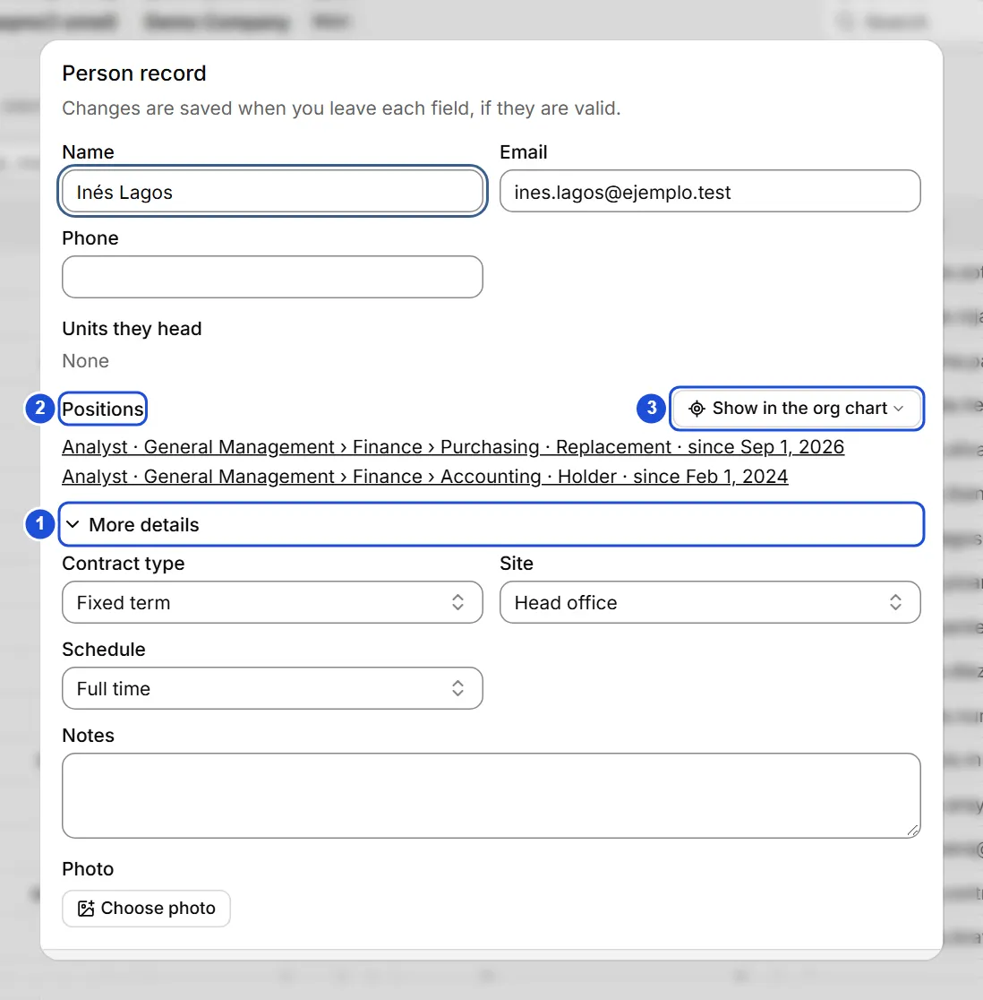
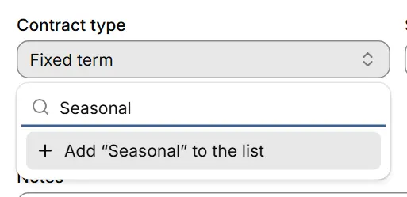

# Person records

::: info In short
The record keeps a person's details: contact, contract, site, schedule, photo and notes. It saves by itself, field by field.
:::

The record is the form for a person: their contact details, contract, site, schedule, photo and notes. It opens from the **Directory**, from **Review**, from the command palette (`Ctrl+K`, searching for the person) or from a position's dialog, by clicking the name of its holder. When you close it, focus returns to where you were; if that place no longer exists, to the **Search** button in the top bar.

Job title and unit are not edited in the record: they belong to the **position** the person holds (as holder or as a replacement). A vacancy is a position without a holder.

The name, email, phone, the units the person heads and their positions are in plain view. **Contract type**, **site**, **schedule**, **notes** and **photo** are under **More details**: it opens by itself if the person already has any of those or there is an error there; otherwise with a click, and it stays as you leave it.

{width=732 height=744}

## Value lists

**Contract type**, **Site** and **Schedule** are chosen from lists, so data stays tidy and free of duplicates.

To pick or add a contract type:

1. Open **More details** and press the **Contract type** field.
2. Type in the search box to filter the list.
3. Pick the value; if it does not exist, press **Add “text” to the list**.

- Type in the search box to filter the list.
- If the value does not exist, **Add “text” to the list** appears: it creates the value and selects it.
- If one already exists that is the same (ignoring case and accents), adding is not offered: pick the one shown in the list.
- If a value was deactivated in the list but the record still uses it, it keeps showing with the **(inactive)** mark. **No value** leaves the field empty.

{width=342 height=166}

## Saving

There is no Save button: each field is saved when you leave it, as long as that field is valid. If one is not valid, the reason appears under the field and that field is not saved until it is fixed; the others are saved. A new record is created once it has a name, which is required; until then you are told it is missing.

::: warning Important
If you close the record with unsaved changes (an invalid field, or a new record not yet created), **You have unsaved changes** appears: **Keep editing** goes back to the record and **Discard** closes it and loses those changes.
:::

- The **email** must look like an address (for example, ana@company.com) and cannot be shared between people.
- The **photo** is optional: PNG, JPG or WebP up to 30 MB.

## Photos

When you choose a photo, BoldoAtlas reduces it before saving it: its longest side becomes 256 pixels and it is saved as JPEG. It looks the same at every size where it appears and weighs much less, also in backups and in `.boldo` files. A small photo is not enlarged. Transparent areas turn white. An image over 120 megapixels is not accepted. If you close the record while the photo is being prepared, it waits until the photo is saved; if that is not possible, it lets you know before closing.

The converted photo does not keep the data the file carried, such as where it was taken or the camera. If converting it would make it heavier, it is saved as it is, **with whatever data it carries**. The same goes for a JPEG or WebP without that data that would barely get lighter: it is saved as it is.

Photos you already have are reduced in **Settings › Photos › Optimize existing photos**, only if you ask. Those over about 36 KB are checked; lighter ones are not touched and keep whatever data they carry.

1. First you see how much they take up, how much they would take up afterwards and how much the backup will take up.
2. A backup is made, marked **Before optimizing photos**, which keeps the originals. The last 3 are kept.
3. The photos are converted in parts, with a progress bar. You can keep working, and **Cancel** keeps what was already optimized.
4. At the end you see how many were optimized and how much space was freed. A photo that could not be optimized is named and stays as it was.

Optimizing does not change the person's modification date: it is the same photo with less weight. If you merge with another copy that still has the original photo, that photo shows up as a difference with the same date, and you choose which one stays.

## Head of unit

**Units they head** lists the units they are head of: they hold the head position as holder or, if that position has no holder, as a replacement.

## Positions

**Positions** lists the person's current positions (job title, unit, whether holder or replacement, and since when) and, under **History**, the ones that have ended. Press one to open the position. **Show in the org chart** closes the record and shows the person on the tree (with several positions, you choose which).

## Delete

**Delete** closes the record and shows a notice with **Undo** for 8 seconds.

**See also:** [Positions and replacements](puestos.md) · [Directory](directorio.md) · [Settings and lists](mantenedores.md).
