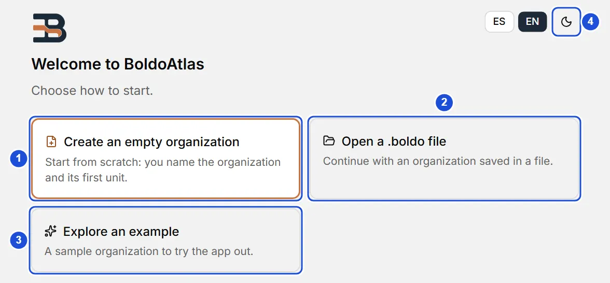
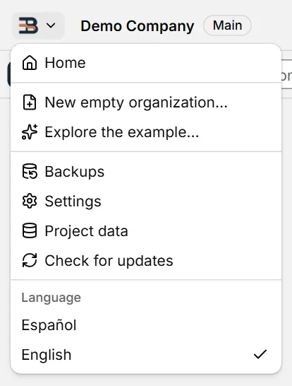
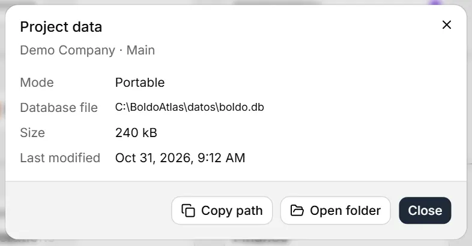

# Getting started

::: info In short
BoldoAtlas builds your organization's org chart on your own computer. Here you see how to get started, what the app menu does, where your data lives and how to open the program for the first time.
:::

## What BoldoAtlas is

BoldoAtlas is a desktop app for Windows, Linux and macOS for building your organization's org chart: divisions, areas and sub-areas connected to each other, plus a record for each person who works in them. You can explore the result on the tree canvas or in the directory.

## First use

When you open a database with no units, BoldoAtlas shows the welcome screen with two paths; the first, highlighted, is the main one:

- **Create an empty organization:** asks for the organization name and the name of its root unit (of the first active unit type) and takes you to the tree.
- **Explore an example:** creates a sample organization, in the interface language, to look around the app.

{width=728 height=268}

::: tip Tip
If it is your first time, start with the example: you can explore it without fear of making mistakes and, whenever you want, create your own organization from the app menu (an automatic backup is made first).
:::

Afterwards you can adjust the name, logo, theme and language in **Settings**, and the lists of job titles, sites and the rest in **Settings › Manage lists**.

## When opening and quitting

BoldoAtlas opens on **Home**, even with data loaded. To go back to your last view, turn on **Settings › When opening and quitting › Continue where I left off**.

When you quit (the window's **X**, `Alt+F4` or **Quit** in the app menu and the tray), it asks if you are sure. Changes save automatically, so there is no need to save first. To stop the question, turn off **Ask before quitting** in that same section.

## The app menu and returning to Home

The logo button on the left of the top bar opens the **app menu**:

- **Home** returns to the welcome screen at any time, also with data loaded.
- **New empty organization…** and **Explore the example…** replace the current data. They ask for confirmation first and make an **automatic backup** (if the backup fails, nothing is replaced); the backup stays in the **Settings › Backups** list so you can restore it.
- **Backups** and **Settings** open those sections; **Project data** shows where your data lives.
- **Language** switches the whole app between Español and English at once. The welcome screen has the same **ES / EN** switch; your choice is remembered on this computer, and on the first run the app follows your system language.

{width=276 height=364}

The same actions are in the command palette (`Ctrl+K`). **Settings**, **Help** and **About** close with their **Close** button, with `Esc`, or with a second click on their side-menu entry, and you return to the previous view (or to the tree if there is none). The sidebar folds, and is pinned open again, with the button at the foot of the bar, above **Settings** (**Hide sidebar** / **Show sidebar**); it stays in the same place open or folded. When folded, it opens over the content when you rest the mouse on it for a moment (or reach it with `Tab`) and folds again when you leave or press `Esc`; turn this off in **Settings › Appearance › Open the sidebar on mouse hover**. In a narrow window (under 1100 px) the sidebar folds by itself. A unit's panel closes with the **×** in its header.

## Which project is open

The window title and the top bar show the organization name with the **Main** badge. Clicking them opens **Project data**: the mode (portable or installed), the path of the database file, its size and last modification, with **Copy path** and **Open folder**.

{width=524 height=274}

## Portable and installed mode

- **Portable:** extract the zip for your system into any folder (or onto a USB drive) and open the program inside. Everything (data, backups and preferences) stays in the `datos/` folder next to the program, and nothing is written outside it (except on macOS: the window preferences, see below). It works because a `portable.flag` file sits next to the program. Extract the zip before running: opening it from inside the zip prevents data from being saved.
- **Installed:** install it with your system's installer and the data goes to your user's data folder.

| System | Portable | Installer | Installed data |
|---|---|---|---|
| Windows | `BoldoAtlas_windows_x64_portable.zip` → `BoldoAtlas.exe` | `BoldoAtlas_windows_x64_setup.exe` | `%APPDATA%\io.github.mscottb.boldoatlas` |
| Linux | `BoldoAtlas_linux_x64_portable.zip` → `BoldoAtlas.AppImage` | `.deb`, `.rpm` or `BoldoAtlas_linux_x64.AppImage` | `~/.local/share/io.github.mscottb.boldoatlas` |
| macOS 11 or newer | `BoldoAtlas_macos_universal_portable.zip` → `BoldoAtlas.app` | `BoldoAtlas_macos_universal.dmg` | `~/Library/Application Support/io.github.mscottb.boldoatlas` |

On macOS, the system keeps the window preferences (theme, zoom, tabs) and its web caches in your `~/Library` folder (`WebKit`, `Caches`), also for the portable; data and backups do stay in `datos/`.

::: warning Important
BoldoAtlas is not digitally signed, so the first time the system warns you. Here is what to do on your system:
:::

- **Windows:** if "Windows protected your PC" appears, click **More info → Run anyway**.
- **macOS:** right-click `BoldoAtlas.app` → **Open** → **Open**. If it says the app is damaged or won't let you open it, run `xattr -dr com.apple.quarantine <folder>` in Terminal on the portable folder (or on `/Applications/BoldoAtlas.app`), or use **System Settings › Privacy & Security › Open Anyway**. For the portable, do it before opening it: otherwise macOS opens it from a read-only copy and it cannot save.
- **Linux:** the AppImage needs execute permission: `chmod +x BoldoAtlas_linux_x64.AppImage` (or Properties › Allow executing). If it doesn't open, install FUSE 2 (`sudo apt install libfuse2`; on Ubuntu 24.04, `libfuse2t64`).

_About_ (at the bottom of the menu) shows the version. **Technical details**, which opens with a click, has the mode it is running in, the exact data folder and **Copy information**, to paste when asking for help.

## Where your data lives

Everything is stored in a local SQLite database, `boldo.db`:

- In portable mode, in the `datos/` folder next to the program.
- In installed mode, in your user data folder, which depends on the system ("Installed data" column of the table in **Portable and installed mode**).

Before upgrading the database structure, BoldoAtlas saves a copy in the `respaldos` subfolder. To move your data to another computer in portable mode, copy the whole folder.

Changes are saved automatically: there is no "Save" button. The indicator in the top bar reads "Saved" when everything is on disk.

## Privacy

Your data never leaves your computer. BoldoAtlas has no accounts and no server. The only thing it does on its own is look for new versions (every day; turn it off in **Settings › Updates**): it reads the public list of releases on GitHub and sends no data or identifiers. See **Updates**.

**See also:** [The tree](arbol.md) · [Backups](respaldos.md) · [Updates](actualizaciones.md).
