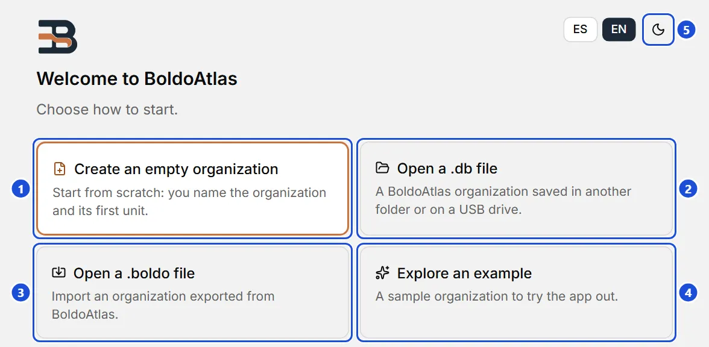
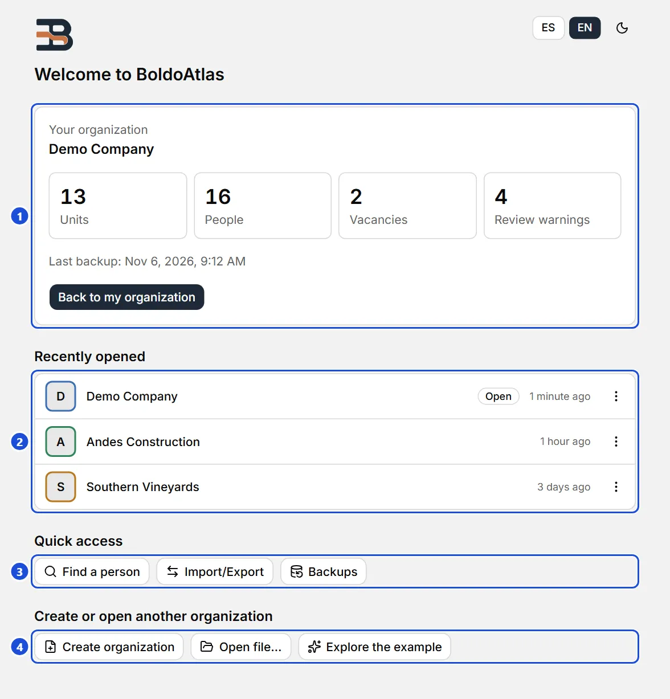
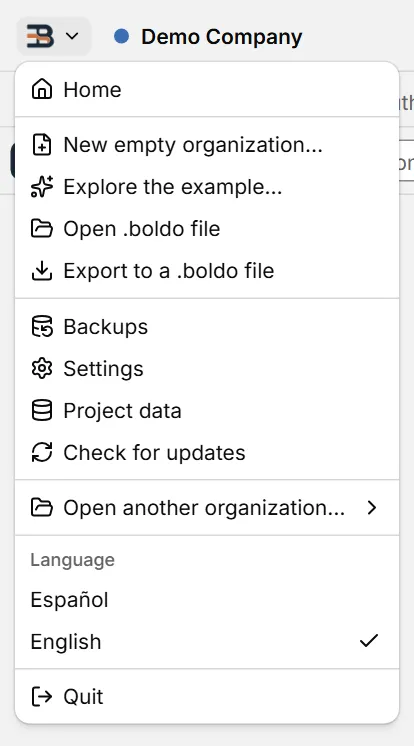
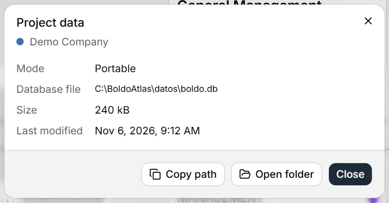

# Getting started

::: info In short
BoldoAtlas builds your organization's org chart on your own computer. Here you see how to get started, what the app menu does, where your data lives and how to open the program for the first time.
:::

## What BoldoAtlas is

BoldoAtlas is a desktop app for Windows, Linux and macOS for building your organization's org chart: divisions, areas and sub-areas connected to each other, plus a record for each person who works in them. You can explore the result on the tree canvas or in the directory.

## First use

With no data, as in a new installation, BoldoAtlas shows the welcome screen with four paths; the first, highlighted, is the main one:

- **Create an empty organization:** asks for the organization name and the name of its root unit (of the first active unit type) and takes you to the tree.
- **Open a .db file:** opens a BoldoAtlas organization saved in another folder or on a USB drive (see [Organizations](organizaciones.md)).
- **Open a .boldo file:** takes you to **Import/Export** to choose the file (see [Export and import](exportar-importar.md)).
- **Explore an example:** creates a sample organization, in the interface language, to look around the app.

At the top right are the **ES / EN** language switch and the light or dark theme button: you can choose them right away, without going into any path first. Under the title, with or without data, you see the version, **About** and **Check for updates**.

{width=784 height=384}

::: tip Tip
If it is your first time, start with the example: you can explore it without fear of making mistakes and, whenever you want, create your own organization from Home or the app menu. The example stays in your list, apart.
:::

Afterwards you can adjust the name, logo, theme and language in **Settings**, and the lists of job titles, sites and the rest in **Settings › Manage lists**.

## Home with your organization loaded

When the database already has data, Home is arranged so you can pick up your work:

- **Your organization:** the name, the totals of **Units**, **People**, **Vacancies** and **Review warnings**, the date of the **last backup** and the **Back to my organization** button, which takes you to the view that was active. Each total opens its view: units, the **Tree**; people, the **Directory**; vacancies and warnings, **Review**.
- **Recently opened:** the organizations you opened lately, the last one first and the open one marked **Open**. It appears when you have more than one. One click opens one, and its **⋮** menu offers **Remove from list** and **Delete organization** (see [Organizations](organizaciones.md)).
- **Quick access:** **Find a person** (opens the command palette), **Import/Export** and **Backups**.
- **Create or open another organization:** **Create organization**, **Open file…** and **Explore the example**. Each one leaves another organization apart and opens it in a new tab: the one you had does not change.

{width=784 height=818}

If an organization's file is no longer in its place, for example on an unplugged USB drive, its entry in **Recently opened** says so and offers **Find file** and **Remove from list**. With no data open, the welcome screen also shows that list if you have any.

## When opening and quitting

BoldoAtlas opens on **Home**, even with data loaded, with the window maximized on the main screen. To go back to your last view, turn on **Settings › When opening and quitting › Continue where I left off**.

When you close the window (the **X** or `Alt+F4`), it asks what to do. What you already applied is saved. Quitting the app loses an unfinished form; in the tray it stays there.

- **Cancel** leaves things as they were.
- **Keep in the tray** hides the window and BoldoAtlas stays open, with its icon next to the clock, ready to come back instantly. To come back, click the icon or open the shortcut again.
- **Quit the app** closes it completely.

With **Don't ask again**, your choice is saved. To change it, go to **Settings › When opening and quitting › When closing the window**: **Ask**, **Keep in the tray** or **Quit the app**. It is saved on this computer.

**Quit**, in the app menu and the icon's menu, closes the app: on its own it never leaves it in the tray. If the option is **Ask** or work is in progress, it asks first, and in that dialog you can choose **Keep in the tray**.

If work is in progress, such as a backup, an update or exporting and importing a file, it always asks, even if you checked **Don't ask again**, and says which work it is: quitting the app interrupts it. In the tray the work continues and the icon's text (you see it when you hover over the icon) says it is in progress and when it finishes. If it fails, the window comes back to the front to show the error. An update continues and BoldoAtlas restarts on its own once installed.

If your system has no tray (Linux without AppIndicator), **Keep in the tray** does not appear. Updating, restoring a backup, the installer and shutting down the computer close the app without asking, also when it is in the tray.

## The app menu and returning to Home

The logo button on the left of the top bar opens the **app menu**:

- **Home** returns to the welcome screen at any time, also with data loaded.
- **New empty organization…** and **Explore the example…** create another organization, apart, and open it in a new tab; the one you had does not change. If the example is already in your list, **Explore the example…** opens it.
- **Open .boldo file** and **Export to a .boldo file** take you to **Import/Export**.
- **Backups** and **Settings** open those sections; **Project data** shows where your data lives.
- **Open another organization…** appears when you have more than one and offers the others.
- **Language** switches the whole app between Español and English at once. The welcome screen has the same **ES / EN** switch and the light or dark theme button; your choice is remembered on this computer, and on the first run the app follows your system language.

{width=276 height=497}

The same actions are in the command palette (`Ctrl+K`). **Settings**, **Help** and **About** close with their **Close** button, with `Esc`, or with a second click on their side-menu entry, and you return to the previous view (or to the tree if there is none). The sidebar folds, and is pinned open again, with the button at the foot of the bar, above **Settings** (**Hide sidebar** / **Show sidebar**); it stays in the same place open or folded. When folded, it opens over the content when you rest the mouse on it for a moment (or reach it with `Tab`) and folds again when you leave or press `Esc`; turn this off in **Settings › Appearance › Open the sidebar on mouse hover**. In a narrow window (under 1100 px) the sidebar folds by itself. A unit's panel closes with the **×** in its header.

## Which project is open

The window title and the top bar show the name of the open organization; the bar also shows its color dot. Clicking the name opens **Project data**: the mode (portable or installed), the path of its database file, its size and last modification, with **Copy path** and **Open folder**, which opens that file's folder.

{width=524 height=274}

## Portable and installed mode

- **Portable:** extract the zip for your system into any folder (or onto a USB drive) and open the program inside. Everything (data, backups and preferences) stays in the `datos/` folder next to the program, and nothing is written outside it (except on macOS: the window preferences, see below). It works because a `portable.flag` file sits next to the program. Extract the zip before running: opening it from inside the zip prevents data from being saved.
- **Installed:** install it with your system's installer and the data goes to your user's data folder.

| System | Portable | Installer | Installed data |
|---|---|---|---|
| Windows | `BoldoAtlas_windows_x64_portable.zip` → `BoldoAtlas.exe` | `BoldoAtlas_windows_x64_setup.exe` | `%APPDATA%\io.github.mscottb.boldoatlas` |
| Linux | `BoldoAtlas_linux_x64_portable.zip` → `BoldoAtlas.AppImage` | `.deb`, `.rpm` or `BoldoAtlas_linux_x64.AppImage` | `~/.local/share/io.github.mscottb.boldoatlas` |
| macOS 11 or newer | `BoldoAtlas_macos_universal_portable.zip` → `BoldoAtlas.app` | `BoldoAtlas_macos_universal.dmg` | `~/Library/Application Support/io.github.mscottb.boldoatlas` |

On macOS, the system keeps the window preferences (theme, zoom, tabs) and its web caches in your `~/Library` folder (`WebKit`, `Caches`), also for the portable; data and backups do stay in `datos/`.

::: warning Important
BoldoAtlas is not digitally signed, so the first time the system warns you. Here is what to do on your system:
:::

- **Windows:** if "Windows protected your PC" appears, click **More info → Run anyway**.
- **macOS:** right-click `BoldoAtlas.app` → **Open** → **Open**. If it says the app is damaged or won't let you open it, run `xattr -dr com.apple.quarantine <folder>` in Terminal on the portable folder (or on `/Applications/BoldoAtlas.app`), or use **System Settings › Privacy & Security › Open Anyway**. For the portable, do it before opening it: otherwise macOS opens it from a read-only copy and it cannot save.
- **Linux:** the AppImage needs execute permission: `chmod +x BoldoAtlas_linux_x64.AppImage` (or Properties › Allow executing). If it doesn't open, install FUSE 2 (`sudo apt install libfuse2`; on Ubuntu 24.04, `libfuse2t64`).

_About_ (at the bottom of the menu) shows the version. **Technical details**, which opens with a click, has the mode it is running in, the exact data folder and **Copy information**, to paste when asking for help.

## Where your data lives

Each organization is stored in its own local SQLite database. The one you already had, or the first one you create, is `boldo.db`; the others go in the `organizaciones` subfolder (see [What is kept apart](organizaciones.md#what-is-kept-apart)). They are all in the data folder:

- In portable mode, in the `datos/` folder next to the program.
- In installed mode, in your user data folder, which depends on the system ("Installed data" column of the table in **Portable and installed mode**).

Before upgrading a database's structure, BoldoAtlas saves a copy among its backups. To move your data to another computer in portable mode, copy the whole folder; an external file, opened from another folder, does not go with it.

Changes are saved automatically: there is no "Save" button. The indicator in the top bar reads "Saved" when everything is on disk.

## Privacy

Your data never leaves your computer. BoldoAtlas has no accounts and no server. The only thing it does on its own is look for new versions (every day; turn it off in **Settings › Updates**): it reads the public list of releases on GitHub and sends no data or identifiers. See **Updates**.

**See also:** [The tree](arbol.md) · [Backups](respaldos.md) · [Updates](actualizaciones.md).
