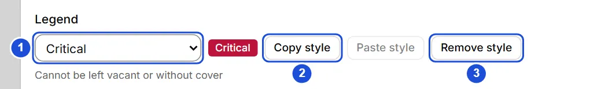
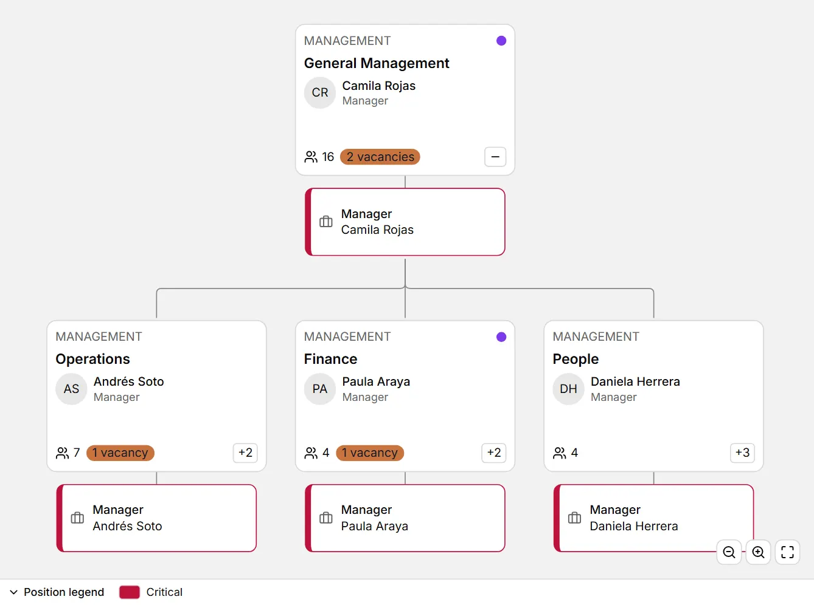

# Legends and position colors

::: info In short
A legend is a colored label to classify positions and spot them at a glance in the tree. Here you see how to create it, assign it and copy its style.
:::

A **legend** is a named color entry (for example, “Critical” in red or “Succession” in amber) used to classify positions and spot them at a glance in the tree. They are organization data: they are saved with it.

## Assign a legend to a position

1. Open the position (from the **Positions** tab of a unit's panel, or by clicking it if you already see positions in the tree).
2. Under **Legend**, pick an entry from the list, or **New entry…** to create one: type the name, pick the color and, optionally, a description. **Create and assign** creates it and assigns it in one go.
3. **Remove style** leaves the position without a legend. A deactivated entry keeps showing on the positions that already had it, marked as inactive.

The color is stored in `#rrggbb` format, for example `#be123c`.

{width=680 height=104}

## Copy and paste the style

- **Copy style** keeps that position’s legend in memory (even when it has none: “no style”).
- **Paste style** assigns the same legend to another position; you can paste it into as many positions as you like. It is available only when something was copied and the entry is still active.
- In the tree, with a position focused: `Ctrl` + `C` copies its style and `Ctrl` + `V` pastes it. What you copied is forgotten when you close the app.

::: tip Tip
To give the same legend to many positions, copy it once with **Copy style** and paste it on each one.
:::

## See them in the tree

1. Click **Customize** and turn on **Show positions**.
2. Under **Color by**, choose **Position legend**.

Each position shows its color on the border and on a stripe at the left; units do not change. Below the canvas, the **legend** strip lists the entries in use (hover over one to read its description); you can fold it with its header.

{width=892 height=664}

**See also:** [Positions and replacements](puestos.md) · [The tree](arbol.md) · [Settings and lists](mantenedores.md).
