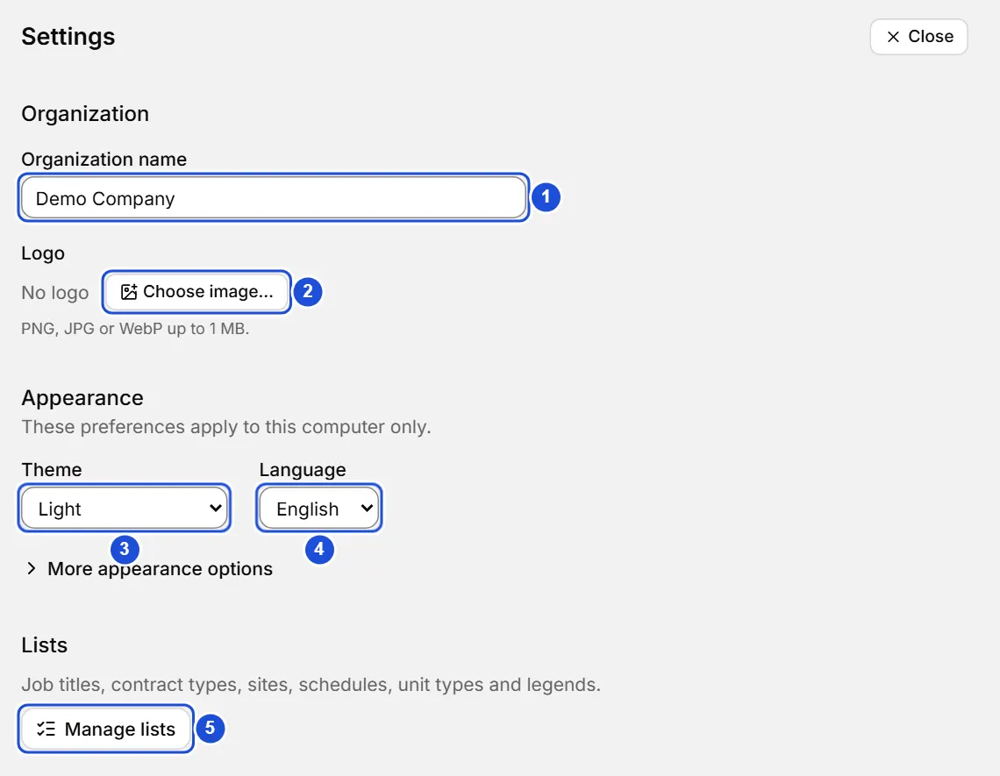
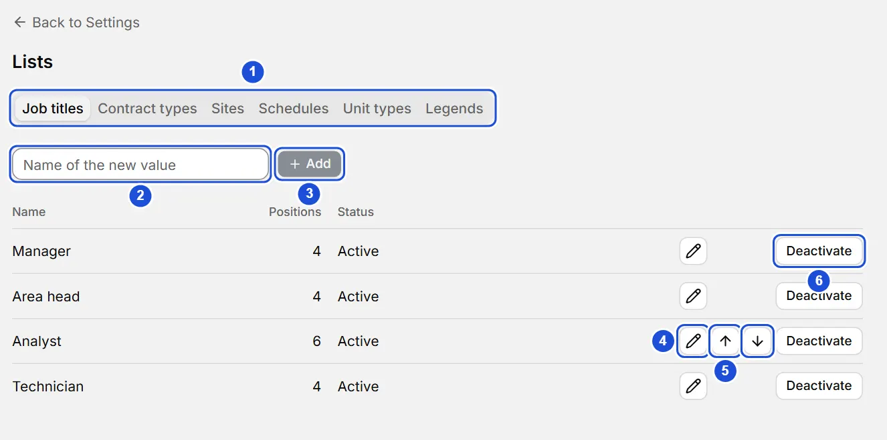

# Settings and lists

::: info In short
Settings gathers the name, the logo, the theme and the language; the lists are the value lists (job titles, contracts, sites…) used by the records and the tree.
:::

## Settings

In **Settings** (at the bottom of the menu) you adjust:

- **Organization name:** saved when you leave the field or press `Enter`.
- **Logo:** PNG, JPG or WebP up to 1 MB. It is stored as a PNG (and scaled down if it is very large) together with your data. **Remove logo** deletes it.
- **Theme, accent color and interface size:** apply to this computer only. The theme is in plain view; the size, the accent color and **Open the sidebar on mouse hover** are under **More appearance options**, which opens with a click (or `Enter` on it) and stays open or folded as you leave it.
- **Language:** Español or English. It switches every text in the app at once (you can also do it from the welcome screen and the app menu); the names you typed are not translated.

{width=760 height=590}

## Lists

The **lists** hold the values you pick from (job titles, contract types, sites…) in person records and the tree. Open them from **Settings › Manage lists**; each one has its own tab:

| Tab | Used in | The usage column counts |
| --- | --- | --- |
| Job titles | Positions | Positions |
| Contract types, Sites and Schedules | The person record | People |
| Unit types | Every unit in the tree | Units |
| Legends | Position colors | Positions |

You do not have to come here to add a value: in person records, positions, units, a position's legend and tags, the list itself offers **Add** (or **New…**) at the end and leaves the new value selected. Here you reorder, rename and deactivate them.

In each list you can:

To add a value to a list:

1. In **Settings**, press **Manage lists** and choose the list's tab.
2. Type the name in **Name of the new value**.
3. Press **Add**.

- **Add** a value by typing its name. If one already exists (ignoring case and accents) it is not duplicated: you are told and the existing one is highlighted.
- **Rename** with the pencil: `Enter` saves and `Esc` cancels.
- **Move up** or **down** to change the order. The arrows appear when you hover over the row or reach it with `Tab`. For unit types, the order suggests the type of new child units.
- **Deactivate** a value: it is no longer offered in lists, but whatever already uses it keeps it (shown as inactive). **Reactivate** brings it back. The last active unit type cannot be deactivated.

{width=884 height=440}

**Legends** add a color (`#rrggbb`) and a description, edited in the same row. How to assign them to positions is covered in the page “Legends and position colors”.

**See also:** [Legends and position colors](leyendas.md) · [Person records](fichas.md) · [Backups](respaldos.md).
