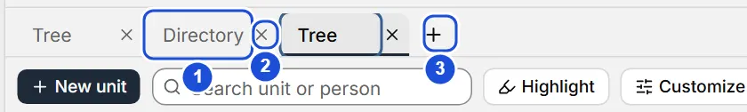

# Work tabs

::: info In short
Tabs let you keep several parts of the project open at once and switch between them without losing your place.
:::

Tabs let you keep different parts of the same project open at once: the full tree, a subtree, the directory with a filter, a person… and switch between them without losing your place.

## Opening a tab

- `Ctrl` + `T` opens a new tab on the tree.
- **Open in new tab**, in the context menu of a unit on the canvas, opens that unit as a subtree.
- In the command palette (`Ctrl` + `K`), `Ctrl` + `Enter` or `Ctrl` + click on a unit, a person or an action that leads to a view opens it in a new tab.
- `Ctrl` + click or middle click on a side menu entry, or on a person in the Directory, also opens it in a new tab. A person opens as the Directory showing only their rows: remove the “Person: …” filter with its ×.

With a single tab the bar is hidden; it appears above the central area as soon as you open a second one. You can have up to 12 tabs open.

{width=560 height=84}

::: tip Tip
Keep one tab with the whole tree and another with the filtered Directory: that way you compare without losing your place in either.
:::

## What each tab remembers

Each tab keeps its view and its state: on the tree, the folded branches, the selected unit, the framing and the highlight; in the Directory, the filters and the sort order. When you go back to it, you find it as you left it. A new tab starts with whatever you used last.

Each tab's name is automatic (the subtree's, "Directory", the person's…) and changes if that name changes.

Settings, Help and About, when closed, go back to the view of that same tab you opened them from (or to the tree, if they were opened in a new tab).

Only the active tab is loaded: having several open does not slow down the canvas.

## Switching, reordering and closing

- Click a tab to view it, or use `Ctrl` + `Tab` and `Ctrl` + `Shift` + `Tab`.
- Drag a tab to move it. With the keyboard: focus it and use `Ctrl` + `Shift` + `←` `→`.
- Close it with its × button, with a middle click on it, with `Del` when it is focused or with `Ctrl` + `W` (the active one). The last tab can't be closed.
- With the focus on the bar, `←` `→` move between tabs and `Enter` opens the focused one.

Tabs are remembered on this computer, separately for each project. When you open the program, **Home** appears and, with **Back to my organization**, your tabs are as you left them; with **Continue where I left off** (in **Settings › When opening and quitting**) you see them right away. Tabs for units or people that no longer exist close on their own.

**See also:** [Keyboard shortcuts](atajos.md) · [Directory](directorio.md).
