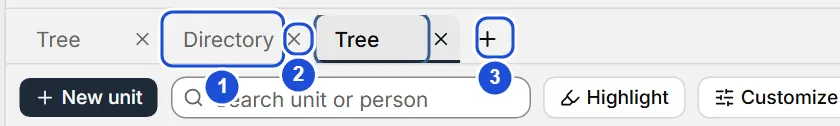

# Work tabs

::: info In short
Tabs let you keep several parts of the project open at once and switch between them without losing your place.
:::

Tabs let you keep different parts of the same project open at once: the full tree, a subtree, the directory with a filter, a person… and switch between them without losing your place.

## Opening a tab

- `Ctrl` + `T` opens a new tab on the tree.
- **Open in new tab**, in the context menu of a unit on the canvas, opens that unit as a subtree.
- In the command palette (`Ctrl` + `K`), `Ctrl` + `Enter` or `Ctrl` + click on a unit, a person or an action that leads to a view opens it in a new tab.
- `Ctrl` + click or middle click on a side menu entry, or on a person in the Directory, also opens it in a new tab. A person opens as the Directory showing only their rows: remove the “Person: …” filter with its ×.

With a single tab the bar is hidden; it appears above the central area as soon as you open a second one. You can have up to 12 tabs open.

{width=560 height=84}

::: tip Tip
Keep one tab with the whole tree and another with the filtered Directory: that way you compare without losing your place in either.
:::

## What each tab remembers

Each tab keeps its view and its state: on the tree, the folded branches, the selected unit, the framing and the highlight; in the Directory, the filters and the sort order. When you go back to it, you find it as you left it. A new tab starts with whatever you used last.

Each tab's name is automatic (the subtree's, "Directory", the person's…) and changes if that name changes.

Settings, Help and About, when closed, go back to the view of that same tab you opened them from (or to the tree, if they were opened in a new tab).

Only the active tab is loaded: having several open does not slow down the canvas.

## Tabs from several organizations

When the open tabs belong to more than one organization, each one shows its organization's color dot and its name before the title, for example "Demo Company · Tree". Going to a tab of another organization opens it, and only the active tab's one is loaded. See [Organizations](organizaciones.md#open-and-switch).

## Switching, reordering and closing

- Click a tab to view it, or use `Ctrl` + `Tab` and `Ctrl` + `Shift` + `Tab`.
- Drag a tab to move it. With the keyboard: focus it and use `Ctrl` + `Shift` + `←` `→`.
- Close it with its × button, with a middle click on it, with `Del` when it is focused or with `Ctrl` + `W` (the active one). The last tab can't be closed.
- With the focus on the bar, `←` `→` move between tabs and `Enter` opens the focused one.

Tabs are remembered on this computer, separately for each copy of BoldoAtlas (the installed one and each portable one), with those of all your organizations. When you open the program, **Home** appears and, with **Back to my organization**, your tabs are as you left them and the **Tree** tab is shown (if there was none, one opens). With **Continue where I left off** (in **Settings › When opening and quitting**) it opens right in the last view. Tabs for units or people that no longer exist close on their own.

## Split view

With the split view you see two tabs at once: the active one in the main panel and another one in the side panel. For example, the tree next to the Directory, or two branches of the same tree.

- **Split**, in the top bar, opens a new tab with the same view to the side. If you press it again, it closes the split view.
- In the command palette (`Ctrl` + `K`): **Split the view** or **Close split view**.
- Right-click a tab, or press `Shift` + `F10` when it is focused: **Open to the side** or **Remove from the side**.
- The × in the side panel's header also closes the split view.

When you close the split view, the side tab stays in the bar like any other. If you close that tab, the split view closes.

Between the two panels there is a divider: drag it to give one of them more room. With the keyboard, reach it with `Tab` and move it with the arrow keys, 5 % at a time; `Home` and `End` take it to one end, and a double click puts it back in the middle. Each panel takes between 20 % and 80 %. The button in the side panel's header switches between **Side by side** and **One above the other**.

The focused panel is in charge: the last one you clicked or the focus moved to. Its header is highlighted. The side menu, the palette, `Ctrl` + `T`, `Ctrl` + `W`, `Ctrl` + `Tab` and a click on the tab bar act on that panel. `F6` moves the focus to the other panel. The tree keys (`F2`, the arrow keys, `Del`, `N`…) only act on the canvas of the focused panel, even when both show the same tree. Settings, Help and About always open in the main panel.

A tab is not shown in both panels: if you ask one panel for the tab that is in the other, they swap. With the split view, both tabs you see are loaded.

The split view is remembered with your tabs: which one is to the side, the orientation and the size of each panel.

**See also:** [Keyboard shortcuts](atajos.md) · [Directory](directorio.md).
