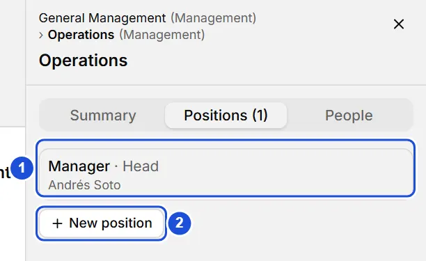
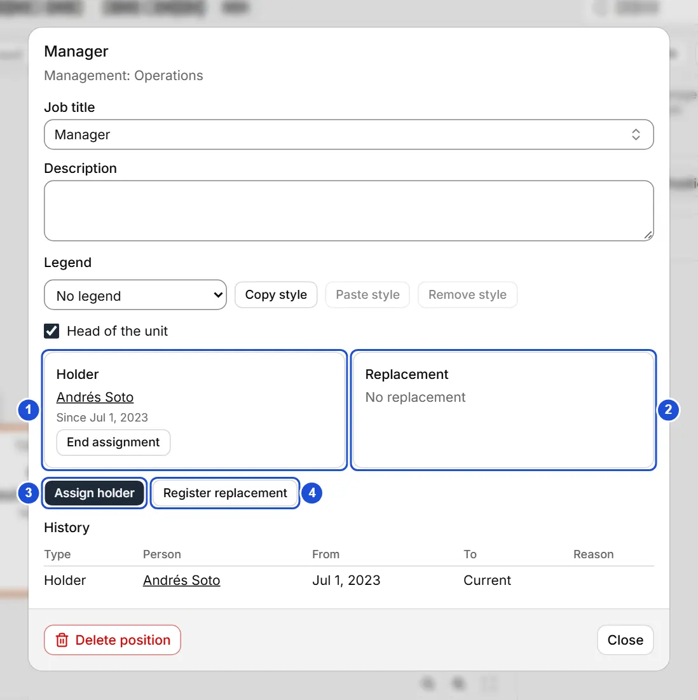

# Positions and replacements

::: info In short
A position is a job title within a unit. Here you see how to create it, assign its holder, register a replacement and review the history.
:::

A **position** is a job title within a unit (for example, "Analyst" in Accounting). The **person** is a separate thing: this lets you record who holds each position, who covers it, and its whole history, without losing data when someone changes.

## Viewing and creating positions

- Select a card in the tree and open the **Positions** tab of the unit panel: the unit's positions are listed with their job title, the holder (or **Vacant**) and the replacement, if any.
- Press a position to open it, or **New position** to create another: choose the job title (from the Job titles list) and press **Create position**.
- You can also open a position from a person's record, in the **Positions** section.

To create a position:

1. Select the unit's card and open the **Positions** tab of its panel.
2. Press **New position**.
3. Choose the job title and press **Create position**.

{width=408 height=250}

## The position dialog

It shows where the position sits (the type and name of the units that contain it), its **job title** and **description** (saved when you change them), the current **holder** and **replacement**, and the **history** sorted by date, newest first. Press a person's name to open their record.

**Head of the unit** marks this position as the one that heads the unit; the card shows its holder, or "Replacement: name" if it only has a replacement.

{width=732 height=734}

## Assigning, replacing and ending

- **Assign holder**: choose the person and the start date (today by default). If the position already had a holder, that assignment is closed the same day and stays in the history; it is never deleted. If you choose the person who is already the holder, nothing changes.
- **Register replacement**: like the above, but the holder stays the holder. The replacement remains current until you end it with **End assignment**. A position has at most one current holder and one current replacement.
- **End assignment**: give the end date and, if you wish, the reason. It cannot be earlier than the start.

::: tip Tip
When choosing the person you can search by name or press **Create person “text”**: it is created with that name and assigned in one go; fill in their other details later in their record.
:::

## Headcount and vacancies

The **headcount** counts positions with a current holder; a replacement does not add to it. A **vacancy** is a position without a current holder (even if it has a replacement).

## Deleting

::: warning Important
**Delete position** removes it together with its history and shows a notice with **Undo** for 8 seconds.
:::

**See also:** [Legends and position colors](leyendas.md) · [Person records](fichas.md) · [The tree](arbol.md).
