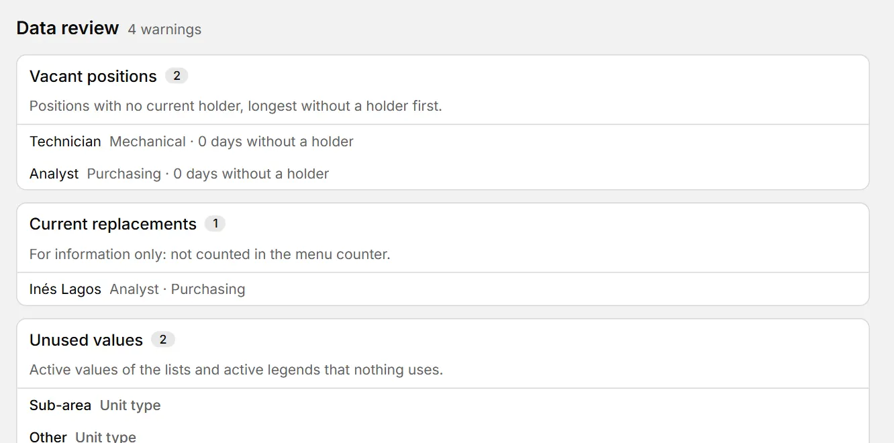

# Data review

::: info In short
Review gathers in one screen what is worth fixing in your data: vacant positions, repeated emails, people without a position and more.
:::

**Review** gathers in one screen what is worth fixing in your data. Every row is a button: press it (or Tab to it and press Enter) to open the unit, position or person and fix it right there.

The number next to **Review** in the menu is the total of pending warnings. It does not include current replacements, which are for information only. It updates by itself whenever the data changes.

{width=888 height=440}

To fix a warning:

1. Open **Review** in the side menu.
2. Press the warning's row.
3. Fix it in the unit, position or record that opens.

## The lists

- **Units without a head**: units with no head position, or whose position has no current holder or replacement. The unit opens in the full tree, selected and with its panel.
- **Vacant positions**: positions with no current holder, with the days since the last holder ended (or since the position was created, if it never had one). The oldest come first. The position opens.
- **Current replacements**: who is covering each position today. For information only. The position opens.
- **People without a current position**: people who today neither hold nor replace any position. Their record opens.
- **Repeated emails**: people with the same email, ignoring case and surrounding spaces. Each person's record opens.
- **Similar names**: people with the same name ignoring case and accents, or with the same words in another order ("Pérez Juan" and "Juan Perez"). These are possible duplicates; typos are not tolerated in the comparison.
- **Empty units**: units with no positions and no subunits.
- **Unused values**: active job titles, contract types, sites, schedules, unit types and legends that nothing uses. They are for information only: you can edit or deactivate them from the lists.

Lists with warnings come first. Those that are in order are grouped at the end in a single line, **No warnings:** and their names, which unfolds with a click (and stays as you leave it) to show each one with "All in order". Deleted or deactivated items are never reported.

**See also:** [Positions and replacements](puestos.md) · [Person records](fichas.md) · [Settings and lists](mantenedores.md).
