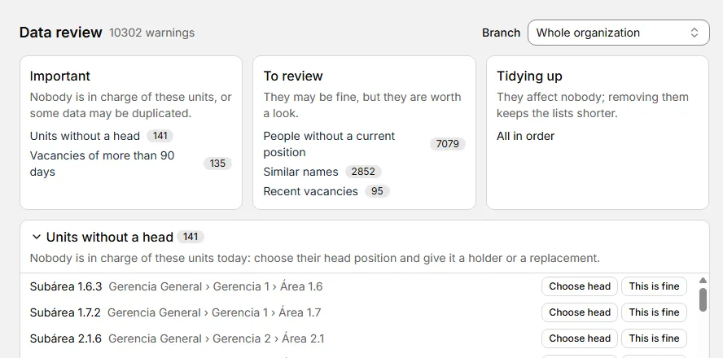

# Data review

::: info In short
Review tells you what is worth fixing in your data and what matters most. Each warning has a one-click action, and what is fine you can mark with **This is fine**.
:::

**Review** gathers in one screen what is worth fixing in your data. At the top there is a summary with three levels. Below it, one section per type of warning, with a sentence on what it means and how to fix it.

The number next to **Review** in the menu is the total of pending warnings for the whole organization. It does not include current replacements, which are for information only, or warnings marked as fine. It updates by itself whenever the data changes.

{width=888 height=440}

To fix a warning:

1. Open **Review** in the side menu.
2. Look at the summary and press the type of warning you want to see: it takes you to its section.
3. Press the row's action and fix it in what opens.

## The three levels

- **Important**: nobody is in charge of these units, or some data may be duplicated. It includes units without a head, repeated emails and vacancies of more than 90 days.
- **To review**: they may be fine, but they are worth a look. It includes people without a current position, similar names, recent vacancies and empty units.
- **Tidying up**: they affect nobody; removing them keeps the lists shorter. It includes unused values.

**Current replacements** only show who is replacing in each position today. They do not count as warnings.

The important sections start open and the rest start collapsed. Each one remembers how you left it.

## What each warning does

- **Units without a head**: press **Choose head**. The unit opens in the tree, selected and with its panel.
- **Vacancies of more than 90 days** and **Recent vacancies**: press **Assign holder**. The position opens. You see how many days it has been without a holder.
- **People without a current position**: press **Open record**. A person gets a position from the position, not from their record.
- **Repeated emails** and **Similar names**: press **Open record** for each person in the group. If it is the same person, delete the extra record. Similar names are possible duplicates: they are compared ignoring accents and case, and with the same words in another order.
- **Empty units**: press **Delete**. It is deleted right there.
- **Unused values**: press **Deactivate**. It is deactivated right there. They are job titles, contract types, sites, schedules, unit types and legends.

**Delete** and **Deactivate** show a notice with **Undo**. Press it if you made a mistake.

## This is fine

If a warning is not a problem, press **This is fine**. It asks for a reason, which is required and can be up to 200 characters. Then press **Save**.

- The warning leaves its list and does not count in the menu number.
- It moves to **Marked as fine**, a collapsed section at the end. There you see each mark's reason and date.
- Press **Warn again** to put the warning back in its list.

A group of repeated emails or similar names is marked as a whole. If a person joins or leaves the group, it is a new warning and shows again.

If you fix something and it breaks again later, it also warns again.

Marks are stored in this organization's database. They go in backups and full copies. They do not go with an exported branch: on another database, you mark them again.

## Filter by branch

The **Branch** filter shows a unit and everything under it.

- A group of emails or names appears if any of its people has a position in that branch.
- Warnings that belong to no unit are hidden, and a line says how many there are.
- The number in the header follows the filter. The menu number is always for the whole organization.

To see everything again, choose **Whole organization**.

## On a date and side by side

If you are viewing a date, or another organization side by side, you can only look and open. The buttons for vacancies and units read **View position** and **View unit**. **This is fine**, **Warn again**, **Delete** and **Deactivate** do not appear.

**See also:** [Positions and replacements](puestos.md) · [Person records](fichas.md) · [Settings and lists](mantenedores.md) · [View side by side](organizaciones.md#view-side-by-side).
