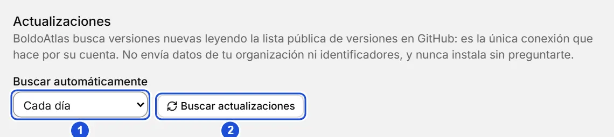

# Actualizaciones

::: info En resumen
BoldoAtlas busca versiones nuevas y te avisa; nunca descarga ni instala nada sin que lo confirmes. Aquí ves cómo buscar, instalar y apagar la búsqueda.
:::

BoldoAtlas busca versiones nuevas por su cuenta y te avisa; nunca descarga ni instala nada sin que lo confirmes.

## Cómo se busca

Por defecto busca **cada día**, igual en la versión portable y en la instalada. Cuando hay una versión nueva aparece un aviso discreto en la barra superior, **Versión X disponible**; un clic abre la ventana de actualización.

También puedes buscar cuando quieras:

- **Acerca de › Buscar actualizaciones**.
- **Buscar actualizaciones** en el menú de la app y en la paleta (Ctrl+K).
- **Configuración › Actualizaciones › Buscar actualizaciones**.

Si no hay nada nuevo verás «Ya tienes la última versión»; sin conexión, «No se pudo consultar: revisa tu conexión».

{width=760 height=170}

## La ventana de actualización

Muestra tu versión y la nueva, y **las novedades de todas las versiones que te saltaste**, de la más nueva a la más antigua. Al pulsar **Descargar e instalar** ves el avance de la descarga y puedes **Cancelar descarga**; cerrar la ventana también la cancela. Cada descarga va firmada por el autor y se rechaza si la firma no calza.

Qué pasa al instalar depende de cómo tienes BoldoAtlas:

| Tipo | Qué hace |
|---|---|
| Portable | Reemplaza el programa dentro de su carpeta y se reinicia. Tus datos en `datos/` no se tocan. |
| Instalado (Windows, macOS, AppImage) | Descarga la actualización, la instala y se reinicia. |
| Linux `.deb` o `.rpm` | Lo actualiza el sistema: **Descargar el paquete** abre la página de la versión para bajarlo e instalarlo con tu gestor de paquetes. |

Si algo falla, se deja la versión anterior y se muestra el error. También puedes actualizar a mano: descarga el zip nuevo y reemplaza el programa; `datos/` no se toca.

## Novedades

La primera vez que abres una versión nueva aparece **Novedades de la versión X**, con lo nuevo desde la última versión que usaste en este PC. Puedes volver a verlas en **Acerca de › Novedades**; vienen dentro de la app, así que se ven sin conexión. Las notas de versión se escriben en español.

## Instalar

Abre el instalador de Windows desde el Explorador de archivos (doble clic en Descargas), no desde dentro de otra aplicación: abierto desde una aplicación empaquetada, como Claude Desktop, la instalación queda incompleta. El instalador se reabre solo o te pide moverlo a Descargas.

En Windows, la versión instalada puede iniciarse con el sistema: casilla en la última página del instalador y en **Configuración › Inicio con el sistema**. Se abre minimizada. Por ahora no se ofrece en la portable, ni en Linux y macOS.

## Icono en la bandeja

Mientras BoldoAtlas está abierto, su icono aparece en la bandeja del sistema. Un clic lo trae al frente; el menú (clic derecho) tiene Abrir BoldoAtlas, **Actualizar a vX** cuando hay una versión nueva (si no, Buscar actualizaciones), Respaldar ahora, Abrir carpeta de datos, Ayuda y Salir. Cerrar la ventana cierra BoldoAtlas por completo: no queda nada en segundo plano. Con una versión nueva, el texto del icono lo avisa. En Linux, si falta la biblioteca de la bandeja (AppIndicator), no aparece el icono y la app funciona igual. En Windows, el sistema anota en el registro (`HKCU\Control Panel\NotifyIconSettings`) la ruta de todo programa que muestra un icono en la bandeja, también de la portable: es el único rastro fuera de su carpeta y no lo escribe BoldoAtlas.

## Limpieza

Los archivos temporales de la actualización (el instalador descargado, el programa anterior de la portable) se borran solos al terminar o al siguiente arranque. En la portable todo eso queda dentro de su carpeta, en `datos/`.

## Apagarlo y privacidad

En **Configuración › Actualizaciones › Buscar automáticamente** eliges **Nunca**, **Al abrir**, **Cada día** (lo normal) o **Cada semana**. La elección vale solo para este computador. Con **Nunca** BoldoAtlas no se conecta a nada por su cuenta.

La búsqueda es la única conexión que BoldoAtlas hace por su cuenta: lee la lista pública de versiones en GitHub y las notas de la versión nueva. No envía datos de tu organización ni identificadores.

::: tip Consejo
Si trabajas sin conexión, elige **Nunca** en **Buscar automáticamente**: BoldoAtlas no se conectará a nada por su cuenta.
:::

**Ver también:** [Inicio](inicio.md) · [Respaldos](respaldos.md).
