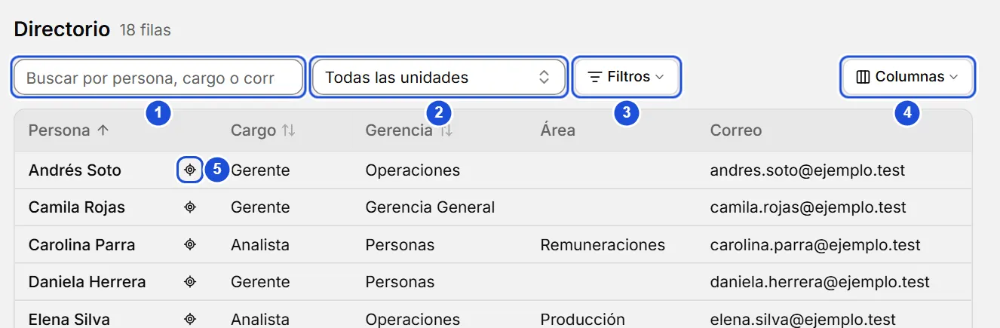
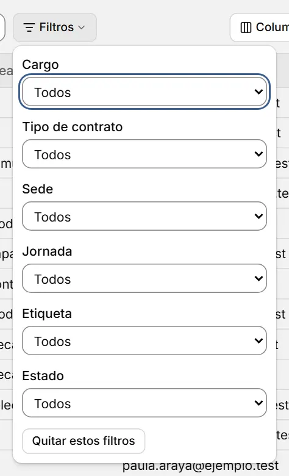

# Directorio

::: info En resumen
El Directorio es una tabla con todas las personas y puestos de la organización: sirve para buscar, filtrar, ordenar y abrir la ficha de cada uno.
:::

El Directorio es una tabla con todos los puestos y todas las personas de la organización. Sirve para buscar, filtrar y comparar sin recorrer el árbol.

## Qué muestra cada fila

- **Un puesto**: con el nombre de su titular vigente o **Vacante** si no tiene. Si el puesto tiene un reemplazo vigente, aparece en la columna **Reemplazo** (se activa en **Columnas**).
- **Una persona sin puesto vigente**: con «Sin puesto» en la columna Cargo.

Una persona con dos puestos aparece en dos filas. Quien solo es reemplazo aparece en la fila del puesto que reemplaza.

Hay una columna por cada tipo de unidad que usas (por ejemplo Gerencia, Área, Subárea): muestra la unidad más cercana de ese tipo hacia arriba, incluida la propia unidad del puesto. A la vista están **Persona**, **Cargo**, **Gerencia**, **Área** y **Correo** (si no usas Gerencia ni Área, el primer tipo en uso). El botón **Columnas** muestra u oculta las demás: **Reemplazo**, los otros tipos de unidad, **Tipo de contrato**, **Sede** y **Jornada**. Lo que elijas se recuerda en este computador.

{width=884 height=290}

## Buscar y filtrar

Para encontrar a una persona:

1. Escribe parte de su nombre, cargo o correo en el cuadro de búsqueda.
2. Pulsa su fila para abrir su ficha.
3. Si quieres verla en el organigrama, pulsa el ícono de ubicar que está junto a su nombre.

- El cuadro de búsqueda busca en el nombre de la persona y del reemplazo, el cargo y el correo del titular, sin distinguir mayúsculas ni tildes («munoz» encuentra «Muñoz»).
- **Unidad** incluye toda su rama. **Ver en el directorio**, en la pestaña Personas del panel de una unidad, abre el directorio con solo ese filtro. El botón **Filtros** reúne los demás y muestra cuántos están activos; **Quitar estos filtros**, dentro de él, vacía solo esos. **Cargo**, **tipo de contrato**, **sede** y **jornada** filtran por valor exacto (también los desactivados); contrato, sede y jornada son los del titular, así que una vacante no los cumple. **Etiqueta** usa las etiquetas de la unidad del puesto. **Estado** separa ocupados, vacantes y personas sin puesto.
- **Limpiar todo**, junto a los filtros, los quita todos (también el texto y la unidad). Los filtros y el orden se recuerdan en este computador.

{width=316 height=520}

::: tip Consejo
`Ctrl` + clic sobre una persona abre su ficha en una pestaña nueva, y así no pierdes los filtros de esta.
:::

## Ordenar y abrir

Pulsa el encabezado de **Persona**, **Cargo** o de la primera columna de unidad a la vista (ordena por la ruta completa) para ordenar; pulsa otra vez para invertir. Las celdas vacías siempre quedan al final.

Pulsa una fila (o Tab hasta el nombre y Enter) para abrir la ficha de la persona; en una vacante se abre el puesto. El ícono de ubicar, junto al nombre, muestra ese puesto en el organigrama (`Ctrl` + clic: en una pestaña nueva); en una persona sin puesto vigente queda deshabilitado.

**Ver también:** [Fichas de personas](fichas.md) · [Pestañas de trabajo](pestanas.md).
