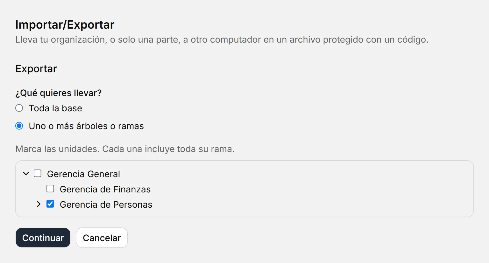
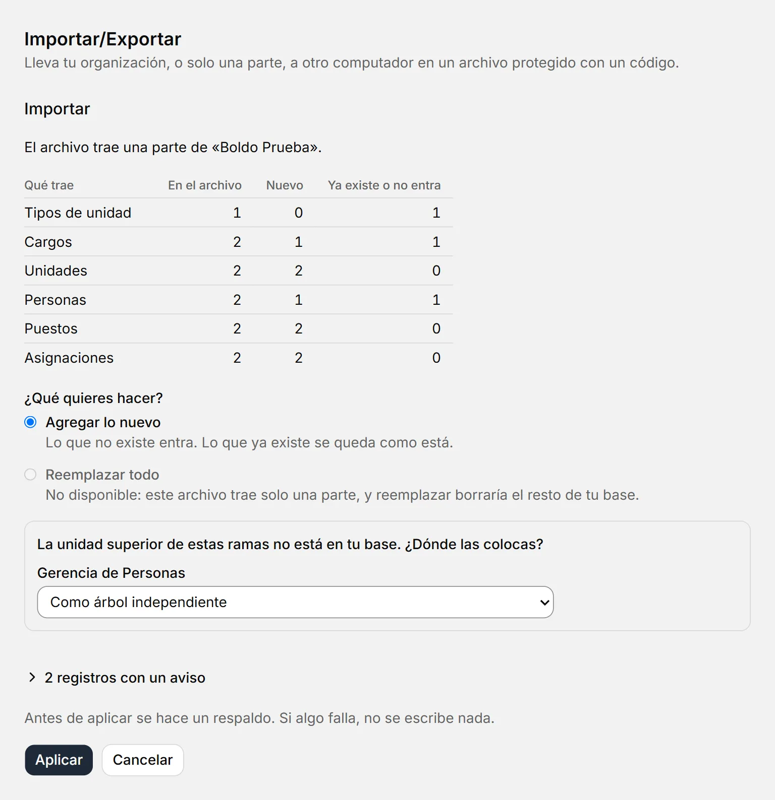
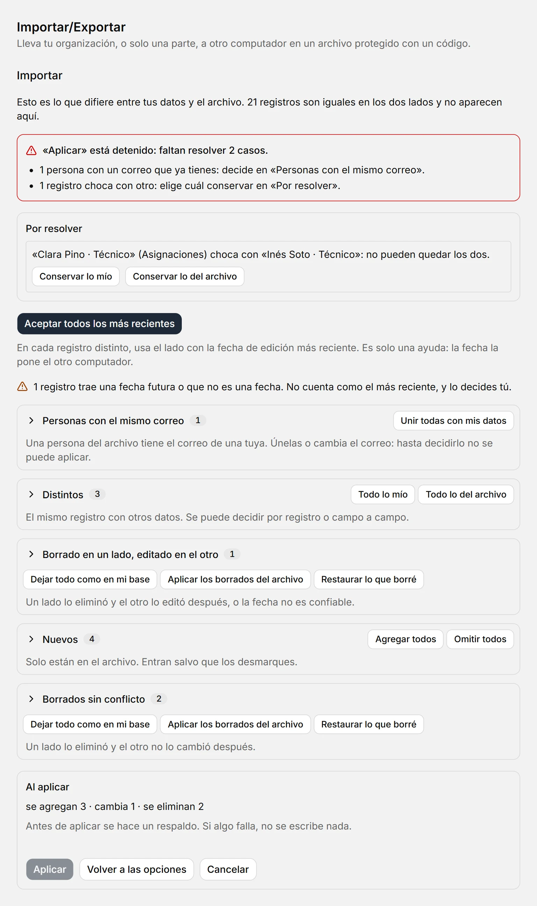
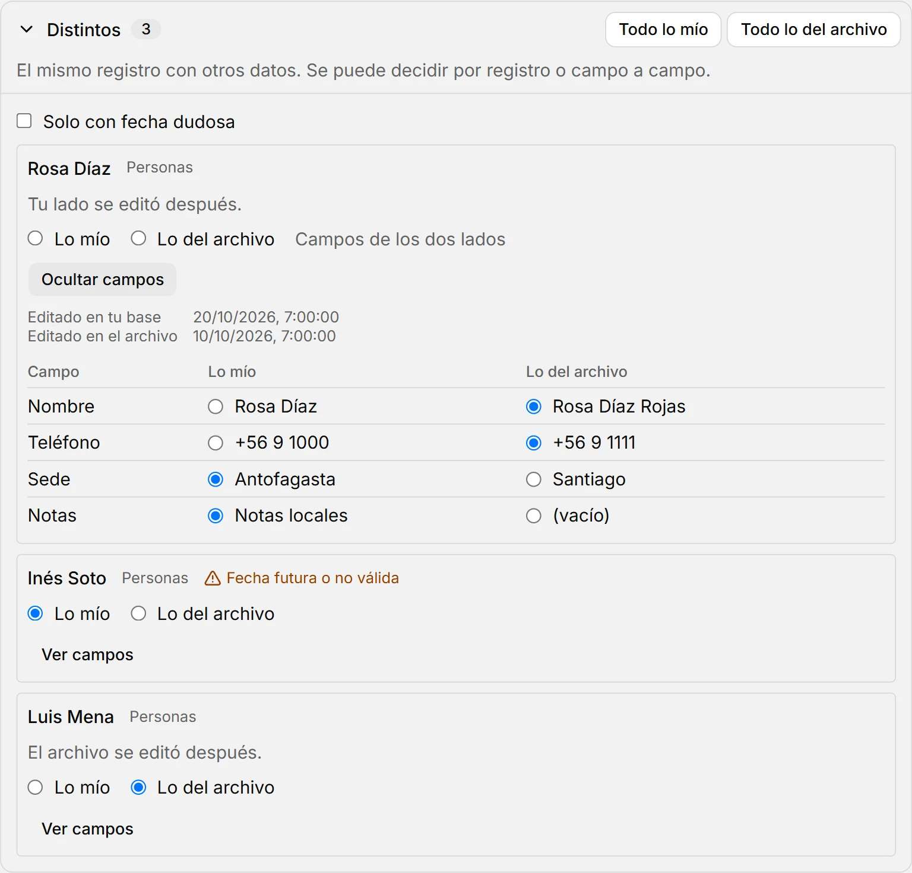

# Exportar e importar

::: info En resumen
Para llevar tu organización, o solo una parte, a otro computador: **Exportar** la guarda en un archivo `.boldo` protegido con un código, e **Importar** abre ese archivo en el otro lado. Aquí ves cómo hacerlo sin pisar los datos que ya tienes.
:::

Ambas acciones están en **Importar/Exportar**, en la barra lateral, y en el menú de la app. Para abrir un archivo también puedes usar **Abrir un archivo .boldo** en la Bienvenida.

## Exportar

1. Pulsa **Exportar** y elige qué llevar: **Toda la base**, o **Uno o más árboles o ramas**. Si marcas una unidad, va toda su rama.
2. Pulsa **Continuar**. Verás qué lleva el archivo y qué queda fuera.
3. Pulsa **Guardar como…** y elige dónde guardarlo.
4. Copia el código con **Copiar código**.

{width=768 height=414}

Una rama lleva sus unidades, sus puestos, las personas que hoy los ocupan, todo el historial de esos puestos, los valores de mantenedor que usan, sus etiquetas, sus ramas y vistas guardadas, y sus procesos. Quienes ya no están viajan solo con su nombre y correo, sin teléfono, notas ni foto, para que el historial se entienda. Lo eliminado no va. Lo que apunta fuera de la rama se corta y se te avisa antes de guardar: las conexiones con una unidad que no va, una jefatura cuyo puesto no va y los roles de personas que no van.

::: warning Importante
El código se muestra una sola vez y no se guarda en ninguna parte. Si se pierde, el archivo no se puede abrir: hay que exportar de nuevo, y eso da otro archivo y otro código. El archivo lleva datos personales: envía el archivo y el código **por canales distintos**, por ejemplo el archivo por correo y el código por teléfono.
:::

## Importar

1. Pulsa **Importar** y luego **Elegir archivo…**.
2. Escribe el código y pulsa **Abrir**. No importan las mayúsculas ni los guiones.
3. Revisa lo que trae: cuánto hay en el archivo, cuánto es nuevo y cuánto ya existe. Hasta aquí tu base no cambió, y **Cancelar** borra la copia temporal del archivo.
4. Elige qué hacer y pulsa **Aplicar**.

{width=768 height=794}

Si el código no corresponde o el archivo se alteró, verás el mismo aviso: «El código no es correcto o el archivo está dañado». Tu base no se toca.

### Agregar lo nuevo

Para traer lo que falta sin revisar uno por uno. Lo que no existe en tu base entra tal cual, salvo lo que en el archivo está eliminado. Lo que ya existe se queda como está, aunque en el archivo sea distinto: al final ves cuántos se omitieron y cuáles, en una lista que se abre con un clic.

| Si en el archivo viene… | Qué pasa |
|---|---|
| Un registro que ya tienes (el mismo, aunque se haya editado) | Se queda el tuyo |
| Un valor de mantenedor con el mismo nombre que uno tuyo, sin contar mayúsculas ni tildes | Se une al tuyo: no se duplica |
| Una persona con el mismo correo que una tuya | No se duplica: lo que venía con ella queda con la tuya |
| Algo que apunta a lo que eliminaste en tu base | Queda vacía esa referencia o, si es obligatoria, no entra. Se avisa |
| Algo que choca con una regla de tu base, como un segundo titular en un puesto | No entra. Se avisa |

Si importas una rama cuya unidad superior está en tu base, vuelve a quedar dentro de ella. Si no está, se te pregunta dónde colocarla: **dentro de una unidad** o **como árbol independiente**. En ambos casos queda al final de sus hermanas. Una base sin nombre toma el de la organización del archivo.

### Revisar y decidir

Para dos copias que siguieron trabajando por separado: comparas el archivo con tus datos y decides qué se queda. Sirve con un archivo de toda la base o de una o más ramas. Comparar no cambia nada: tus datos se escriben solo cuando pulsas **Aplicar**.

1. Elige **Revisar y decidir** y pulsa **Continuar**.
2. Mira el resumen: cada tipo de caso con su cantidad. Lo que es igual en los dos lados no aparece.
3. Pulsa **Aceptar todos los más recientes** para resolver lo común de un clic, o abre un grupo y decide por registro. **Ver campos** muestra cada campo con su valor en tus datos y en el archivo, y puedes elegir campo a campo.
4. Resuelve lo que aparezca en **Por resolver**. Mientras quede algo, **Aplicar** está detenido y un aviso arriba dice qué falta.
5. Pulsa **Aplicar**. El recuadro **Al aplicar** dice antes cuánto se agrega, cambia o elimina.

{width=768 height=REV1ES}

| Caso | Qué es | Qué viene elegido | Qué puedes hacer |
|---|---|---|---|
| **Nuevos** | Solo están en el archivo | Entran | Desmarcarlos |
| **Distintos** | El mismo registro con otros datos | El lado editado más recientemente | Lo tuyo o lo del archivo, por registro o por campo |
| **Borrado en un lado, editado en el otro** | Un lado lo eliminó y el otro lo editó después | Se mantiene | Mantener o borrar |
| **Borrados sin conflicto** | Un lado lo eliminó y el otro no lo cambió después | Queda eliminado | Revertir |
| **Se unen a lo que ya tienes** | Valores con el mismo nombre que uno tuyo, sin contar mayúsculas ni tildes | Se usa el tuyo | Nada que decidir |
| **Personas con el mismo correo** | Una persona del archivo tiene el correo de una tuya | Nada: detiene **Aplicar** | Unir con tus datos, unir con los del archivo o cambiar su correo |
| **Choca con otro** | Por ejemplo, dos titulares en un puesto o dos Aprobadores en una actividad | Nada: detiene **Aplicar** | Conservar lo tuyo o lo del archivo. Si conservas una asignación del archivo, la tuya se cierra |
| **Referencia a algo que no estará** | Algo apunta a lo que decidiste no traer o a lo que quedará eliminado | Nada: detiene **Aplicar** | Reasignar, dejar vacío si se puede o descartar el registro. **Resolver todas las referencias** lo hace de una vez |
| **Quedaría dentro de sí misma** | Con lo elegido, una unidad termina colgando de sí misma | Nada: detiene **Aplicar** | Cambiar su unidad superior o dejarla sin superior |

Lo que solo está en tu base se queda: nada se borra por no venir en el archivo. Eso es lo que permite traer una sola rama sin tocar el resto. Una foto o la configuración de una vista se comparan sin mostrarse, y dice cuánto pesan.

{width=768 height=REV2ES}

::: warning Importante
«El más reciente» es solo una ayuda: esa fecha la pone el otro computador, y puede estar mal. Una fecha futura o que no es una fecha se marca, nunca cuenta como la más reciente y no borra ni recupera nada sola: lo decides tú.
:::

Si tus datos cambian mientras revisas, por ejemplo en otra pestaña, **Aplicar** avisa y no escribe nada. Pulsa **Comparar de nuevo**: lo que decidiste sobre lo que no cambió se conserva, y un aviso dice cuántas decisiones volvieron a su valor inicial.

Las decisiones duran mientras dura la revisión. **Cancelar** y **Volver a las opciones** avisan antes de perderlas. Si te vas a otra pantalla, un aviso te ofrece volver a la revisión o descartarla; y si cierras la app con decisiones sin aplicar, pregunta antes.

### Reemplazar todo

Tus datos actuales se cambian por los del archivo y la app se reinicia. Solo se puede con un archivo de **toda la base**: con una parte borrarías el resto. Se pide confirmar.

::: tip Consejo
Antes de aplicar cualquiera de las tres, BoldoAtlas hace un respaldo marcado **Antes de reemplazar**. Si te arrepientes, restáuralo desde [Respaldos](respaldos.md). Si algo falla al aplicar, no se escribe nada.
:::

## Si cierras a mitad de camino

Mientras exporta o importa, cerrar pregunta antes y dice qué trabajo está en curso. **Dejar en la bandeja** no lo interrumpe. **Cerrar la app** sí: lo que estaba a medias nunca queda con el nombre final y tus datos no cambian. Al volver a abrir se borran las copias en claro de la carpeta `datos`. Si un corte deja un archivo `.boldo.tmp` junto al destino, va cifrado y lo puedes borrar a mano.

Si te vas de la pantalla del código sin copiarlo, BoldoAtlas lo sigue mostrando en un aviso hasta que lo copies o decidas cerrarlo.

## Versiones distintas

- Un archivo hecho con una versión anterior de BoldoAtlas se actualiza al abrirlo, sin tocar tu base.
- Uno hecho con una versión **más nueva** no se abre hasta que actualices BoldoAtlas.
- Si tu base no cabe en un solo archivo (máximo 512 MB de datos), exporta por ramas: cada archivo lleva una parte. Si un campo es demasiado largo, el aviso dice cuál es, para que lo acortes.
- Aunque el código sea correcto, BoldoAtlas revisa el archivo antes de aplicarlo: rechaza lo que no sea una copia válida o traiga más datos de los que puede manejar. Esa revisión mira la forma, no el contenido: los datos son los que puso quien lo envió, así que importa solo archivos de personas en quienes confías y mira lo que trae antes de aplicar.

**Ver también:** [Respaldos](respaldos.md) · [Mantenedores](mantenedores.md).
