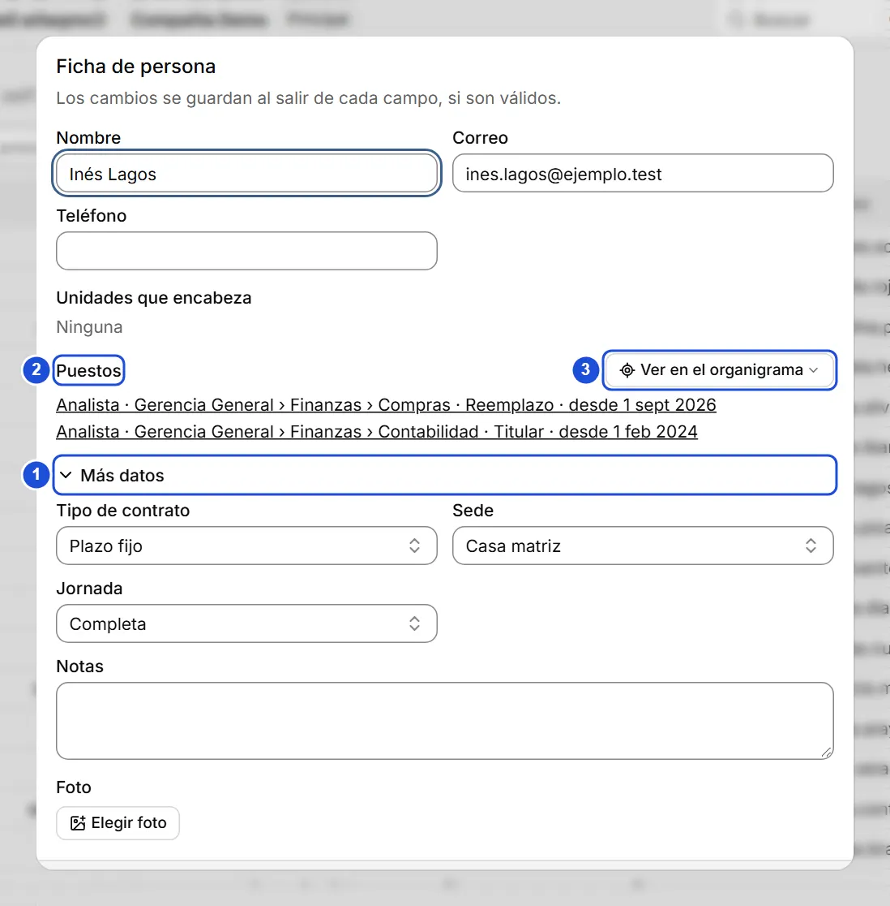
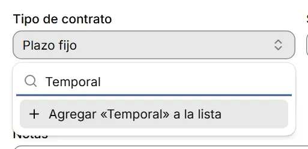

# Fichas de personas

::: info En resumen
La ficha guarda los datos de una persona: contacto, contrato, sede, jornada, foto y notas. Se guarda sola, campo por campo.
:::

La ficha es el formulario de una persona: sus datos de contacto, contrato, sede, jornada, foto y notas. Se abre desde el **Directorio**, desde **Revisión**, desde la paleta de comandos (`Ctrl+K`, buscando a la persona) o desde el diálogo de un puesto, pulsando el nombre de quien lo ocupa. Al cerrarla, el foco vuelve a donde estabas; si ese lugar ya no existe, al botón **Buscar** de la barra superior.

El cargo y la unidad no se editan en la ficha: son del **puesto** que la persona ocupa (como titular o como reemplazo). Una vacante es un puesto sin titular.

A la vista están el nombre, el correo, el teléfono, las unidades que encabeza y sus puestos. **Tipo de contrato**, **sede**, **jornada**, **notas** y **foto** están en **Más datos**: se abre solo si la persona ya tiene alguno de esos datos o hay un error ahí; si no, con un clic, y queda como lo dejes.

{width=732 height=744}

## Listas de valores

**Tipo de contrato**, **Sede** y **Jornada** se eligen de listas, para que los datos queden ordenados y sin duplicados.

Para elegir o agregar un tipo de contrato:

1. Abre **Más datos** y pulsa el campo **Tipo de contrato**.
2. Escribe en el cuadro de búsqueda para filtrar la lista.
3. Elige el valor; si no existe, pulsa **Agregar «texto» a la lista**.

- Escribe en el cuadro de búsqueda para filtrar la lista.
- Si el valor no existe, aparece **Agregar «texto» a la lista**: lo crea y lo deja elegido.
- Si ya existe uno igual (sin importar mayúsculas ni tildes), no se ofrece agregarlo: elige el que aparece en la lista.
- Si un valor fue desactivado en la lista pero la ficha lo usa, se sigue mostrando con la marca **(inactivo)**. **Sin valor** deja el campo vacío.

{width=342 height=166}

## Guardado

No hay botón Guardar: cada campo se guarda al salir de él, siempre que ese campo sea válido. Si uno no es válido, el motivo aparece bajo el campo y ese campo no se guarda hasta corregirlo; los demás sí se guardan. Una ficha nueva se crea cuando tiene nombre, que es obligatorio; hasta entonces se muestra que falta.

::: warning Importante
Si cierras la ficha con cambios sin guardar (un campo inválido o una ficha nueva sin crear), aparece **Hay cambios sin guardar**: **Seguir editando** vuelve a la ficha y **Descartar** la cierra y pierde esos cambios.
:::

- El **correo** debe tener forma de dirección (por ejemplo, ana@empresa.cl) y no puede repetirse entre personas.
- La **foto** es opcional: PNG, JPG o WebP de hasta 30 MB.

## Fotos

Al elegir una foto, BoldoAtlas la reduce antes de guardarla: su lado mayor queda en 256 píxeles y se guarda como JPEG. Se ve igual en todos los tamaños en que aparece y pesa mucho menos, también en los respaldos y en los archivos `.boldo`. Una foto pequeña no se agranda. Lo transparente queda blanco. Una imagen de más de 120 megapíxeles no se acepta. Si cierras la ficha mientras la foto se prepara, se espera a que quede guardada.

La foto convertida no guarda los datos que traía el archivo, como el lugar donde se tomó o la cámara. Si convertirla la dejara más pesada, se guarda tal cual, **con los datos que traiga**. Lo mismo vale para un JPEG o WebP sin esos datos que casi no bajaría de peso: se guarda tal cual.

Las fotos que ya tenías se reducen en **Configuración › Fotos › Optimizar fotos existentes**, solo si lo pides. Se revisan las que pesan más de unos 36 KB; las más livianas no se tocan y conservan los datos que traigan.

1. Primero ves cuánto ocupan, en cuánto quedarían y cuánto ocupará el respaldo.
2. Se hace un respaldo, marcado **Antes de optimizar fotos**, que conserva las originales. Quedan los últimos 3.
3. Las fotos se convierten por partes, con una barra de avance. Puedes seguir trabajando, y **Cancelar** deja lo ya optimizado.
4. Al final ves cuántas se optimizaron y cuánto espacio se liberó. Una foto que no se pudo optimizar se nombra y sigue como estaba.

Optimizar no cambia la fecha de modificación de la persona: es la misma foto con menos peso. Si fusionas con otra copia que aún tiene la foto original, esa foto aparece como una diferencia con la misma fecha, y eliges cuál se queda.

## Jefatura

**Unidades que encabeza** lista las unidades de las que es jefe: ocupa el puesto de jefatura como titular o, si ese puesto no tiene titular, como reemplazo.

## Puestos

En **Puestos** se ven los puestos vigentes de la persona (cargo, unidad, si es titular o reemplazo y desde cuándo) y, en **Historial**, los que ya terminaron. Pulsa uno para abrir el puesto. **Ver en el organigrama** cierra la ficha y muestra a la persona en el árbol (con varios puestos, eliges cuál).

## Eliminar

**Eliminar** cierra la ficha y muestra un aviso con **Deshacer** durante 8 segundos.

**Ver también:** [Puestos y reemplazos](puestos.md) · [Directorio](directorio.md) · [Configuración y mantenedores](mantenedores.md).
