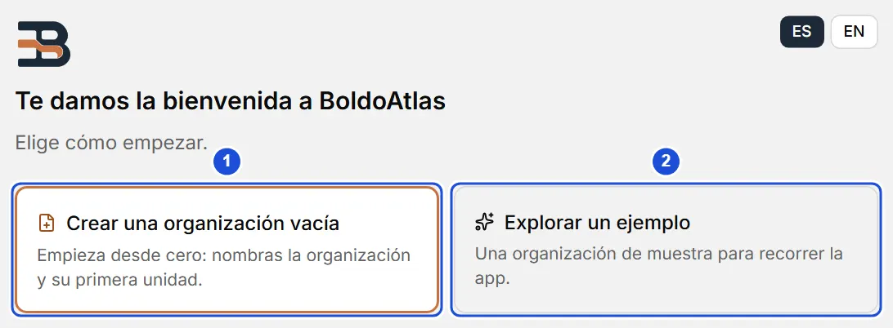
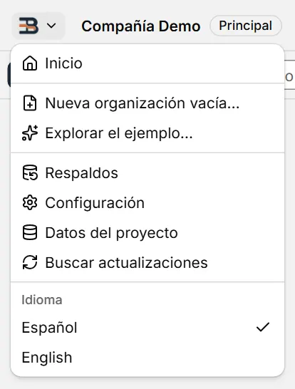
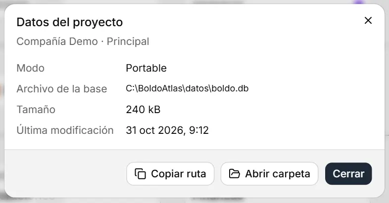

# Inicio

::: info En resumen
BoldoAtlas arma el organigrama de tu organización en tu computador. Aquí ves cómo empezar, qué hace el menú de la app, dónde quedan tus datos y cómo abrir el programa la primera vez.
:::

## Qué es BoldoAtlas

BoldoAtlas es una app de escritorio para Windows, Linux y macOS con la que armas el organigrama de tu organización: gerencias, áreas y subáreas, conectadas entre sí, y la ficha de cada persona que trabaja en ellas. Puedes explorar el resultado en el lienzo del árbol o en el directorio.

## Primer uso

Al abrir una base sin unidades, BoldoAtlas muestra la bienvenida con dos caminos; el primero, destacado, es el principal:

- **Crear una organización vacía:** te pide el nombre de la organización y el de su unidad raíz (del primer tipo de unidad activo) y te lleva al árbol.
- **Explorar un ejemplo:** crea una organización de muestra, en el idioma de la interfaz, para recorrer la app.

{width=728 height=268}

::: tip Consejo
Si es tu primera vez, empieza por el ejemplo: puedes recorrerlo sin miedo a equivocarte y, cuando quieras, crear tu propia organización desde el menú de la app (antes se hace un respaldo automático).
:::

Después puedes ajustar el nombre, el logo, el tema y el idioma en **Configuración**, y las listas de cargos, sedes y demás en **Configuración › Mantenedores**.

## Al abrir y al salir

BoldoAtlas abre en **Inicio**, también con datos cargados. Para volver a la última vista, activa **Configuración › Al abrir y al salir › Continuar donde estaba**.

Al salir (la **X** de la ventana, `Alt+F4` o **Salir** en el menú de la app y en la bandeja), pregunta si estás seguro. Lo que ya aplicaste está guardado; un formulario sin terminar se pierde. Para que no pregunte, apaga **Preguntar antes de salir** en esa misma sección.

## El menú de la app y volver a Inicio

El botón con el logo, a la izquierda de la barra superior, abre el **menú de la app**:

- **Inicio** vuelve a la bienvenida en cualquier momento, también con datos cargados.
- **Nueva organización vacía…** y **Explorar el ejemplo…** reemplazan los datos actuales. Antes piden confirmación y hacen un **respaldo automático** (si el respaldo falla, no se reemplaza nada); el respaldo queda en la lista de **Configuración › Respaldos** para restaurarlo.
- **Respaldos** y **Configuración** abren esas secciones; **Datos del proyecto** muestra dónde están tus datos.
- **Idioma** cambia al instante toda la app entre Español y English. La pantalla de bienvenida tiene el mismo selector **ES / EN**; tu elección se recuerda en este equipo y, la primera vez, la app sigue el idioma del sistema.

{width=276 height=364}

Las mismas acciones están en la paleta de comandos (`Ctrl+K`). **Configuración**, **Ayuda** y **Acerca de** se cierran con su botón **Cerrar**, con `Esc` o con un segundo clic en su entrada del menú lateral, y vuelves a la vista anterior (o al árbol si no hay ninguna). La barra lateral se pliega y se vuelve a fijar abierta con el botón del pie de la barra, sobre **Configuración** (**Ocultar barra lateral** / **Mostrar barra lateral**); queda en el mismo lugar abierta o plegada. Plegada, se despliega sobre el contenido al dejar el mouse encima un momento (o al llegar a ella con `Tab`) y se vuelve a plegar al salir o con `Esc`; esto se apaga en **Configuración › Apariencia › Abrir la barra lateral al pasar el mouse**. Con la ventana angosta (menos de 1100 px) la barra se pliega sola. El panel de una unidad se cierra con la **×** de su encabezado.

## Qué proyecto está abierto

El título de la ventana y la barra superior muestran el nombre de la organización con la insignia **Principal**. Al pulsarlos se abre **Datos del proyecto**: el modo (portable o instalado), la ruta del archivo de la base, su tamaño y la última modificación, con **Copiar ruta** y **Abrir carpeta**.

{width=524 height=274}

## Modo portable e instalado

- **Portable:** extraes el zip de tu sistema en cualquier carpeta (o en un pendrive) y abres el programa que trae. Todo (datos, respaldos y preferencias) queda en la carpeta `datos/`, junto al programa, y nada se escribe fuera de ella (salvo en macOS: las preferencias de la ventana, ver más abajo). Funciona porque junto al programa hay un archivo `portable.flag`. Extrae el zip antes de ejecutar: abrirlo desde dentro del zip impide guardar los datos.
- **Instalado:** lo instalas con el instalador de tu sistema y los datos quedan en la carpeta de datos de tu usuario.

| Sistema | Portable | Instalador | Datos del instalado |
|---|---|---|---|
| Windows | `BoldoAtlas_windows_x64_portable.zip` → `BoldoAtlas.exe` | `BoldoAtlas_windows_x64_setup.exe` | `%APPDATA%\io.github.mscottb.boldoatlas` |
| Linux | `BoldoAtlas_linux_x64_portable.zip` → `BoldoAtlas.AppImage` | `.deb`, `.rpm` o `BoldoAtlas_linux_x64.AppImage` | `~/.local/share/io.github.mscottb.boldoatlas` |
| macOS 11 o más nuevo | `BoldoAtlas_macos_universal_portable.zip` → `BoldoAtlas.app` | `BoldoAtlas_macos_universal.dmg` | `~/Library/Application Support/io.github.mscottb.boldoatlas` |

En macOS, las preferencias de la ventana (tema, escala, pestañas) y sus cachés web las guarda el sistema en tu carpeta `~/Library` (`WebKit`, `Caches`), también en la portable; los datos y los respaldos sí quedan en `datos/`.

::: warning Importante
BoldoAtlas no está firmado digitalmente, así que la primera vez el sistema avisa. Esto es lo que debes hacer según tu sistema:
:::

- **Windows:** si aparece «Windows protegió su PC», pulsa **Más información → Ejecutar de todas formas**.
- **macOS:** clic derecho sobre `BoldoAtlas.app` → **Abrir** → **Abrir**. Si dice que está dañada o no deja abrirla, ejecuta en Terminal `xattr -dr com.apple.quarantine <carpeta>` sobre la carpeta de la portable (o sobre `/Applications/BoldoAtlas.app`), o usa **Configuración del Sistema › Privacidad y seguridad › Abrir igualmente**. Con la portable hazlo antes de abrirla: si no, macOS la abre desde una copia de solo lectura y no puede guardar.
- **Linux:** el AppImage necesita permiso de ejecución: `chmod +x BoldoAtlas_linux_x64.AppImage` (o Propiedades › Permitir ejecutar). Si no abre, instala FUSE 2 (`sudo apt install libfuse2`; en Ubuntu 24.04, `libfuse2t64`).

En _Acerca de_ (abajo en el menú) ves la versión. En **Detalles técnicos**, que se abre con un clic, están el modo en que está corriendo, la carpeta de datos exacta y **Copiar información**, para pegarla al pedir ayuda.

## Dónde quedan tus datos

Todo se guarda en una base de datos SQLite local, `boldo.db`:

- En modo portable, en la carpeta `datos/` junto al programa.
- En modo instalado, en la carpeta de datos de tu usuario, que depende del sistema (columna «Datos del instalado» de la tabla de **Modo portable e instalado**).

Antes de actualizar la estructura de la base, BoldoAtlas guarda una copia en la subcarpeta `respaldos`. Para llevarte tus datos a otro computador en modo portable, copia la carpeta completa.

Los cambios se guardan solos: no hay botón "Guardar". El indicador de la barra superior muestra "Guardado" cuando todo está en disco.

## Privacidad

Tus datos no salen de tu computador. BoldoAtlas no usa cuentas ni tiene servidor. Lo único que hace por su cuenta es buscar versiones nuevas (cada día; se apaga en **Configuración › Actualizaciones**): lee la lista pública de versiones en GitHub y no envía datos ni identificadores. Ver **Actualizaciones**.

**Ver también:** [El árbol](arbol.md) · [Respaldos](respaldos.md) · [Actualizaciones](actualizaciones.md).
