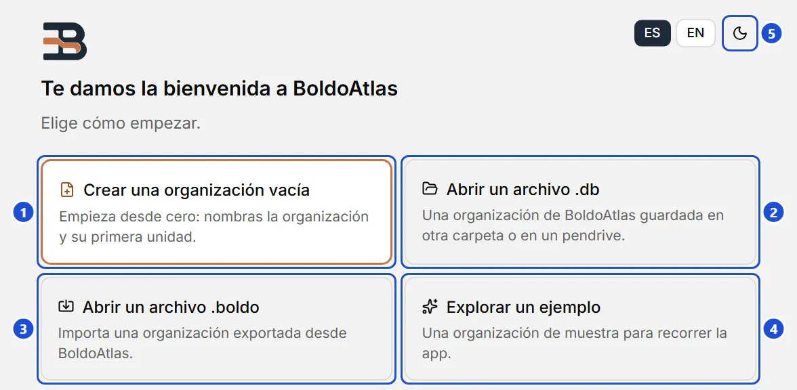
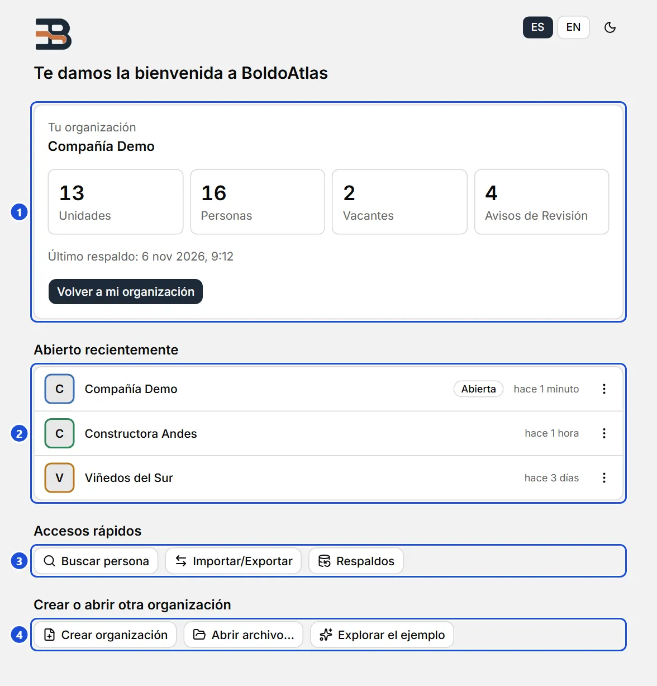
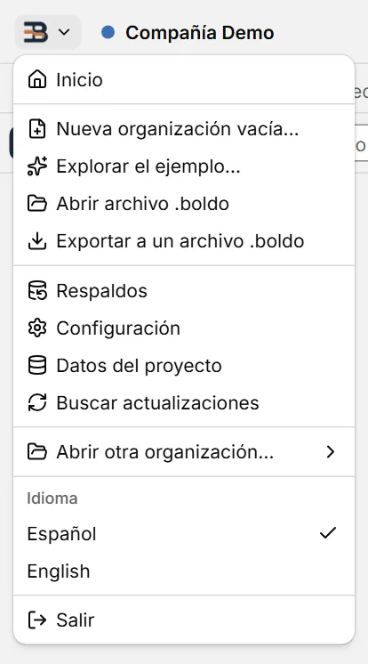
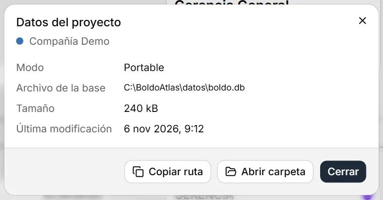

# Inicio

::: info En resumen
BoldoAtlas arma el organigrama de tu organización en tu computador. Aquí ves cómo empezar, qué hace el menú de la app, dónde quedan tus datos y cómo abrir el programa la primera vez.
:::

## Qué es BoldoAtlas

BoldoAtlas es una app de escritorio para Windows, Linux y macOS con la que armas el organigrama de tu organización: gerencias, áreas y subáreas, conectadas entre sí, y la ficha de cada persona que trabaja en ellas. Puedes explorar el resultado en el lienzo del árbol o en el directorio.

## Primer uso

Sin datos, como en una instalación nueva, BoldoAtlas muestra la bienvenida con cuatro caminos; el primero, destacado, es el principal:

- **Crear una organización vacía:** te pide el nombre de la organización y el de su unidad raíz (del primer tipo de unidad activo) y te lleva al árbol.
- **Abrir un archivo .db:** abre una organización de BoldoAtlas guardada en otra carpeta o en un pendrive (ver [Organizaciones](organizaciones.md)).
- **Abrir un archivo .boldo:** te lleva a **Importar/Exportar** para elegir el archivo (ver [Exportar e importar](exportar-importar.md)).
- **Explorar un ejemplo:** crea una organización de muestra, en el idioma de la interfaz, para recorrer la app.

Arriba a la derecha están el selector de idioma **ES / EN** y el botón de tema claro u oscuro: puedes elegirlos desde el primer momento, sin entrar antes a ningún camino. Bajo el título, con datos o sin ellos, ves la versión, **Acerca de** y **Buscar actualizaciones**.

{width=784 height=384}

::: tip Consejo
Si es tu primera vez, empieza por el ejemplo: puedes recorrerlo sin miedo a equivocarte y, cuando quieras, crear tu propia organización desde Inicio o el menú de la app. El ejemplo sigue en tu lista, aparte.
:::

Después puedes ajustar el nombre, el logo, el tema y el idioma en **Configuración**, y las listas de cargos, sedes y demás en **Configuración › Mantenedores**.

## Inicio con tu organización cargada

Cuando la base ya tiene datos, Inicio se ordena para que retomes el trabajo:

- **Tu organización:** el nombre, los totales de **Unidades**, **Personas**, **Vacantes** y **Avisos de Revisión**, la fecha del **último respaldo** y el botón **Volver a mi organización**, que te lleva a la vista que estaba activa. Cada total abre su vista: las unidades, el **Árbol**; las personas, el **Directorio**; las vacantes y los avisos, **Revisión**.
- **Abierto recientemente:** las organizaciones que abriste hace poco, la última primero y la abierta marcada **Abierta**. Aparece cuando tienes más de una. Un clic abre una, y su menú **⋮** ofrece **Quitar de la lista** y **Eliminar organización** (ver [Organizaciones](organizaciones.md)).
- **Accesos rápidos:** **Buscar persona** (abre la paleta de comandos), **Importar/Exportar** y **Respaldos**.
- **Crear o abrir otra organización:** **Crear organización**, **Abrir archivo…** y **Explorar el ejemplo**. Cada uno deja otra organización aparte y la abre en una pestaña nueva: la que tenías no cambia.

{width=784 height=818}

Si el archivo de una organización ya no está en su lugar, por ejemplo en un pendrive desconectado, su entrada en **Abierto recientemente** lo dice y ofrece **Buscar archivo** y **Quitar de la lista**. Sin datos abiertos, la bienvenida también muestra esa lista si tienes alguna.

## Al abrir y al salir

BoldoAtlas abre en **Inicio**, también con datos cargados, con la ventana maximizada en la pantalla principal. Para volver a la última vista, activa **Configuración › Al abrir y al salir › Continuar donde estaba**.

Al cerrar la ventana (la **X** o `Alt+F4`), pregunta qué hacer. Lo que ya aplicaste está guardado. Al cerrar la app, un formulario sin terminar se pierde; en la bandeja sigue ahí.

- **Cancelar** sigue como estabas.
- **Dejar en la bandeja** oculta la ventana y BoldoAtlas sigue abierto, con su icono junto al reloj, listo para volver al instante. Para volver, haz clic en el icono o abre de nuevo el acceso directo.
- **Cerrar la app** la cierra del todo.

Con **No volver a preguntar**, tu elección queda guardada. Para cambiarla, ve a **Configuración › Al abrir y al salir › Al cerrar la ventana**: **Preguntar**, **Dejar en la bandeja** o **Cerrar la app**. Se guarda en este computador.

**Salir**, en el menú de la app y en el del icono, cierra la app: por sí solo nunca la deja en la bandeja. Si la opción es **Preguntar** o hay un trabajo en curso, pregunta antes, y en ese diálogo puedes elegir **Dejar en la bandeja**.

Si hay un trabajo en curso, como un respaldo, una actualización o exportar e importar un archivo, pregunta siempre, aunque hayas marcado **No volver a preguntar**, y dice qué trabajo es: cerrar la app lo interrumpe. En la bandeja el trabajo sigue y el texto del icono (se ve al pasar el mouse sobre él) dice que está en curso y cuándo termina. Si falla, la ventana vuelve al frente para mostrar el error. Una actualización continúa y BoldoAtlas se reinicia solo al instalarla.

Si tu sistema no tiene bandeja (Linux sin AppIndicator), no aparece **Dejar en la bandeja**. Actualizar, restaurar un respaldo, el instalador y el apagado del computador cierran la app sin preguntar, también cuando está en la bandeja.

## El menú de la app y volver a Inicio

El botón con el logo, a la izquierda de la barra superior, abre el **menú de la app**:

- **Inicio** vuelve a la bienvenida en cualquier momento, también con datos cargados.
- **Nueva organización vacía…** y **Explorar el ejemplo…** crean otra organización, aparte, y la abren en una pestaña nueva; la que tenías no cambia. Si el ejemplo ya está en tu lista, **Explorar el ejemplo…** lo abre.
- **Abrir archivo .boldo** y **Exportar a un archivo .boldo** llevan a **Importar/Exportar**.
- **Respaldos** y **Configuración** abren esas secciones; **Datos del proyecto** muestra dónde están tus datos.
- **Abrir otra organización…** aparece cuando tienes más de una y ofrece las demás.
- **Idioma** cambia al instante toda la app entre Español y English. La pantalla de bienvenida tiene el mismo selector **ES / EN** y el botón de tema claro u oscuro; tu elección se recuerda en este equipo y, la primera vez, la app sigue el idioma del sistema.

{width=276 height=497}

Las mismas acciones están en la paleta de comandos (`Ctrl+K`). **Configuración**, **Ayuda** y **Acerca de** se cierran con su botón **Cerrar**, con `Esc` o con un segundo clic en su entrada del menú lateral, y vuelves a la vista anterior (o al árbol si no hay ninguna). La barra lateral se pliega y se vuelve a fijar abierta con el botón del pie de la barra, sobre **Configuración** (**Ocultar barra lateral** / **Mostrar barra lateral**); queda en el mismo lugar abierta o plegada. Plegada, se despliega sobre el contenido al dejar el mouse encima un momento (o al llegar a ella con `Tab`) y se vuelve a plegar al salir o con `Esc`; esto se apaga en **Configuración › Apariencia › Abrir la barra lateral al pasar el mouse**. Con la ventana angosta (menos de 1100 px) la barra se pliega sola. El panel de una unidad se cierra con la **×** de su encabezado.

## Qué proyecto está abierto

El título de la ventana y la barra superior muestran el nombre de la organización abierta; la barra, también su punto de color. Al pulsar el nombre se abre **Datos del proyecto**: el modo (portable o instalado), la ruta del archivo de su base, su tamaño y la última modificación, con **Copiar ruta** y **Abrir carpeta**, que abre la carpeta de ese archivo.

{width=524 height=274}

## Modo portable e instalado

- **Portable:** extraes el zip de tu sistema en cualquier carpeta (o en un pendrive) y abres el programa que trae. Todo (datos, respaldos y preferencias) queda en la carpeta `datos/`, junto al programa, y nada se escribe fuera de ella (salvo en macOS: las preferencias de la ventana, ver más abajo). Funciona porque junto al programa hay un archivo `portable.flag`. Extrae el zip antes de ejecutar: abrirlo desde dentro del zip impide guardar los datos.
- **Instalado:** lo instalas con el instalador de tu sistema y los datos quedan en la carpeta de datos de tu usuario.

| Sistema | Portable | Instalador | Datos del instalado |
|---|---|---|---|
| Windows | `BoldoAtlas_windows_x64_portable.zip` → `BoldoAtlas.exe` | `BoldoAtlas_windows_x64_setup.exe` | `%APPDATA%\io.github.mscottb.boldoatlas` |
| Linux | `BoldoAtlas_linux_x64_portable.zip` → `BoldoAtlas.AppImage` | `.deb`, `.rpm` o `BoldoAtlas_linux_x64.AppImage` | `~/.local/share/io.github.mscottb.boldoatlas` |
| macOS 11 o más nuevo | `BoldoAtlas_macos_universal_portable.zip` → `BoldoAtlas.app` | `BoldoAtlas_macos_universal.dmg` | `~/Library/Application Support/io.github.mscottb.boldoatlas` |

En macOS, las preferencias de la ventana (tema, escala, pestañas) y sus cachés web las guarda el sistema en tu carpeta `~/Library` (`WebKit`, `Caches`), también en la portable; los datos y los respaldos sí quedan en `datos/`.

::: warning Importante
BoldoAtlas no está firmado digitalmente, así que la primera vez el sistema avisa. Esto es lo que debes hacer según tu sistema:
:::

- **Windows:** si aparece «Windows protegió su PC», pulsa **Más información → Ejecutar de todas formas**.
- **macOS:** clic derecho sobre `BoldoAtlas.app` → **Abrir** → **Abrir**. Si dice que está dañada o no deja abrirla, ejecuta en Terminal `xattr -dr com.apple.quarantine <carpeta>` sobre la carpeta de la portable (o sobre `/Applications/BoldoAtlas.app`), o usa **Configuración del Sistema › Privacidad y seguridad › Abrir igualmente**. Con la portable hazlo antes de abrirla: si no, macOS la abre desde una copia de solo lectura y no puede guardar.
- **Linux:** el AppImage necesita permiso de ejecución: `chmod +x BoldoAtlas_linux_x64.AppImage` (o Propiedades › Permitir ejecutar). Si no abre, instala FUSE 2 (`sudo apt install libfuse2`; en Ubuntu 24.04, `libfuse2t64`).

En _Acerca de_ (abajo en el menú) ves la versión. En **Detalles técnicos**, que se abre con un clic, están el modo en que está corriendo, la carpeta de datos exacta y **Copiar información**, para pegarla al pedir ayuda.

## Dónde quedan tus datos

Cada organización se guarda en su propia base de datos SQLite local. La que ya tenías, o la primera que creas, es `boldo.db`; las demás quedan en la subcarpeta `organizaciones` (ver [Qué se guarda aparte](organizaciones.md#que-se-guarda-aparte)). Todas están en la carpeta de datos:

- En modo portable, en la carpeta `datos/` junto al programa.
- En modo instalado, en la carpeta de datos de tu usuario, que depende del sistema (columna «Datos del instalado» de la tabla de **Modo portable e instalado**).

Antes de actualizar la estructura de una base, BoldoAtlas guarda una copia entre sus respaldos. Para llevarte tus datos a otro computador en modo portable, copia la carpeta completa; un archivo externo, abierto desde otra carpeta, no va con ella.

Los cambios se guardan solos: no hay botón "Guardar". El indicador de la barra superior muestra "Guardado" cuando todo está en disco.

## Privacidad

Tus datos no salen de tu computador. BoldoAtlas no usa cuentas ni tiene servidor. Lo único que hace por su cuenta es buscar versiones nuevas (cada día; se apaga en **Configuración › Actualizaciones**): lee la lista pública de versiones en GitHub y no envía datos ni identificadores. Ver **Actualizaciones**.

**Ver también:** [El árbol](arbol.md) · [Respaldos](respaldos.md) · [Actualizaciones](actualizaciones.md).
