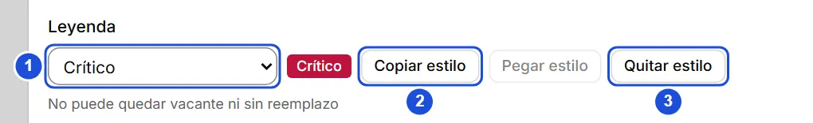
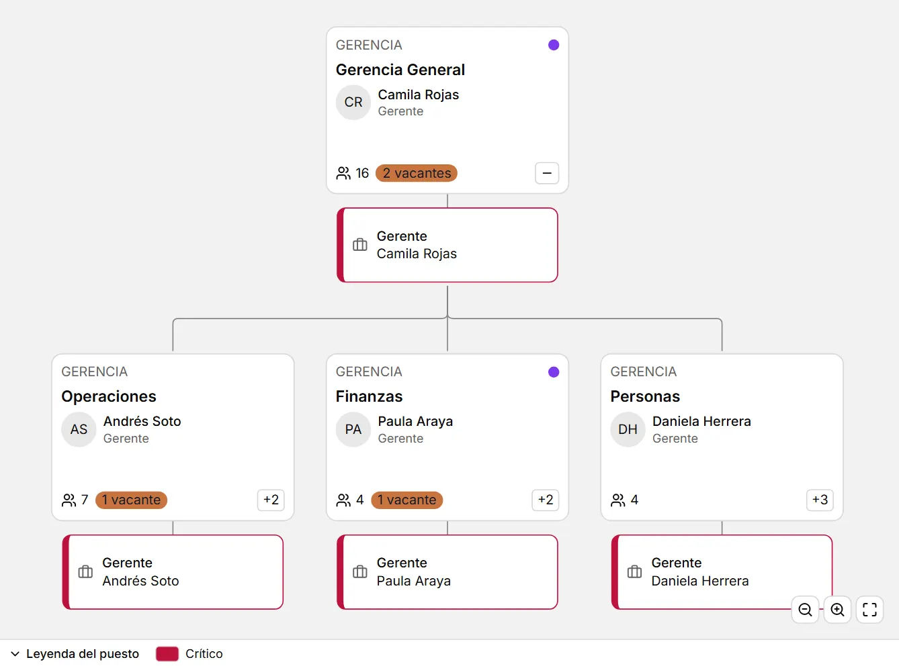

# Leyendas y colores de puestos

::: info En resumen
Una leyenda es una etiqueta con color para clasificar puestos y verlos de un vistazo en el árbol. Aquí ves cómo crearla, asignarla y copiar su estilo.
:::

Una **leyenda** es una entrada con nombre y color (por ejemplo, «Crítico» en rojo o «En sucesión» en ámbar) que sirve para clasificar puestos y verlos de un vistazo en el árbol. Son datos de la organización: se guardan con ella.

## Asignar una leyenda a un puesto

1. Abre el puesto (desde la pestaña **Puestos** del panel de una unidad, o pulsándolo si ya ves los puestos en el árbol).
2. En **Leyenda**, elige una entrada de la lista, o **Nueva entrada…** para crear una: escribe el nombre, elige el color y, si quieres, una descripción. Al pulsar **Crear y asignar** se crea y se asigna de una vez.
3. **Quitar estilo** deja el puesto sin leyenda. Una entrada desactivada sigue mostrándose en los puestos que ya la tenían, marcada como inactiva.

El color se guarda en formato `#rrggbb`, por ejemplo `#be123c`.

{width=680 height=104}

## Copiar y pegar el estilo

- **Copiar estilo** guarda en memoria la leyenda de ese puesto (también si no tiene: «sin estilo»).
- **Pegar estilo** asigna la misma leyenda a otro puesto; puedes pegarla en tantos puestos como quieras. Está disponible solo cuando hay algo copiado y la entrada sigue activa.
- En el árbol, con un puesto enfocado: `Ctrl` + `C` copia su estilo y `Ctrl` + `V` lo pega. Lo copiado se olvida al cerrar la aplicación.

::: tip Consejo
Para dar la misma leyenda a muchos puestos, cópiala una vez con **Copiar estilo** y pégala en cada uno.
:::

## Verlas en el árbol

1. Pulsa **Personalizar** y activa **Ver puestos**.
2. En **Colorear por**, elige **Leyenda del puesto**.

Cada puesto muestra su color en el borde y en una franja a la izquierda; las unidades no cambian. Bajo el lienzo aparece la franja de la **leyenda** con las entradas que se están usando (pasa el cursor sobre una para leer su descripción); puedes plegarla con su encabezado.

{width=892 height=664}

**Ver también:** [Puestos y reemplazos](puestos.md) · [El árbol](arbol.md) · [Configuración y mantenedores](mantenedores.md).
