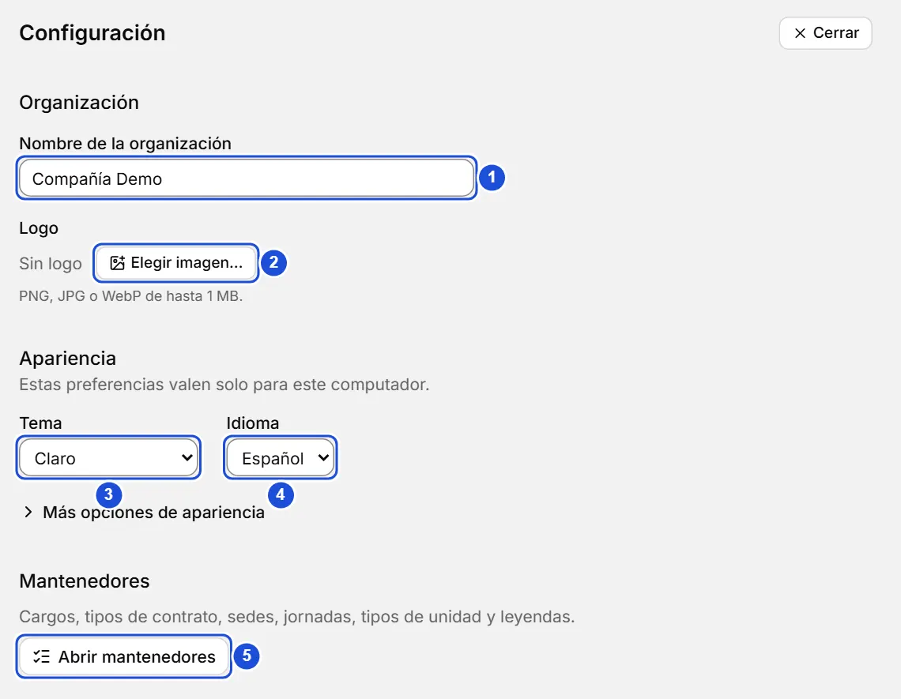
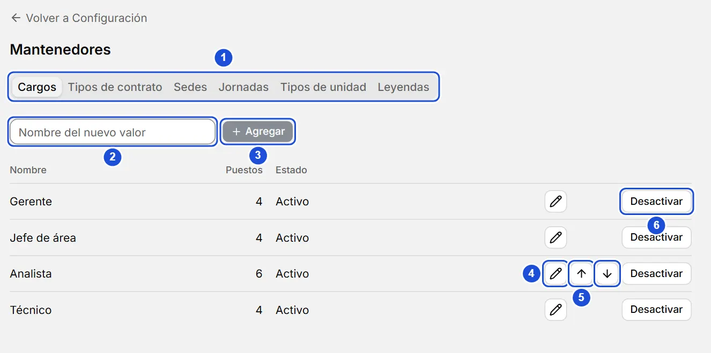

# Configuración y mantenedores

::: info En resumen
Configuración reúne el nombre, el logo, el tema y el idioma; los mantenedores son las listas de valores (cargos, contratos, sedes…) que usan las fichas y el árbol.
:::

## Configuración

En **Configuración** (abajo en el menú) ajustas:

- **Nombre de la organización:** se guarda al salir del campo o con `Enter`.
- **Logo:** PNG, JPG o WebP de hasta 1 MB. Se guarda como PNG (y se reduce si es muy grande) junto con tus datos. **Quitar logo** lo borra.
- **Tema, color de acento y tamaño de la interfaz:** valen solo para este computador. El tema está a la vista; el tamaño, el color de acento y **Abrir la barra lateral al pasar el mouse** están en **Más opciones de apariencia**, que se abre con un clic (o con `Enter` sobre él) y queda abierto o plegado como lo dejes.
- **Idioma:** Español o English. Cambia al instante todos los textos de la app (también desde la pantalla de bienvenida y el menú de la app); los nombres que escribiste no se traducen.

{width=760 height=590}

## Mantenedores

Los **mantenedores** son las listas controladas que usan las fichas y el árbol. Se abren desde **Configuración › Abrir mantenedores** y tienen una pestaña cada uno:

| Pestaña | Se usa en | La columna de uso cuenta |
| --- | --- | --- |
| Cargos | Puestos | Puestos |
| Tipos de contrato, Sedes y Jornadas | Ficha de la persona | Personas |
| Tipos de unidad | Cada unidad del árbol | Unidades |
| Leyendas | Color de los puestos | Puestos |

No hace falta venir aquí para sumar un valor: en las fichas, los puestos, las unidades, las leyendas de un puesto y las etiquetas, la propia lista ofrece **Agregar** (o **Nueva…**) al final y deja el valor nuevo elegido. Aquí se ordenan, renombran y desactivan.

En cada lista puedes:

Para agregar un valor a una lista:

1. En **Configuración**, pulsa **Abrir mantenedores** y elige la pestaña de la lista.
2. Escribe el nombre en **Nombre del nuevo valor**.
3. Pulsa **Agregar**.

- **Agregar** un valor escribiendo su nombre. Si ya existe uno igual (sin importar mayúsculas ni tildes) no se duplica: se te avisa y se marca el que ya estaba.
- **Renombrar** con el lápiz: `Enter` guarda y `Esc` cancela.
- **Subir** o **bajar** para cambiar el orden. Las flechas aparecen al pasar el mouse por la fila o al llegar a ella con `Tab`. En los tipos de unidad, el orden sugiere el tipo de las unidades hijas nuevas.
- **Desactivar** un valor: deja de ofrecerse en las listas, pero lo que ya lo usa lo conserva (se ve como inactivo). **Reactivar** lo devuelve. El último tipo de unidad activo no se puede desactivar.

{width=884 height=440}

Las **leyendas** suman un color (`#rrggbb`) y una descripción, que se editan en la misma fila. Cómo asignarlas a los puestos está en la página «Leyendas y colores de puestos».

**Ver también:** [Leyendas y colores de puestos](leyendas.md) · [Fichas de personas](fichas.md) · [Respaldos](respaldos.md).
