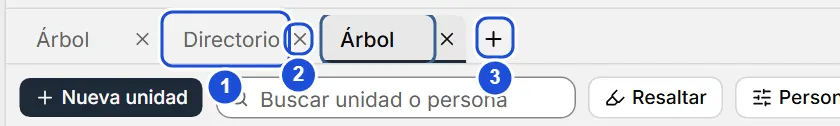

# Pestañas de trabajo

::: info En resumen
Las pestañas te dejan tener abiertas a la vez varias partes del proyecto y pasar de una a otra sin perder dónde estabas.
:::

Las pestañas te dejan tener abiertas a la vez distintas partes del mismo proyecto: el árbol completo, un subárbol, el directorio con un filtro, una persona… y pasar de una a otra sin perder dónde estabas.

## Abrir una pestaña

- `Ctrl` + `T` abre una pestaña nueva en el árbol.
- **Abrir en pestaña nueva**, en el menú contextual de una unidad del lienzo, abre esa unidad como subárbol.
- En la paleta de comandos (`Ctrl` + `K`), `Ctrl` + `Enter` o `Ctrl` + clic sobre una unidad, una persona o una acción que lleva a una vista la abre en una pestaña nueva.
- `Ctrl` + clic o clic central sobre una entrada del menú lateral, o sobre una persona del Directorio, también la abren en una pestaña nueva. Una persona se abre como el Directorio con solo sus filas: el filtro «Persona: …» se quita con su ×.

Con una sola pestaña la barra no se muestra; aparece sobre el área central en cuanto abres la segunda. Puedes tener hasta 12 pestañas abiertas.

{width=560 height=84}

::: tip Consejo
Deja una pestaña con el árbol completo y otra con el Directorio filtrado: así comparas sin perder tu lugar en ninguno.
:::

## Qué recuerda cada pestaña

Cada pestaña guarda su vista y su estado: en el árbol, las ramas plegadas, la unidad seleccionada, el encuadre y el resaltado; en el Directorio, los filtros y el orden. Al volver a ella la encuentras como la dejaste. Una pestaña nueva parte con lo último que usaste.

El nombre de cada pestaña es automático (el del subárbol, «Directorio», el de la persona…) y cambia si cambia ese nombre.

Configuración, Ayuda y Acerca de, al cerrarlas, vuelven a la vista de esa misma pestaña desde la que las abriste (o al árbol, si se abrieron en una pestaña nueva).

Solo la pestaña activa está cargada: tener varias abiertas no hace más lento el lienzo.

## Pestañas de varias organizaciones

Cuando las pestañas abiertas son de más de una organización, cada una muestra el punto de color de la suya y su nombre antes del título, por ejemplo «Compañía Demo · Árbol». Pasar a una pestaña de otra organización la abre, y solo está cargada la de la pestaña activa. Ver [Organizaciones](organizaciones.md#abrir-y-cambiar).

## Cambiar, ordenar y cerrar

- Pulsa una pestaña para verla, o usa `Ctrl` + `Tab` y `Ctrl` + `Mayús` + `Tab`.
- Arrastra una pestaña para cambiarla de lugar. Con el teclado: enfócala y usa `Ctrl` + `Mayús` + `←` `→`.
- Ciérrala con su botón ×, con clic central sobre ella, con `Supr` si está enfocada o con `Ctrl` + `W` (la activa). La última pestaña no se cierra.
- Con el foco en la barra, `←` `→` recorren las pestañas y `Enter` abre la enfocada.

Las pestañas se recuerdan en este computador, aparte para cada copia de BoldoAtlas (la instalada y cada portable), con las de todas tus organizaciones. Al abrir el programa aparece **Inicio** y, con **Volver a mi organización**, las pestañas están como las dejaste y se ve la del **Árbol** (si no había una, se abre). Con **Continuar donde estaba** (en **Configuración › Al abrir y al salir**) se abre directo en la última vista. Las de unidades o personas que ya no existen se cierran solas.

## Vista dividida

Con la vista dividida ves dos pestañas a la vez: la activa en el panel principal y otra en el panel de al lado. Por ejemplo, el árbol junto al Directorio, o dos ramas del mismo árbol.

- **Dividir**, en la barra superior, abre al lado una pestaña nueva con la misma vista. Si lo pulsas otra vez, cierra la vista dividida.
- En la paleta de comandos (`Ctrl` + `K`): **Dividir la vista** o **Cerrar la vista dividida**.
- Con clic derecho sobre una pestaña, o con `Mayús` + `F10` si está enfocada: **Abrir al lado** o **Quitar de al lado**.
- La × del encabezado de al lado también cierra la vista dividida.

Al cerrar la vista dividida, la pestaña de al lado queda en la barra como una más. Si cierras esa pestaña, se cierra la vista dividida.

Entre los dos paneles hay un divisor: arrástralo para darle más espacio a uno. Con el teclado, llega a él con `Tab` y muévelo con las flechas, de 5 en 5 %; `Inicio` y `Fin` lo llevan a un extremo, y un doble clic lo deja al medio. Cada panel ocupa entre 20 % y 80 %. El botón del encabezado de al lado cambia entre **Lado a lado** y **Una sobre otra**.

Manda el panel con foco: el último donde hiciste clic o al que llegó el foco. Su encabezado se marca. El menú lateral, la paleta, `Ctrl` + `T`, `Ctrl` + `W`, `Ctrl` + `Tab` y un clic en la barra de pestañas actúan en ese panel. `F6` pasa el foco al otro panel. Las teclas del árbol (`F2`, las flechas, `Supr`, `N`…) actúan solo en el lienzo del panel con foco, aunque los dos muestren el mismo árbol. Configuración, Ayuda y Acerca de se abren siempre en el panel principal.

Una pestaña no se muestra en los dos paneles: si pides en un panel la que está en el otro, se intercambian. Con la vista dividida están cargadas las dos pestañas que ves.

La vista dividida se recuerda con las pestañas: cuál está al lado, la orientación y el tamaño de cada panel.

Al lado también puedes ver otra organización, sin cambiar la abierta: ver [Ver al lado](organizaciones.md#ver-al-lado).

**Ver también:** [Atajos de teclado](atajos.md) · [Directorio](directorio.md).
