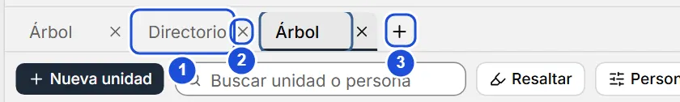

# Pestañas de trabajo

::: info En resumen
Las pestañas te dejan tener abiertas a la vez varias partes del proyecto y pasar de una a otra sin perder dónde estabas.
:::

Las pestañas te dejan tener abiertas a la vez distintas partes del mismo proyecto: el árbol completo, un subárbol, el directorio con un filtro, una persona… y pasar de una a otra sin perder dónde estabas.

## Abrir una pestaña

- `Ctrl` + `T` abre una pestaña nueva en el árbol.
- **Abrir en pestaña nueva**, en el menú contextual de una unidad del lienzo, abre esa unidad como subárbol.
- En la paleta de comandos (`Ctrl` + `K`), `Ctrl` + `Enter` o `Ctrl` + clic sobre una unidad, una persona o una acción que lleva a una vista la abre en una pestaña nueva.
- `Ctrl` + clic o clic central sobre una entrada del menú lateral, o sobre una persona del Directorio, también la abren en una pestaña nueva. Una persona se abre como el Directorio con solo sus filas: el filtro «Persona: …» se quita con su ×.

Con una sola pestaña la barra no se muestra; aparece sobre el área central en cuanto abres la segunda. Puedes tener hasta 12 pestañas abiertas.

{width=560 height=84}

::: tip Consejo
Deja una pestaña con el árbol completo y otra con el Directorio filtrado: así comparas sin perder tu lugar en ninguno.
:::

## Qué recuerda cada pestaña

Cada pestaña guarda su vista y su estado: en el árbol, las ramas plegadas, la unidad seleccionada, el encuadre y el resaltado; en el Directorio, los filtros y el orden. Al volver a ella la encuentras como la dejaste. Una pestaña nueva parte con lo último que usaste.

El nombre de cada pestaña es automático (el del subárbol, «Directorio», el de la persona…) y cambia si cambia ese nombre.

Configuración, Ayuda y Acerca de, al cerrarlas, vuelven a la vista de esa misma pestaña desde la que las abriste (o al árbol, si se abrieron en una pestaña nueva).

Solo la pestaña activa está cargada: tener varias abiertas no hace más lento el lienzo.

## Cambiar, ordenar y cerrar

- Pulsa una pestaña para verla, o usa `Ctrl` + `Tab` y `Ctrl` + `Mayús` + `Tab`.
- Arrastra una pestaña para cambiarla de lugar. Con el teclado: enfócala y usa `Ctrl` + `Mayús` + `←` `→`.
- Ciérrala con su botón ×, con clic central sobre ella, con `Supr` si está enfocada o con `Ctrl` + `W` (la activa). La última pestaña no se cierra.
- Con el foco en la barra, `←` `→` recorren las pestañas y `Enter` abre la enfocada.

Las pestañas se recuerdan en este computador, aparte para cada proyecto. Al abrir el programa aparece **Inicio** y, con **Volver a mi organización**, las pestañas están como las dejaste; con **Continuar donde estaba** (en **Configuración › Al abrir y al salir**) se ven directo. Las de unidades o personas que ya no existen se cierran solas.

**Ver también:** [Atajos de teclado](atajos.md) · [Directorio](directorio.md).
