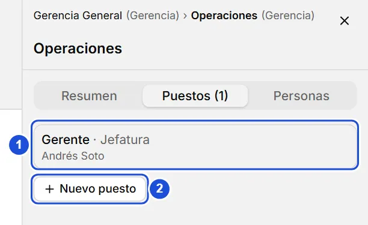
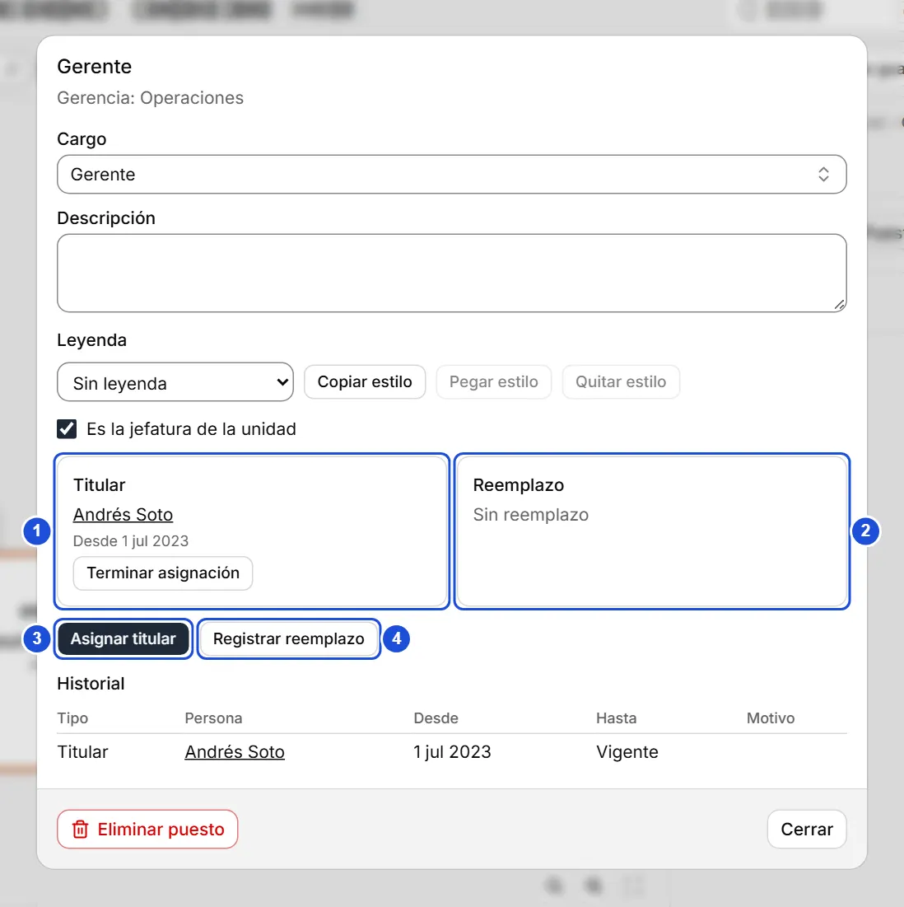

# Puestos y reemplazos

::: info En resumen
Un puesto es un cargo dentro de una unidad. Aquí ves cómo crearlo, asignar a su titular, registrar un reemplazo y revisar el historial.
:::

Un **puesto** es un cargo dentro de una unidad (por ejemplo, «Analista» en Contabilidad). La **persona** es otra cosa: así puedes registrar quién ocupa cada puesto, quién lo reemplaza y todo el historial, sin perder datos cuando alguien cambia.

## Ver y crear puestos

- Selecciona una tarjeta del árbol y abre la pestaña **Puestos** del panel de la unidad: aparece la lista de puestos de la unidad con su cargo, el titular (o **Vacante**) y el reemplazo si lo hay.
- Pulsa un puesto para abrirlo, o **Nuevo puesto** para crear otro: elige el cargo (de la lista, igual que en las fichas) y pulsa **Crear puesto**.
- También puedes abrir un puesto desde la ficha de una persona, en la sección **Puestos**.

Para crear un puesto:

1. Selecciona la tarjeta de la unidad y abre la pestaña **Puestos** de su panel.
2. Pulsa **Nuevo puesto**.
3. Elige el cargo y pulsa **Crear puesto**.

{width=408 height=250}

## El diálogo del puesto

Muestra la ubicación del puesto (el tipo y nombre de las unidades que lo contienen), su **cargo** y **descripción** (se guardan al cambiarlos), el **titular** y el **reemplazo** vigentes, y el **historial** ordenado por fecha, del más reciente al más antiguo. Pulsa el nombre de una persona para abrir su ficha.

**Es la jefatura de la unidad** marca este puesto como el que encabeza la unidad; en la tarjeta se ve a su titular, o «Reemplazo: nombre» si solo tiene reemplazo.

{width=732 height=734}

## Asignar, reemplazar y terminar

- **Asignar titular**: elige la persona y la fecha de inicio (por defecto, hoy). Si el puesto ya tenía titular, esa asignación se cierra el mismo día y queda en el historial; nunca se borra. Si eliges a quien ya es titular, no se cambia nada.
- **Registrar reemplazo**: igual que lo anterior, pero el titular sigue siéndolo. El reemplazo queda vigente hasta que lo termines con **Terminar asignación**. Un puesto tiene como máximo un titular y un reemplazo vigentes.
- **Terminar asignación**: indica la fecha de término y, si quieres, el motivo. No puede ser anterior al inicio.

::: tip Consejo
Al elegir la persona puedes buscarla por nombre o pulsar **Crear persona «texto»**: se crea con ese nombre y se asigna de una vez; sus demás datos se completan después en su ficha.
:::

## Dotación y vacantes

La **dotación** cuenta los puestos con titular vigente; un reemplazo no suma. Una **vacante** es un puesto sin titular vigente (aunque tenga reemplazo).

## Eliminar

::: warning Importante
**Eliminar puesto** lo quita junto con su historial y muestra un aviso con **Deshacer** durante 8 segundos.
:::

**Ver también:** [Leyendas y colores de puestos](leyendas.md) · [Fichas de personas](fichas.md) · [El árbol](arbol.md).
