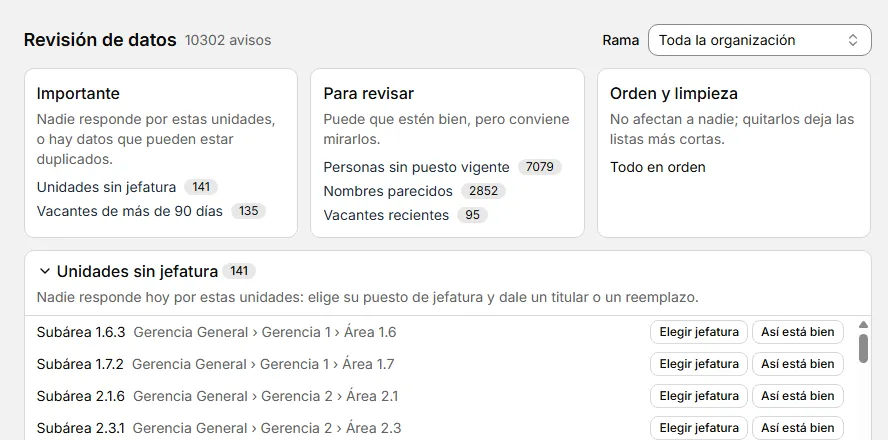

# Revisión de datos

::: info En resumen
Revisión te dice qué conviene corregir en tus datos y qué importa más. Cada aviso trae una acción a un clic, y lo que está bien lo puedes marcar con **Así está bien**.
:::

**Revisión** reúne en una sola pantalla lo que conviene corregir en tus datos. Arriba hay un resumen con tres niveles. Debajo, una sección por tipo de aviso, con una frase que dice qué significa y cómo arreglarlo.

El número junto a **Revisión** en el menú es el total de avisos pendientes de toda la organización. No incluye los reemplazos vigentes, que solo informan, ni los avisos marcados como bien. Se actualiza solo cuando cambian los datos.

{width=888 height=440}

Para corregir un aviso:

1. Abre **Revisión** en el menú lateral.
2. Mira el resumen y pulsa el tipo de aviso que quieras ver: te lleva a su sección.
3. Pulsa la acción de la fila y corrige en lo que se abre.

## Los tres niveles

- **Importante**: nadie responde por estas unidades, o hay datos que pueden estar duplicados. Incluye unidades sin jefatura, correos repetidos y vacantes de más de 90 días.
- **Para revisar**: puede que estén bien, pero conviene mirarlos. Incluye personas sin puesto vigente, nombres parecidos, vacantes recientes y unidades vacías.
- **Orden y limpieza**: no afectan a nadie; quitarlos deja las listas más cortas. Incluye los valores sin uso.

Los **Reemplazos vigentes** solo informan quién reemplaza hoy en cada puesto. No cuentan como aviso.

Las secciones importantes empiezan abiertas y las demás, plegadas. Cada una recuerda cómo la dejaste.

## Qué hace cada aviso

- **Unidades sin jefatura**: pulsa **Elegir jefatura**. Se abre la unidad en el árbol, seleccionada y con su panel.
- **Vacantes de más de 90 días** y **Vacantes recientes**: pulsa **Asignar titular**. Se abre el puesto. Verás los días que lleva sin titular.
- **Personas sin puesto vigente**: pulsa **Abrir ficha**. A una persona se le da un puesto desde el puesto, no desde su ficha.
- **Correos repetidos** y **Nombres parecidos**: pulsa **Abrir ficha** en cada persona del grupo. Si es la misma persona, elimina la ficha que sobra. Los nombres parecidos son posibles duplicados: se comparan sin tildes ni mayúsculas, y con las mismas palabras en otro orden.
- **Unidades vacías**: pulsa **Eliminar**. Se elimina ahí mismo.
- **Valores sin uso**: pulsa **Desactivar**. Se desactiva ahí mismo. Son valores de cargos, tipos de contrato, sedes, jornadas, tipos de unidad y leyendas.

**Eliminar** y **Desactivar** avisan con un mensaje que trae **Deshacer**. Púlsalo si te equivocaste.

## Así está bien {#asi-esta-bien}

Si un aviso no es un problema, pulsa **Así está bien**. Te pide un motivo, que es obligatorio y puede tener hasta 200 caracteres. Luego pulsa **Guardar**.

- El aviso sale de su lista y no cuenta en el número del menú.
- Pasa a **Marcados como bien**, una sección plegada al final. Ahí ves el motivo y la fecha de cada marca.
- Pulsa **Volver a avisar** para que el aviso vuelva a su lista.

Un grupo de correos repetidos o de nombres parecidos se marca entero. Si una persona entra al grupo o sale de él, es un aviso nuevo y vuelve a aparecer.

Si arreglas algo y más tarde se rompe otra vez, también vuelve a avisar.

Las marcas se guardan en la base de esta organización. Van en los respaldos y en las copias completas. No viajan con una rama exportada: en otra base, la marcas de nuevo.

## Filtrar por rama

El filtro **Rama** muestra una unidad y todo lo que hay debajo de ella.

- Un grupo de correos o de nombres aparece si alguna de sus personas tiene un puesto en esa rama.
- Los avisos que no pertenecen a ninguna unidad se ocultan, y una línea dice cuántos son.
- El número del encabezado sigue al filtro. El número del menú siempre es el de toda la organización.

Para volver a verlo todo, elige **Toda la organización**.

## A una fecha y al lado

Si miras una fecha, o si ves otra organización al lado, solo puedes mirar y abrir. **Así está bien**, **Volver a avisar**, **Eliminar** y **Desactivar** no aparecen.

**Ver también:** [Puestos y reemplazos](puestos.md) · [Fichas de personas](fichas.md) · [Configuración y mantenedores](mantenedores.md) · [Ver al lado](organizaciones.md#ver-al-lado).
