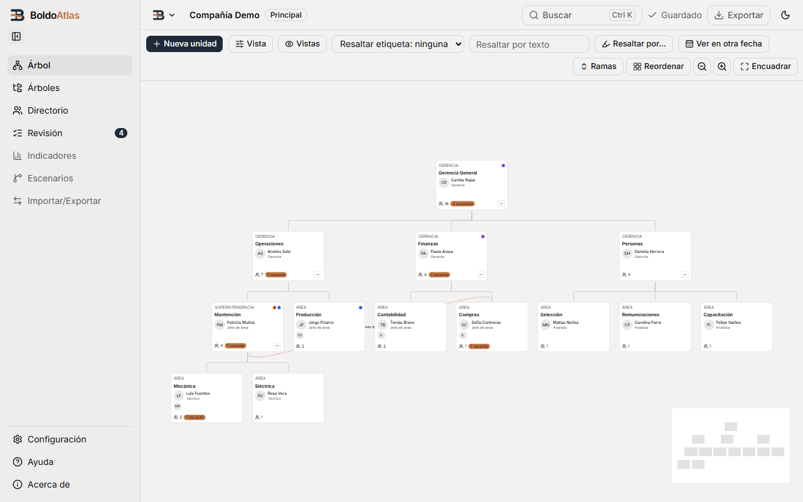
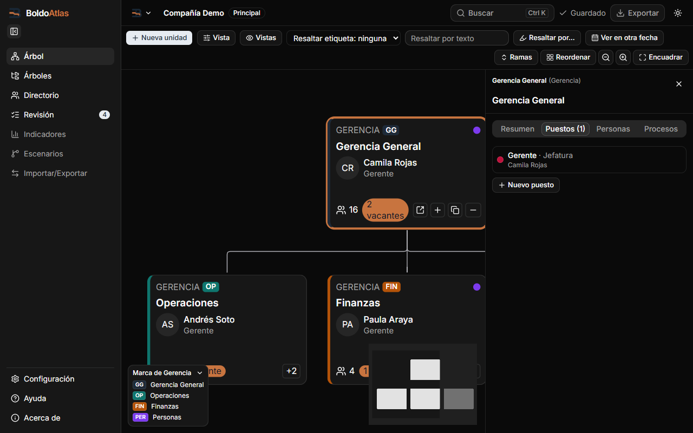
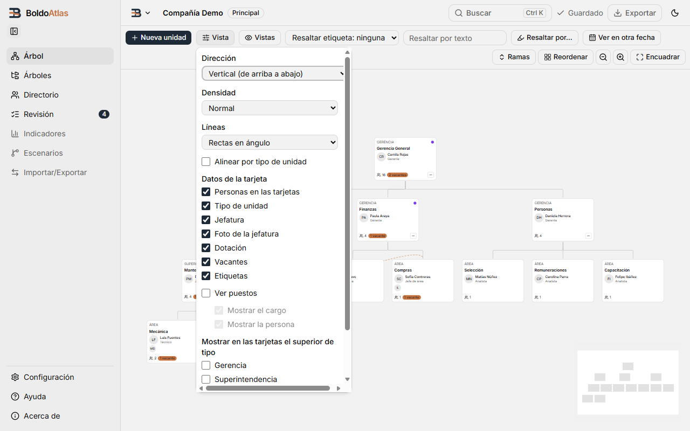

# Propuesta de UX/UI: lo sencillo a la vista, lo avanzado plegado (T17d) — 2026-10-30

## Resumen para el autor

1. **Hoy la app muestra todo a la vez.** La barra del árbol tiene 13 controles y ocupa dos filas; «Vista» abre 20 opciones seguidas; el Directorio muestra 8 filtros; la barra lateral y la bienvenida muestran cosas que aún no funcionan (Indicadores, Escenarios, Excel…).
2. **La idea:** cada pantalla deja a la vista solo lo que se usa casi siempre. El resto va a un botón **«Más opciones»** o a un bloque **«Avanzado»** que se abre con un clic. Nada se borra: solo cambia de lugar.
3. **Árbol:** la barra baja de 13 a 7 controles en una sola fila. El zoom pasa a una esquina del lienzo, como en un mapa. «Vista» pasa a llamarse **«Personalizar»** y muestra 4 opciones; el resto queda plegado.
4. **Lienzo:** la leyenda de colores ya no tapa tarjetas (pasa a una franja fija bajo el lienzo). El minimapa queda apagado al inicio y, si se enciende, toma los colores del tema. La píldora «2 vacantes» deja de partirse en dos líneas.
5. **Colores:** se corrigen los que no se leen bien. El borde de foco del teclado se ve poco (1,75:1; debe ser 3:1 o más). El cobre como texto («Atlas», enlace de Acerca) tiene 3,10:1 en claro y debe tener 4,5:1. Los botones «Eliminar» tienen 4,18:1 y 3,47:1 al pasar el mouse. Las líneas del árbol en claro tienen 1,90:1. Todo queda en AA con los valores propuestos (tablas en §3).
6. **Modo oscuro:** el logo azul marino casi desaparece. Las marcas de color oscuro (p. ej. la de Gerencia General) también se pierden sobre la tarjeta, y el minimapa queda gris claro.
7. **Lo que pido decidir** está en §7. Son tres cosas: campos blancos o grises, qué hacer con lo «Próximamente», y aprobar la nueva barra del árbol.
8. Para la Task 17e propongo **5 cambios** que caben en una tarea (§6). Lo demás queda como trabajo posterior.

| El árbol hoy (claro) | La leyenda y el minimapa tapan tarjetas (oscuro) | «Vista» hoy: 20 opciones seguidas |
|---|---|---|
| [](../../capturas/fase2/17d-arbol-claro.png) | [](../../capturas/fase2/17d-panel-puestos-oscuro.png) | [](../../capturas/fase2/17d-vista-claro.png) |

## Cómo se hizo

- **Capturas nuevas:** 41 capturas reales en `docs/capturas/fase2/17d-*.png`, todas a 1280×800 salvo los recortes, en claro y oscuro. Se tomaron con el proyecto de ejemplo («Explorar un ejemplo», 13 unidades) y la rama `propuesta-ux` (2b7970a), en un arnés de navegador con base temporal en memoria. Las de T14 en la misma carpeta quedan desactualizadas.
- **Contrastes:** salen de un script propio. Convierte oklch → sRGB completo (también los colores con croma, no solo los grises) y mezcla la transparencia como el navegador. Se comprobó contra los colores que pinta Edge 156: `oklch(0.53 0.235 27.325)` = `#d20000`, `oklch(0.828 0.189 84.429)` = `#ffb900`, etc.
- **Código revisado:** `src/styles/main.css`, `src/components/ui/button`, `BarraLienzo.vue`, `PanelVista.vue`, `NodoUnidad.vue`, `VistaArbol.vue`, `LeyendaLienzo.vue`, `VistaConfiguracion.vue`, `App.vue` y `BarraSuperior.vue`, más los demás componentes de cada vista.

---

## 1. Por vista: qué se ve siempre y qué se pliega

Convención: **Básico** = visible siempre. **Más opciones** = menú o bloque plegable. **Avanzado** = bloque plegado dentro de un panel. Un bloque plegado recuerda si el usuario lo dejó abierto (preferencia por PC, como el tema).

### 1.1 Marco de la app (barra lateral y barra superior)

Capturas: [árbol claro](../../capturas/fase2/17d-arbol-claro.png), [logo en oscuro](../../capturas/fase2/17d-logo-oscuro.png).

| Control | Hoy | Propuesta |
|---|---|---|
| Logo «BoldoAtlas» | arriba a la izquierda | Básico. En oscuro, el ícono azul marino no se ve (ver §4.7) |
| Botón contraer/fijar barra | **debajo** del logo, en una fila propia | Al **pie** de la barra, sobre Configuración. Así queda en el mismo lugar abierta o contraída (la barra contraída mide 56 px y no cabe al lado del logo) y la fila del logo queda libre |
| Árbol, Árboles, Directorio, Revisión (con contador) | visibles | Básico |
| Indicadores, Escenarios, Importar/Exportar | visibles pero deshabilitadas («llega en Fase 3/5…») | **Decisión del autor (§7-B).** Recomiendo ocultarlas hasta que existan |
| Configuración, Ayuda, Acerca de | al pie | Básico |
| Menú de la app (logo ▾) | barra superior | Básico |
| Nombre del proyecto + insignia «Principal» | barra superior | Nombre: básico. La insignia «Principal» solo cuando haya más de un proyecto |
| Buscar (Ctrl K) | barra superior | Básico |
| «Guardado» | barra superior | Básico (es un aviso, no un botón) |
| Exportar | deshabilitado («Fase 4») | Igual que Indicadores (§7-B) |
| Cambiar tema (sol/luna) | barra superior | Básico |

### 1.2 Bienvenida

Capturas: [claro](../../capturas/fase2/17d-bienvenida-claro.png), [oscuro](../../capturas/fase2/17d-bienvenida-oscuro.png).

- **Hoy:** 4 tarjetas iguales. Dos están deshabilitadas, con insignias «Fase 4» y «Fase 5». No hay una acción principal.
- **Básico:** «Crear una organización vacía» como **acción principal** (tarjeta destacada con borde de marca) y «Explorar un ejemplo» como secundaria.
- **Más opciones:** Excel y archivo .boldo pasan a una línea pequeña «Próximamente: cargar desde Excel, abrir un archivo .boldo» (según §7-B).
- ES/EN se queda arriba a la derecha.

### 1.3 Árbol — barra del lienzo (`BarraLienzo.vue`)

Capturas: [claro](../../capturas/fase2/17d-arbol-claro.png), [oscuro](../../capturas/fase2/17d-arbol-oscuro.png), [con panel abierto: la barra pasa a 2 filas](../../capturas/fase2/17d-panel-claro.png).

**Inventario de hoy (13 controles, 2 filas a 1280 px):**

| # | Control | Uso | Propuesta |
|---|---|---|---|
| 1 | **+ Nueva unidad** | muy frecuente | Básico, acción principal |
| 2 | Guardar en Árboles (con unidad seleccionada) | ocasional | **Más ▾** (ya está también en el menú contextual) |
| 3 | Vista (popover) | frecuente | Básico, renombrado **«Personalizar»** (§1.4) |
| 4 | Vistas (guardadas) | ocasional | Básico, renombrado **«Vistas guardadas»** («Vista» y «Vistas» juntas confunden) |
| 5 | Resaltar etiqueta (select) | ocasional | Entra en **Resaltar ▾** |
| 6 | Resaltar por texto (campo) | frecuente | Básico, como **«Buscar en el diagrama»** (atajo F) |
| 7 | Resaltar por… (popover) | ocasional | Básico, renombrado **«Resaltar ▾»**, con la etiqueta adentro y el contador de filtros activos |
| 8 | Ver en otra fecha | ocasional | Básico (es la función distintiva). Solo el ícono de calendario y el texto «Fecha» cuando falta espacio |
| 9 | Ramas ▾ | ocasional | **Más ▾** (también en el menú contextual) |
| 10 | Reordenar | raro | **Más ▾** |
| 11–13 | Alejar, Acercar, Encuadrar | frecuente | Salen de la barra: grupo flotante en la esquina **inferior derecha del lienzo**, como en un mapa (Ctrl 0 sigue encuadrando) |

**Antes:**
```
┌───────────────────────────────────────────────────────────────────────────────────────────────┐
│ [+ Nueva unidad] [Guardar en Árboles] [Vista] [Vistas] [Resaltar etiqueta: ninguna ▾]          │
│ [Resaltar por texto______] [Resaltar por…] [Ver en otra fecha]                                 │
│                                         [Ramas ▾] [Reordenar] [−] [+] [Encuadrar]              │
└───────────────────────────────────────────────────────────────────────────────────────────────┘
```

**Después (una fila, 7 controles):**
```
┌──────────────────────────────────────────────────────────────────────────────────────────────────────────────────┐
│ [+ Nueva unidad] [🔍 Buscar en el diagrama___] [Resaltar ▾ ②] [Personalizar ▾] [Vistas guardadas ▾]  [📅 Ver en otra fecha] [⋯ Más ▾] │
└──────────────────────────────────────────────────────────────────────────────────────────────────────────────────┘
  Más ▾ = Guardar en Árboles · Ramas › (Expandir todo, Contraer todo, Contraer hasta nivel…) · Reordenar · Mostrar minimapa
                                                                            ┌──────┐
                                                           (en el lienzo)   │ − + ⛶│  ← zoom abajo a la derecha
                                                                            └──────┘
```
Ancho estimado de la fila: unos 960 px. Caben en los 1.056 px que deja la barra lateral abierta a 1280 px, y también a 1100 px con la barra contraída. El panel de unidad se abre debajo de la barra, así que no la angosta.

### 1.4 «Personalizar» (hoy «Vista», `PanelVista.vue`)

Capturas: [claro](../../capturas/fase2/17d-vista-claro.png), [oscuro](../../capturas/fase2/17d-vista-oscuro.png). La tarea lo llama «Personalizar diagrama»; en la app el botón dice «Vista».

- **Hoy:** son 20 controles seguidos: 3 selects, 1 casilla, 7 casillas de «Datos de la tarjeta», «Ver puestos» con 2 subopciones, 5 casillas de «superior de tipo» y «Colorear por».
- **Además** hay una barra de desplazamiento **horizontal**: el select «Dirección» es más ancho que el panel (`w-72`).

**Antes:**
```
Dirección            [Vertical (de arriba a abajo) ▾]
Densidad             [Normal ▾]
Líneas               [Rectas en ángulo ▾]
☐ Alinear por tipo de unidad
Datos de la tarjeta  ☑ Personas ☑ Tipo ☑ Jefatura ☑ Foto ☑ Dotación ☑ Vacantes ☑ Etiquetas
☐ Ver puestos   ☑ Mostrar el cargo  ☑ Mostrar la persona
Mostrar en las tarjetas el superior de tipo  ☐ Gerencia ☐ Superintendencia ☐ Área ☐ Subárea ☐ Otra
Colorear por         [Ninguno ▾]
```

**Después:**
```
Dirección     ( Vertical | Horizontal )        ← botones segmentados, no select
Tamaño        ( Normal | Compacto )
Colorear por  [Ninguno ▾]
☐ Ver puestos
▸ Qué mostrar en las tarjetas (7)              ← plegado
▸ Avanzado                                      ← plegado: Líneas, Alinear por tipo,
                                                   Mostrar el cargo / la persona (con Ver puestos),
                                                   Mostrar el superior de tipo…
[Restablecer]                                   ← vuelve a los valores por defecto
```
- Ancho `w-80` y el select dentro de la caja: sin barra horizontal.

### 1.5 Resaltar, Ver en otra fecha, Vistas guardadas

- **Resaltar** ([claro](../../capturas/fase2/17d-resaltar-claro.png)):
  - **Hoy:** «Con vacantes» + 4 selects + ayuda, y aparte el select de etiqueta en la barra.
  - **Propuesta:** un solo popover con Etiqueta y Con vacantes arriba (básico). Sede, Contrato, Jornada y Cargo van en **«Más filtros»** plegado, y se agrega **«Quitar filtros»** al pie. El número en el botón cuenta todo lo activo.
- **Ver en otra fecha** ([claro](../../capturas/fase2/17d-fecha-claro.png), [oscuro](../../capturas/fase2/17d-fecha-oscuro.png)):
  - El calendario, los saltos «Cambio anterior/siguiente» y el campo de fecha ya están bien agrupados. Queda igual.
  - El texto de ayuda de 4 líneas pasa a un ícono «?» con globo, para que el popover sea más corto.
- **Vistas guardadas:** queda igual (nombre + Guardar, lista con renombrar/eliminar). Solo se renombra el botón.

### 1.6 Menú contextual de la tarjeta (`MenuLienzo.vue`)

Capturas: [claro](../../capturas/fase2/17d-menu-claro.png), [oscuro](../../capturas/fase2/17d-menu-oscuro.png).

- **Hoy:** 12 acciones en 5 grupos, con «Eliminar…» al final en rojo. Está bien ordenado; es el lugar natural de las opciones avanzadas.
- **Propuesta:** se mantiene igual. Es donde ya viven las opciones avanzadas de cada tarjeta (Duplicar rama, Seleccionar rama, Guardar en Árboles…), así que la barra puede soltarlas sin que se pierdan.

### 1.7 Panel de unidad (`PanelUnidad.vue`)

Capturas: [Resumen, claro](../../capturas/fase2/17d-panel-claro.png), [Resumen, oscuro](../../capturas/fase2/17d-panel-oscuro.png), [Puestos](../../capturas/fase2/17d-panel-puestos-claro.png).

- **Pestaña Resumen hoy:**
  - Tipo, Nombre, Descripción, Superior, Marca (color + código + Quitar marca) y Jefatura.
  - 3 cifras: dotación directa, total y vacantes.
  - Etiquetas (con «Nueva etiqueta…»), Conexiones laterales («Conectar con…»), Duplicar rama, Eliminar unidad.
- **Básico:** Nombre, Tipo, Jefatura, las 3 cifras y Etiquetas.
- **Avanzado (plegado):** Descripción, Superior (mover; también se puede arrastrar), Marca, Conexiones laterales y Duplicar rama.
- **Al pie, separado:** «Eliminar unidad» con la variante destructiva nueva (§2.2).
- Las pestañas Puestos, Personas y Procesos quedan igual.

### 1.8 Ficha de persona y diálogo de puesto

Capturas: [ficha claro](../../capturas/fase2/17d-ficha-claro.png), [ficha oscuro](../../capturas/fase2/17d-ficha-oscuro.png).

- **Ficha:**
  - **Básico:** Nombre, Correo, Teléfono, Puestos y Unidades que encabeza.
  - **Más datos (plegado, abierto si tiene algo):** Tipo de contrato, Sede, Jornada, Notas y Foto. «Historial» ya está plegado.
  - **Inconsistencia visible:** los campos de texto son blancos y los selectores con buscador (Contrato, Sede, Jornada) son grises. Se unifican según §7-A.
- **Diálogo de puesto:** queda igual. Ya separa asignación, historial y estilo. Solo cambia la variante de «Eliminar puesto» (§2.2).

### 1.9 Árboles

Capturas: [claro](../../capturas/fase2/17d-arboles-claro.png), [oscuro](../../capturas/fase2/17d-arboles-oscuro.png).

- Es simple: «+ Nuevo árbol» (principal) y una tarjeta por árbol con «Abrir» y los subárboles guardados. **Sin cambios.**
- Solo un detalle: cuando no hay subárboles, el bloque «SUBÁRBOLES GUARDADOS — Aún no hay…» ocupa espacio. Propongo una sola línea gris.

### 1.10 Directorio

Capturas: [claro](../../capturas/fase2/17d-directorio-claro.png), [oscuro](../../capturas/fase2/17d-directorio-oscuro.png).

- **Hoy:** buscador, unidad y 6 selects (Cargo, Tipo de contrato, Sede, Jornada, Etiqueta, Estado) en 2 filas, más «Exportar esta lista a Excel» (deshabilitado). La tabla tiene 10 columnas en el ejemplo (una por cada tipo de unidad en uso) y barra horizontal a 1280 px.
- **Básico:** buscador, unidad y un botón **«Filtros ▾ (n)»** con los otros 6 selects y «Quitar filtros».
- **Columnas:** Persona, Cargo, Gerencia, Área y Correo, más un botón **«Columnas ▾»** para Reemplazo, los demás tipos de unidad (Superintendencia…), Tipo de contrato, Sede y Jornada.
- **Exportar:** como §7-B.

### 1.11 Revisión de datos

Capturas: [claro](../../capturas/fase2/17d-revision-claro.png), [oscuro](../../capturas/fase2/17d-revision-oscuro.png).

- **Hoy:** 8 tarjetas una debajo de otra, con o sin avisos. En el ejemplo, la mayoría dice «Todo en orden» y lo que sí tiene avisos queda entre ellas.
- **Propuesta:**
  - Primero las tarjetas **con avisos**.
  - Las que están en orden van juntas en una sola línea al final: «Sin avisos: Unidades sin jefatura · Personas sin puesto · …». Se despliega con un clic.
- **Detalle visual:** las tarjetas son del mismo gris que el fondo. Con `bg-card` (blanco) se distinguen.

### 1.12 Configuración

Capturas: [claro](../../capturas/fase2/17d-configuracion-claro.png), [oscuro](../../capturas/fase2/17d-configuracion-oscuro.png).

**Antes (todo abierto, ~20 controles hasta el final de Respaldos):**
```
Configuración                                         [× Cerrar]
Organización   Nombre [__________]   Logo  Sin logo [Elegir imagen…]
Apariencia     Tema [Claro ▾]  Tamaño [100 % ▾]  Idioma [Español ▾]
               Color de acento (Cobre)(Azul)(Verde)(Violeta)
               ☑ Abrir la barra lateral al pasar el mouse
Mantenedores   texto…  [Abrir mantenedores]
Respaldos      texto…  Frecuencia [▾]  [Respaldar ahora] [Abrir carpeta]
               tabla: Fecha | Revisión | Tamaño | [Restaurar] × N
```

**Después:**
```
Configuración                                         [× Cerrar]
Organización   Nombre [__________]   Logo [Elegir imagen…]
Apariencia     Tema ( Claro | Oscuro | Sistema )   Idioma [Español ▾]
               ▸ Más opciones de apariencia        ← Tamaño de la interfaz, Color de acento,
                                                      Abrir la barra al pasar el mouse
Mantenedores   [Abrir mantenedores]  Cargos, contratos, sedes, jornadas, tipos y leyendas
Respaldos      Último respaldo: hoy 12:00  [Respaldar ahora]
               ▸ Ver respaldos y restaurar         ← frecuencia, lista, Restaurar, Abrir carpeta
```

### 1.13 Mantenedores

Capturas: [claro](../../capturas/fase2/17d-mantenedores-claro.png), [oscuro](../../capturas/fase2/17d-mantenedores-oscuro.png).

- **Hoy:** 6 pestañas y una fila «nuevo valor + Agregar». Cada fila tiene 4 botones: lápiz, ↑, ↓, Desactivar.
- **Propuesta:**
  - Lápiz y «Desactivar» quedan visibles.
  - ↑ y ↓ aparecen al pasar el mouse o con el foco en la fila (siguen en el orden de tabulación).
  - «Agregar» (principal) se ve deshabilitado con el campo vacío. Hoy se lee como un botón gris apagado: está bien, pero con el nuevo foco se nota más.
- **Pendiente T14 #9:** la zona de contenido de cada pestaña recibe el foco con Tab y no muestra borde (ver §5).

### 1.14 Ayuda y Acerca de

Capturas: [Ayuda](../../capturas/fase2/17d-ayuda-claro.png), [Acerca claro](../../capturas/fase2/17d-acerca-claro.png), [Acerca oscuro](../../capturas/fase2/17d-acerca-oscuro.png).

- **Ayuda:** sin cambios de estructura. El índice a la izquierda y el texto a la derecha funcionan.
- **Acerca de:**
  - **Básico:** logo, versión y «Creado por…».
  - **Detalles técnicos (plegado):** esquema, identificador de la base, revisión, fecha de creación, modo, carpeta y «Copiar información».
  - **Cambios visuales:** hoy «Copiar información» es el único botón relleno (principal), pero no es la acción principal de la página: pasa a contorno. El enlace del autor usa el cobre como texto (3,10:1, ver §3).

### 1.15 Paleta de comandos (Ctrl K)

Capturas: [claro](../../capturas/fase2/17d-paleta-claro.png), [oscuro](../../capturas/fase2/17d-paleta-oscuro.png).

- Agrupa bien (Unidades, Personas, Acciones). **Sin cambios de contenido.**
- **Pendiente T14 #10:** el campo de búsqueda no muestra foco (`outline-hidden`). Basta con un borde inferior en color de foco mientras tiene el cursor.

---

## 2. Jerarquía visual

### 2.1 Una acción principal por vista

| Vista | Acción principal (botón relleno) | Lo demás |
|---|---|---|
| Bienvenida | Crear una organización vacía | Explorar un ejemplo: contorno |
| Árbol | + Nueva unidad | contorno / fantasma |
| Árboles | + Nuevo árbol | contorno |
| Directorio | ninguna (es una consulta) | Filtros y Exportar: contorno |
| Revisión | ninguna | enlaces en las filas |
| Configuración | ninguna (se guarda sola) | contorno |
| Mantenedores | Agregar | lápiz y flechas fantasma; Desactivar contorno |
| Acerca de | ninguna | «Copiar información»: contorno (hoy es relleno) |
| Diálogos | la acción que confirma (Crear, Mover, Restaurar…) | Cancelar: contorno; Eliminar: destructivo |

### 2.2 Variantes de botón (`src/components/ui/button/index.ts`)

| Variante | Para qué | Cambio |
|---|---|---|
| `default` (relleno) | solo la acción principal | Agregar `hover:bg-primary/90` a todos los botones; hoy solo lo tienen los enlaces (`[a]:hover`) |
| `outline` | acciones secundarias visibles | sin cambio (en claro su fondo pasa a `bg-card` si se elige §7-A) |
| `ghost` | botones de solo ícono en barras y filas | sin cambio |
| `destructive` | Eliminar | **Nueva forma:** fondo `bg-card`, texto `text-destructive`, borde `border-destructive/50` y `hover:bg-destructive/10`. Contraste 5,61:1 y 4,67:1 al pasar el mouse en claro; 6,19:1 y 5,46:1 en oscuro. Hoy: 4,18:1 y 3,47:1 en claro, y 4,36:1 al pasar el mouse en oscuro |
| `link` | enlaces en texto | color `--marca-texto` cuando es de marca |

Se usa en 6 lugares (`variant="destructive"`); el cambio en la variante los arregla todos.

### 2.3 Espaciado y tamaños

- **Escala única:** 4 · 8 · 12 · 16 · 24 · 32 px (Tailwind 1, 2, 3, 4, 6, 8). Nada de 5, 7 ni 10 sueltos.
  - Página: margen `p-6`; entre secciones `gap-8`.
  - Dentro de una sección: entre campos `gap-4`; etiqueta → campo `gap-1.5`.
  - Barras: `p-2 gap-2`; menús y popovers: `p-3 gap-3`.
- **Alturas:**
  - 28 px (`sm`) para todo lo que está en barras y popovers del lienzo.
  - 32 px (`default`) en páginas y diálogos.
  - Botones de solo ícono, del mismo alto que su fila.
  - Los botones de la tarjeta (20 px) son el mínimo aceptable. Cumplen el tamaño de objetivo (WCAG 2.5.8) solo porque están separados por 4 px: no achicar ni juntar más.
- **Selects nativos:** hay 19 `<select>` en 13 archivos con clases escritas a mano: dos alturas (h-7 y h-8), `rounded-md` o `rounded-lg`, y con o sin foco propio. Propongo **una sola clase compartida** (una constante en `src/lib/utils.ts`) con el mismo alto, fondo, borde y foco que `Input`.
- **Texto:** títulos de página `text-lg font-semibold`; títulos de sección `font-medium`; cuerpo `text-sm`; ayuda `text-xs text-muted-foreground`. Ya es así en casi todo; solo hay que no inventar otros.

### 2.4 Estados

| Estado | Regla |
|---|---|
| Hover | `bg-muted` en contorno, fantasma y filas; `bg-primary/90` en el principal; subrayado en enlaces |
| **Foco del teclado** | **Igual en todo:** `outline-2 outline-offset-2 outline-ring`, con `--ring` sólido (sin `/50`). Reemplaza `focus-visible:ring-3 ring-ring/50` en Button, Input, Textarea, SelectTrigger, TabsTrigger, Badge e InputGroup. También en los `tabpanel` (T14 #9) y en el campo de la paleta (T14 #10) |
| Presionado | `translate-y-px` (ya está) |
| Seleccionado / activo | `bg-accent font-medium` en listas y barra lateral (ya está); en botones de alternar, `aria-pressed` con `bg-accent` y borde `foreground` (como los acentos de Configuración) |
| Deshabilitado | `opacity-50 cursor-not-allowed`, con un globo que dice **por qué** («Solo lectura: estás viendo otra fecha»). Si nunca se puede usar todavía, mejor no mostrarlo (§7-B) |
| Error | `aria-invalid` + borde `destructive` + mensaje `text-destructive` bajo el campo (ya está) |
| Tarjeta seleccionada | borde y anillo de 2 px en `--marca` (ya está; cumple 3:1 con los 4 acentos, §3.3) |
| Tarjeta que no coincide con el resaltado | `opacity-35` (ya está: atenuar a propósito) |

La selección usa la **marca** y el foco usa el **anillo azul pizarra**. Así una tarjeta seleccionada y con el foco del teclado muestra los dos sin confundirse.

---

## 3. Paleta de tokens para claro y oscuro

Mínimos WCAG 2.x: 4,5:1 para texto; 3:1 para el foco, los bordes que identifican un campo y los gráficos que se necesitan entender (líneas, selección).

### 3.1 Lo que se mantiene (ya cumple)

| Par | Claro | Oscuro |
|---|---|---|
| `foreground` sobre `background` / `card` / `sidebar` | 17,62 / 19,79 / 16,85 | 18,96 / 17,16 / 17,16 |
| `muted-foreground` sobre `background` / `card` / `muted` / `sidebar` / `sidebar-accent` | 5,34 / 6,00 / 4,88 / 5,11 / 4,59 | 7,63 / 6,91 / 5,83 / 6,91 / 5,83 |
| `primary-foreground` sobre `primary` | 13,93 | 12,14 |
| `destructive` como texto sobre `background` / `card` | 5,00 / 5,61 | 6,84 / 6,19 |
| «Sin jefatura» (`amber-800` / `amber-400`) sobre la tarjeta | 7,13 | 10,43 |
| Píldora de vacantes (`marca-foreground` sobre `marca`) | 5,09 | 5,09 |
| Selección (cobre) sobre el lienzo / la tarjeta | 3,10 / 3,49 | 5,68 / 5,14 |

El fondo gris claro (`--background: oklch(0.96 0 0)`) de 18d se mantiene: el texto sigue en AA.

### 3.2 Lo que cambia

| Token | Uso | Hoy | Contraste hoy | Propuesto | Contraste propuesto |
|---|---|---|---|---|---|
| `--ring` (claro) | borde de foco | `oklch(0.6 0 0)` usado al 50 % y 3 px en los componentes | **1,75** sobre background, **1,83** sobre card, **1,72** sobre sidebar | `oklch(0.48 0.09 255)` = `#395f8f` (azul pizarra), sólido, 2 px + 2 px de separación | 5,82 / 6,54 / 5,57 |
| `--ring` (oscuro) | borde de foco | `oklch(0.556 0 0)` al 50 % | **1,87** sobre background, card y sidebar | `oklch(0.72 0.09 255)` = `#7ea7dc`, sólido | 7,99 / 7,23 / 7,23 |
| `--campo-borde` (nuevo, claro) | borde de Input, Textarea, Select | `--input` = `oklch(0.88 0 0)` | **1,28** sobre background, **1,44** sobre card | `oklch(0.63 0 0)` = `#898989` | 3,12 / 3,50 |
| `--campo-borde` (nuevo, oscuro) | ídem | blanco al 15 % | **1,47** / **1,57** | `oklch(0.52 0 0)` = `#696969` | 3,59 / 3,25 |
| `--marca-texto` (nuevo, claro) | «Atlas» del logo, enlace de Acerca, cualquier texto en color de marca | `--marca` cobre `#c8743f` | **3,10** sobre background, **2,97** sobre sidebar | `oklch(0.52 0.12 50)` = `#9e511e` | 5,13 / 5,76 sobre card / 4,91 sobre sidebar |
| `--marca-texto` (oscuro) | ídem | cobre | 5,68 / 5,14 (ya cumple) | el mismo cobre `#c8743f` | 5,68 / 5,14 |
| Botón `destructive` (claro) | Eliminar | texto `#d20000` sobre `destructive/10` | **4,18**; al pasar el mouse **3,47** | contorno sobre `bg-card` (§2.2) | 5,61; al pasar el mouse 4,67 |
| Botón `destructive` (oscuro) | ídem | sobre `destructive/20` y `/30` | 5,30; al pasar el mouse **4,36** | contorno sobre `card` | 6,19; al pasar el mouse 5,46 |
| `--arista` (nuevo, claro) | líneas del árbol | `#b1b1b7` fijo de Vue Flow | **1,90** sobre el lienzo | `oklch(0.62 0 0)` = `#868686` | 3,24 |
| `--arista` (nuevo, oscuro) | ídem | `#b1b1b7` | 9,28 (demasiado brillante junto a tarjetas oscuras) | `oklch(0.52 0 0)` = `#636363` | 3,30 |
| Nodo del minimapa (claro) | minimapa | `#e2e2e2` fijo | 1,30 sobre su fondo blanco (casi no se ve) | `oklch(0.85 0 0)` | 1,58 (decorativo) |
| Nodo del minimapa (oscuro) | minimapa | `#e2e2e2` fijo | 13,83: bloques gris claro sobre fondo oscuro, sin tema | `oklch(0.40 0 0)` | 1,94 (decorativo) |

- `--destructive` **no cambia**: con la nueva variante del botón ya cumple.
- `--border` (divisores) tampoco cambia: es decorativo y queda suave a propósito.

### 3.3 Texto de marca según el acento elegido

`tema.ts` cambia `--marca` según el acento. `--marca-texto` debe cambiar con él. Valores con el mismo tono y la luminosidad ajustada hasta ≥ 4,6:1 sobre `background`, `card` y `sidebar` (se da el peor de los tres):

| Acento | Color base | Base como texto, claro | `--marca-texto` claro | Peor | Base como texto, oscuro | `--marca-texto` oscuro | Peor |
|---|---|---|---|---|---|---|---|
| Cobre | `#C8743F` | 2,97 | `#9e511e` | 4,91 | 5,14 | `#c8743f` (el mismo) | 5,14 |
| Azul | `#2563EB` | 4,40 | `#205ee6` | 4,70 | 3,47 | `#3a7aff` | 4,61 |
| Verde | `#0D9488` | 3,19 | `#00776c` | 4,63 | 4,78 | `#0d9488` (el mismo) | 4,78 |
| Violeta | `#7C3AED` | 4,85 | `#7c3aed` (el mismo) | 4,85 | 3,14 | `#985fff` | 4,61 |

La selección de tarjeta sigue en `--marca` (no en `--marca-texto`). Con los 4 acentos cumple 3:1:

| Acento | Fondo claro | Tarjeta clara | Fondo oscuro | Tarjeta oscura |
|---|---|---|---|---|
| Cobre | 3,10 | 3,49 | 5,68 | 5,14 |
| Azul | 4,60 | 5,17 | 3,83 | 3,47 |
| Verde | 3,33 | 3,74 | 5,29 | 4,78 |
| Violeta | 5,07 | 5,70 | 3,47 | 3,14 |

### 3.4 Bloque CSS propuesto (para 17e)

```css
:root {
  --ring: oklch(0.48 0.09 255);
  --sidebar-ring: oklch(0.48 0.09 255);
  --campo-borde: oklch(0.63 0 0);
  --marca-texto: #9e511e;          /* tema.ts lo reemplaza según el acento (§3.3) */
  --arista: oklch(0.62 0 0);
  --minimapa-nodo: oklch(0.85 0 0);
}
.dark {
  --ring: oklch(0.72 0.09 255);
  --sidebar-ring: oklch(0.72 0.09 255);
  --campo-borde: oklch(0.52 0 0);
  --marca-texto: #c8743f;
  --arista: oklch(0.52 0 0);
  --minimapa-nodo: oklch(0.40 0 0);
}
```
Y en `@theme inline`: `--color-campo-borde`, `--color-marca-texto` y `--color-arista`. `tema.ts` necesita un segundo valor por acento (`texto: { claro, oscuro }`) y `aplicar()` lo escribe en `--marca-texto` según el tema.

---

## 4. Reglas del lienzo

### 4.1 Tarjetas
- **Fondo y borde:** `bg-card` con borde `border`. Sin sombras ni transiciones (regla de rendimiento, ya se cumple).
- **Marca:** la franja izquierda de 4 px y el chip de código usan el color de la marca.
  - **Regla nueva:** si ese color tiene menos de 3:1 contra la tarjeta en el tema actual, la franja y el chip llevan un contorno de 1 px en `--muted-foreground` (6,00:1 claro, 6,91:1 oscuro).
  - **Caso real:** la marca de Gerencia General del ejemplo (`#1e2a38`) tiene 1,23:1 sobre la tarjeta oscura y hoy no se ve ([leyenda oscuro](../../capturas/fase2/17d-leyenda-oscuro.png)).
  - El cálculo ya existe: `contraste()` en `tema.ts`.
- **Selección:** borde + `ring-2` en `--marca` (sin cambio).
- **Foco del teclado:** anillo `--ring` (§2.4), aparte de la selección.
- **Atenuadas por el resaltado:** `opacity-35` (sin cambio).

### 4.2 Píldora de vacantes
- **Problema:** con la tarjeta seleccionada aparecen 3 botones más y el botón «+N». Entonces «2 vacantes» se parte en dos líneas y empuja el contenido.
  - Reproducido con Gerencia General plegada y seleccionada: [claro](../../capturas/fase2/17d-vacante-claro.png), [oscuro](../../capturas/fase2/17d-vacante-oscuro.png).
  - La fila inferior de la tarjeta mide unos 200 px. «16» + «2 vacantes» + 4 botones de 20 px no caben.
- **Regla:**
  - La píldora nunca se parte (`whitespace-nowrap shrink-0`).
  - Con la tarjeta seleccionada muestra **solo el número** (como ya hace la densidad compacta). El texto completo queda en `title` y en `sr-only`.
  - Así cabe sin achicar los botones.

### 4.3 Leyenda («Marca de Gerencia», leyenda de puestos)
- **Problema:** flota en la esquina inferior izquierda **encima** de las tarjetas.
  - En [panel-puestos oscuro](../../capturas/fase2/17d-panel-puestos-oscuro.png) tapa la píldora de vacantes de Operaciones.
  - En [leyenda claro](../../capturas/fase2/17d-leyenda-claro.png) toca la tarjeta Mecánica.
- **Regla:** la leyenda deja de flotar. Pasa a una **franja fija bajo el lienzo** (fuera del área de dibujo), con los chips en una fila que se desplaza a lo ancho y el botón para plegarla.
  - Plegada ocupa una línea (≈ 28 px). Así ninguna tarjeta queda debajo, con cualquier zoom.

### 4.4 Minimapa
- **Problemas:** tapa las tarjetas de abajo a la derecha. En oscuro sus bloques siguen gris claro (`#e2e2e2` fijo; T14 #16, sigue abierto) ([árbol oscuro](../../capturas/fase2/17d-arbol-oscuro.png)).
- **Regla:**
  - **Apagado por defecto.** Se enciende con «Mostrar minimapa» en **Más ▾** (preferencia por PC).
  - Encendido: `node-color` = `var(--minimapa-nodo)`, borde `--border`, máscara `--background` al 60 %, tamaño 160×100.
  - Va arriba del grupo de zoom, abajo a la derecha.
  - Al encuadrar, se deja un margen a la derecha del ancho del minimapa para que no tape tarjetas.

### 4.5 Líneas
- **Jerarquía:** `--arista` (§3.2): 3,24:1 en claro, 3,30:1 en oscuro. Hoy usan el `#b1b1b7` de Vue Flow en los dos temas.
- **Conexiones laterales:** punteadas en `--marca` (sin cambio). Su etiqueta ya usa `--background` y `--foreground`.

### 4.6 Controles flotantes del lienzo
- **Abajo a la derecha:** grupo de zoom (− + Encuadrar) y, encima, el minimapa si está encendido.
- **Arriba a la derecha:** el aviso «Ordenando…» (sin cambio).
- **Arriba al centro:** la barra de selección múltiple (sin cambio).
- **Abajo a la izquierda:** nada (la leyenda pasa a la franja fija).

### 4.7 Logo en modo oscuro
- **Problema:** el ícono y el logo horizontal de Acerca son azul marino sobre fondo casi negro: no se ven ([logo oscuro](../../capturas/fase2/17d-logo-oscuro.png), [Acerca oscuro](../../capturas/fase2/17d-acerca-oscuro.png)).
- **Arreglo rápido (17e):** en oscuro, el ícono va sobre una placa clara redondeada (`dark:bg-primary dark:rounded-md dark:p-0.5`, `#e6ebf1`).
- **Arreglo de fondo (posterior):** una versión clara del logo en `assets/brand/` (pedir al autor).

---

## 5. Hallazgos de T14 revisados contra el código actual

| T14 | Qué decía | Estado hoy (2b7970a) |
|---|---|---|
| **5** | Foco bajo 3:1 | **Mejorado a medias.** 18d subió `--ring` a `oklch(0.6)`. Los enlaces y selects con `outline-2 outline-ring` ya cumplen: 3,51 / 3,95 en claro, 4,18 / 3,79 en oscuro. Pero los componentes shadcn (Button, Input, Textarea, SelectTrigger, TabsTrigger, Badge, InputGroup) siguen con `ring-ring/50`: **1,72–1,83 en claro y 1,87 en oscuro** ([foco claro](../../capturas/fase2/17d-foco-claro.png), [foco oscuro](../../capturas/fase2/17d-foco-oscuro.png)). Arreglo en §2.4 y §3.2 |
| **7** | Texto bajo AA en claro | **En parte arreglado.** `muted-foreground` ya cumple (4,59–6,00). Siguen fallando el botón destructivo (4,18 y 3,47 al pasar el mouse en claro; 4,36 al pasar el mouse en oscuro) y el cobre como texto (3,10 / 2,97). Arreglo en §2.2 y §3.2–3.3 |
| **9** | `tabpanel` con foco y sin borde | **Abierto.** `TabsContent.vue` sigue con `outline-none`; afecta a Mantenedores y al panel de unidad |
| **10** | Campo de la paleta sin foco | **Abierto.** `PaletaComandos.vue` usa `outline-hidden` |
| **16** | Minimapa tapa tarjetas y no toma el tema | **En parte arreglado.** El fondo ya usa `--card` y la máscara `--muted`, pero los bloques siguen en `#e2e2e2` fijo y sigue tapando tarjetas. Arreglo en §4.4 |

Lo que quedó para esta tarea en revisiones posteriores:

| Pendiente | Dónde se resuelve |
|---|---|
| La leyenda «Marca de Gerencia» tapa tarjetas abajo a la izquierda | §4.3 |
| «1 vacante» / «2 vacantes» se parte en la tarjeta seleccionada con hijos | §4.2 |
| Campos y selects grises sobre el fondo gris | §7-A (recomiendo `bg-card`) |
| Botón `destructive` bajo AA (4,18 y 3,47) | §2.2 |
| Cobre como texto 3,10:1 | §3.2–3.3 (`--marca-texto`) |
| El botón de la barra lateral va bajo el logo y no al lado | §1.1 (al pie de la barra) |

---

## 6. Lista priorizada para la Task 17e (una tarea)

1. **Foco visible en toda la app** (T14 #5, #9, #10).
   - `--ring` nuevo en claro y oscuro (§3.2).
   - Cambiar `focus-visible:ring-3 ring-ring/50` por `outline-2 outline-offset-2 outline-ring` en los 7 componentes de `src/components/ui` que lo usan.
   - Foco en `TabsContent` y en el campo de la paleta.
   - **Verificación:** recorrer cada vista con Tab en claro y oscuro y medir ≥ 3:1.
2. **Tokens de color.**
   - Agregar `--marca-texto` (con su valor por acento en `tema.ts`), `--campo-borde` y `--arista`.
   - Usar `--marca-texto` en el «Atlas» del logo y en el enlace de Acerca.
   - Nueva variante `destructive` (§2.2).
   - Fondo de los campos según §7-A, con **una sola clase** para los 19 `<select>` nativos.
3. **Lienzo.**
   - Aristas con `--arista`.
   - Minimapa apagado por defecto, con el tema y con el interruptor en «Más ▾».
   - Leyenda en franja fija bajo el lienzo.
   - Píldora de vacantes sin cortes (solo el número en la tarjeta seleccionada).
   - Contorno para marcas oscuras (§4.1).
   - Placa clara del logo en oscuro (§4.7).
4. **Barra del árbol y «Personalizar».**
   - Reagrupar `BarraLienzo` según §1.3: zoom al lienzo; Más ▾ con Guardar en Árboles, Ramas, Reordenar y Mostrar minimapa; etiqueta dentro de Resaltar.
   - Renombrar «Vista» → «Personalizar» y «Vistas» → «Vistas guardadas».
   - En `PanelVista`, los bloques plegados de §1.4 y el ancho sin barra horizontal.
5. **Lo «Próximamente»** según la decisión §7-B (barra lateral, barra superior y bienvenida).

Cada punto lleva textos en `es.json` y `en.json` y su línea de ayuda en `ayuda/{es,en}/arbol.md` donde cambie un nombre. Las capturas se vuelven a tomar al final.

**Trabajo posterior (no en 17e):**
- Configuración: «Más opciones de apariencia» y «Ver respaldos y restaurar» plegados (§1.12).
- Directorio: botón «Filtros ▾ (n)» y «Columnas ▾» (§1.10).
- Revisión: primero lo que tiene avisos y lo que está en orden agrupado (§1.11).
- Panel de unidad: bloque «Avanzado» (§1.7). Ficha: «Más datos» (§1.8). Acerca: «Detalles técnicos» (§1.14).
- Bienvenida con acción principal destacada (§1.2).
- Botón de la barra lateral al pie (§1.1). Flechas de Mantenedores al pasar el mouse (§1.13).
- Logo claro como archivo de marca (§4.7).
- No propongo un interruptor global «modo sencillo / avanzado». Con plegables por vista basta y no hay que mantener dos versiones de cada pantalla.

---

## 7. Decisiones del autor

- **A. Campos (texto y selects) en claro: ¿blancos o grises?**
  - Hoy cambia según el lugar. Las cajas de texto son transparentes: grises sobre el fondo gris, blancas dentro de un diálogo. Los selects usan `bg-background` y se ven siempre grises. En la ficha conviven las dos cosas ([ficha](../../capturas/fase2/17d-ficha-claro.png)).
  - **Recomiendo blanco (`bg-card`) para todos**, con el borde nuevo de 3,12:1. Un campo blanco sobre gris se reconoce como «aquí se escribe»; el gris parece deshabilitado.
  - En oscuro no cambia (`input/30`).
  - Mantener el gris es posible: igual hay que oscurecer el borde para cumplir 3:1.
- **B. Lo que todavía no existe (Indicadores, Escenarios, Importar/Exportar, Exportar, Excel y .boldo en la bienvenida): ¿ocultar o mostrar como «Próximamente»?**
  - Hoy son 7 controles deshabilitados repartidos por la app. Para alguien nuevo es ruido: no puede usarlos.
  - **Recomiendo ocultarlos** de la barra lateral y la barra superior, y dejar una sola línea «Próximamente: …» en la bienvenida y en Ayuda › Inicio.
- **C. Aprobar la nueva barra del árbol** (§1.3–1.4):
  - zoom en el lienzo;
  - Más ▾;
  - «Personalizar» y «Vistas guardadas»;
  - leyenda en franja fija;
  - minimapa apagado al inicio.
  - Cambia dónde están botones que ya se usan, así que conviene que el autor lo vea antes.
- **Menor:** el color del foco del teclado. Propongo **azul pizarra** (distinto de la marca, que ya marca la selección). La alternativa es gris oscuro, que también cumple.

---

### Decidido por el autor (2026-10-31)

- **A. Campos:** blancos en modo claro, con el borde nuevo de 3:1.
- **B. Lo «Próximamente»:** ocultarlo; una línea «Próximamente: …» en la Bienvenida y en la Ayuda.
- **C. Barra del árbol:** aprobada tal como se propone (7 controles, «Más ▾», «Personalizar», leyenda en franja, minimapa apagado al inicio).
- **D. Botón de la barra lateral:** al pie, sobre Configuración.

## Anexo: índice de capturas (`docs/capturas/fase2/`)

Todas con el proyecto de ejemplo, en `-claro` y `-oscuro` salvo que se indique:

- **Vistas:** `17d-bienvenida`, `17d-arbol`, `17d-arboles`, `17d-directorio`, `17d-revision`, `17d-configuracion`, `17d-mantenedores`, `17d-ayuda`, `17d-acerca`.
- **Árbol y sus menús:**
  - `17d-vista`: «Vista» / Personalizar.
  - `17d-fecha`: Ver en otra fecha.
  - `17d-resaltar`: Resaltar por.
  - `17d-menu`: menú contextual sobre Operaciones.
  - `17d-panel`: panel de Mantención.
  - `17d-panel-puestos`: panel de Gerencia General en Puestos. La leyenda y el minimapa tapan tarjetas.
  - `17d-leyenda`: Colorear por Marca de Gerencia.
  - `17d-vacante`: recorte con la píldora partida.
- **Otros:**
  - `17d-paleta`: Ctrl K con «ma».
  - `17d-ficha`: Andrés Soto.
  - `17d-foco`: recorte del foco del teclado en «Vista».
  - `17d-logo-oscuro`: solo oscuro.
- **Notas:**
  - La ruta «Carpeta de datos» de Acerca es ficticia (la del arnés).
  - En `17d-panel-puestos` y `17d-vacante` el lienzo está con más zoom porque Gerencia General estaba plegada al encuadrar.
